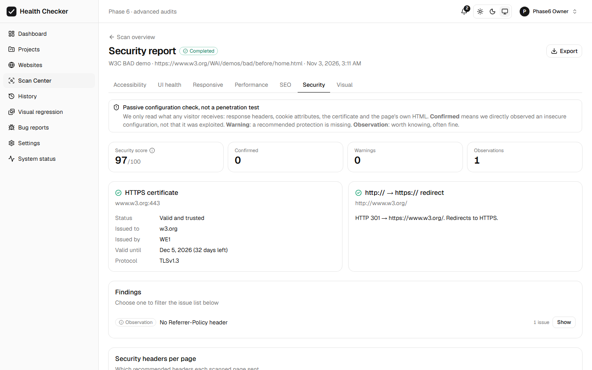

# Website Accessibility & UI Health Checker

A web application that scans websites for accessibility (WCAG), UI, responsive,
performance, SEO and basic security problems, with screenshots, AI explanations,
bug reports and scan history.

> **Status: Phase 6 of 8 complete.** Real browser scanning through an SSRF-blocking
> egress proxy, a full dashboard with history and reports, and now: Google Lighthouse
> performance, on-page SEO and passive security configuration audits, visual regression
> with explicit baselines, bug reports, optional AI explanations (Claude Sonnet), and
> in-app + e-mail notifications. See [docs/08-roadmap.md](docs/08-roadmap.md).



| Doc | |
|---|---|
| [docs/README.md](docs/README.md) | Design documents (architecture, database, API, security, ...) |
| [docs/09-phase-2-setup.md](docs/09-phase-2-setup.md) | How the project setup works: config files, dependencies, database, health checks |
| [docs/10-phase-3-auth.md](docs/10-phase-3-auth.md) | How sign-in, JWT, roles, projects and websites work |
| [docs/11-phase-4-scanning.md](docs/11-phase-4-scanning.md) | **How scanning works**: Playwright, DOM checks, axe-core, the security proxy, BullMQ, progress, debugging |
| [docs/12-phase-5-frontend.md](docs/12-phase-5-frontend.md) | **How the dashboard, history, reports, issue tracking and exports work** |
| [docs/13-phase-6-advanced-audits.md](docs/13-phase-6-advanced-audits.md) | **Lighthouse, SEO, security, visual regression, bug reports, AI, notifications, storage cleanup** |
| [docs/14-scanner-reliability.md](docs/14-scanner-reliability.md) | **Re-checking failed resources and links (no false "broken"), console error classification** |
| [docs/15-phase-7-chrome-extension.md](docs/15-phase-7-chrome-extension.md) | **Chrome extension: install, load, permissions, privacy, tests** |
| [docs/VERSIONS.md](docs/VERSIONS.md) | Exact versions and why |

---

## Tech stack

React 19 · Vite 8 · Tailwind CSS 4 · shadcn/ui · React Router 8 · TanStack Query ·
Node.js 24 · Express 5 · TypeScript 6 · PostgreSQL 17 · Prisma 7 · Redis 7 ·
BullMQ 6 · Playwright 1.64 · axe-core 4.14 · Lighthouse 13 · Claude API (optional) ·
Zod 4 · Vitest · Docker Compose · Chrome Extension (Manifest V3).

## Project structure

```
apps/
  api/            Express REST API          (src/app.ts, src/server.ts, src/modules/*)
  web/            React dashboard           (src/app, src/features, src/components/ui)
  scanner/        BullMQ worker: Playwright, axe-core, crawler, screenshots
  egress-proxy/   SSRF guard: every scanner request goes through it
  extension/      Chrome extension (MV3): checks the current page locally
packages/
  shared/         Code used everywhere      (Zod schemas, URL/IP safety, constants)
  db/             Prisma schema, migrations, typed client, relationship tests
  dom-checks/     Checks that run inside web pages + shared axe config and issue
                  wording (used by the scanner AND the Chrome extension)
tests/fixtures/   Small websites with deliberate defects (scanner + extension tests)
docker/           Dockerfiles, nginx config, Postgres init script
docs/             Design and explanation documents
docker-compose.yml
.env.example      All settings (copy to .env)
```

---

## Prerequisites (Windows)

| Tool | Check with | Get it |
|---|---|---|
| Node.js **24** + npm 11 | `node -v` · `npm -v` | https://nodejs.org (LTS) |
| Docker Desktop (running) | `docker version` | https://www.docker.com/products/docker-desktop |
| Git | `git --version` | https://git-scm.com |

All commands below are for **PowerShell**, run from the project folder
(e.g. `C:\Users\<you>\Desktop\website`).

## First-time setup

```powershell
# 1. Get the code (skip if you already have the folder)
git clone https://github.com/souravranjan680/website-checker.git
cd website-checker

# 2. Create your local settings file (never committed)
Copy-Item .env.example .env

# 3. Put a random secret in .env for signing login tokens (JWT_ACCESS_SECRET).
#    The API refuses the example value in production (Docker) mode.
$secret = node -e "process.stdout.write(require('crypto').randomBytes(48).toString('base64'))"
(Get-Content .env) -replace '^JWT_ACCESS_SECRET=.*', "JWT_ACCESS_SECRET=$secret" | Set-Content .env

# 4. Install all dependencies for every package (+ generates the Prisma client)
npm install
npm run db:generate

# 5. Download the Chromium build the scanner uses (~150 MB, once)
npm run scanner:install-browser

# 6. Start PostgreSQL, Redis and Mailpit in Docker, wait until healthy
docker compose up -d --wait postgres redis mailpit

# 7. Create the database tables
npm run db:deploy
```

## Your first account (and making yourself admin)

There are **no built-in or demo accounts**. Open the app, click **Create one**
on the sign-in page and register. To make your account a global administrator:

```powershell
npm run admin:promote -- you@example.com
```
Then sign out and back in. (Admins can see every project and use the
`/api/admin/users` endpoints.)

## Run the app: option A, development (recommended while coding)

The database services run in Docker; the egress proxy, scanner, API and web run
on your PC with **hot reload** (save a file → it updates instantly).

```powershell
docker compose up -d --wait postgres redis mailpit   # if not already running
npm run dev        # starts [proxy] [scanner] [api] [web]
```

You should see `Egress proxy listening`, `Scanner worker ready, waiting for scan jobs`,
`API listening` and `VITE ready`.

| Open | What |
|---|---|
| http://localhost:5173 | Web app → sign in / create an account |
| http://localhost:5173/status | System Status page (after signing in) |
| http://localhost:5173/api/health | Health check (through the Vite proxy) |
| http://localhost:8025 | Mailpit inbox: password-reset emails land here |

> Use `localhost` (not `127.0.0.1`) in the browser: the login cookies belong to
> the address you signed in on.

Stop: press **Ctrl + C** in the `npm run dev` terminal, then `npm run services:down`.

## Run the app: option B, everything in Docker

```powershell
docker compose up -d --build --wait
```

This builds the images, runs database migrations (the `migrate` container runs
once and exits), then starts the egress proxy, scanner, API and the nginx web server.
The first build downloads the Playwright image (~2 GB, includes Chromium).

In Docker the scanner sits on an **internal network with no internet access**
(`scan-net`); its only way out is the egress proxy.

| Open | What |
|---|---|
| http://localhost:8081 | Web app |
| http://localhost:8081/api/health | Health check |

```powershell
docker compose ps                 # status of every container
docker compose logs -f api        # follow API logs (Ctrl+C to stop following)
docker compose stop               # stop everything (data is kept)
docker compose down               # stop and remove containers (data is kept in volumes)
docker compose down -v            # ⚠ also DELETES the database and Redis data
```

> Don't run option A's `npm run dev` and option B at the same time against the
> same database while developing migrations; use one mode at a time.

---

## Everyday commands

| Command | What it does |
|---|---|
| `npm run dev` | Proxy (:3128) + scanner + API (:4000) + web (:5173) with hot reload |
| `npm run scanner:install-browser` | Download Playwright's Chromium (once per machine) |
| `npm run check` | **Everything CI would check**: schema validation → type check → lint → all tests |
| `npm test` | All tests (needs Postgres + Redis running) |
| `npm run typecheck` | TypeScript errors in every workspace |
| `npm run lint` / `npm run format` | ESLint / Prettier |
| `npm run build` | Production build of the API and web |
| `npm run services:up` / `services:down` | Start/stop Postgres, Redis, Mailpit |
| `npm run db:validate` | Check `schema.prisma` for errors |
| `npm run db:migrate -- --name <change>` | After editing the schema: create + apply a migration |
| `npm run db:deploy` | Apply committed migrations (no new ones) |
| `npm run db:status` | Which migrations are applied |
| `npm run db:generate` | Regenerate the typed Prisma client |
| `npm run db:studio` | Browse the database in your browser |
| `npm run db:reset` | ⚠ Drop and recreate the dev database |
| `npm run admin:promote -- <email>` | Make a registered user a global admin |

Run one workspace's script: `npm run test -w @whc/api` (or `@whc/web`, `@whc/db`,
`@whc/shared`, `@whc/scanner`, `@whc/egress-proxy`). The scanner tests start a real
Chromium and take about a minute.

## Scanning a website

1. Sign in → **Websites** → **Add website** (tick "I own this website or have
   permission to test it").
2. Open the website → **Start scan** (crawl) or **Scan one page**.
3. Watch live progress (current page, pages scanned, issues found). **Cancel scan**
   stops the browser immediately.
4. When it finishes: scores, issues by category, highlighted screenshots, a page list
   and **Compare** with the previous scan. **Reports** (from the scan, the website page
   or History) show the accessibility (WCAG criteria, rules, pages, manual checklist),
   UI health and responsive (per screen size, before/after) reports. **Export** gives
   PDF, CSV or JSON.
5. **Rescan** after fixing things: issues keep their identity, so the Compare tab shows
   what is new, resolved and still present. Open an issue for its full history, or mark
   it **Ignored** / **False positive**.
6. **Dashboard** and **History** summarise all your websites (filter by project, website,
   dates, status).

Only scan websites you own or are allowed to test. A good public practice target is
the W3C's deliberately inaccessible demo: `https://www.w3.org/WAI/demos/bad/before/home.html`
(set "Only include paths" to `/WAI/demos/bad/*` to stay inside the demo).

## Chrome extension (check the page you are viewing)

A toolbar button that checks the current page locally in your browser: accessibility
(axe-core) and UI problems, highlight on the page, copy as Markdown, open in the
dashboard. **Results are local checks, not saved scans.** Only check websites you own or
are authorized to test.

```powershell
npm run extension:build      # builds apps\extension\dist
npm run extension:package    # optional: ZIP in apps\extension\release\
```

Then in Chrome: `chrome://extensions` → turn on **Developer mode** → **Load unpacked** →
choose `C:\Users\Lenovo\Desktop\website\apps\extension\dist` → pin **UI Health Checker**.
Details, permissions and privacy: [docs/15-phase-7-chrome-extension.md](docs/15-phase-7-chrome-extension.md).

## Health checks

| Endpoint | Meaning |
|---|---|
| `GET /api/health/live` | API process is running → `200` |
| `GET /api/health` | API can reach PostgreSQL **and** Redis → `200`; otherwise `503` with details |

```powershell
Invoke-RestMethod http://localhost:4000/api/health | ConvertTo-Json -Depth 5
docker compose ps        # Docker's own health status per container
```

## Verify Phase 3 by hand (PowerShell)

With `npm run dev` running, this signs up, creates a project and adds a website
through the real API, then shows that a second user can't see it:

```powershell
$api = 'http://localhost:5173/api'; $h = @{ 'X-Requested-With' = 'whc-web' }
$me = New-Object Microsoft.PowerShell.Commands.WebRequestSession
Invoke-RestMethod "$api/auth/register" -Method Post -Headers $h -WebSession $me -ContentType 'application/json' `
  -Body '{"name":"Me","email":"me@example.com","password":"my long passphrase"}'
$project = (Invoke-RestMethod "$api/projects" -Method Post -Headers $h -WebSession $me -ContentType 'application/json' `
  -Body '{"name":"My sites"}').data
Invoke-RestMethod "$api/websites" -Method Post -Headers $h -WebSession $me -ContentType 'application/json' `
  -Body (@{ projectId = $project.id; name = 'Example'; baseUrl = 'example.com'; authorizationConfirmed = $true } | ConvertTo-Json)

# A different user gets 404 for my project:
$other = New-Object Microsoft.PowerShell.Commands.WebRequestSession
Invoke-RestMethod "$api/auth/register" -Method Post -Headers $h -WebSession $other -ContentType 'application/json' `
  -Body '{"name":"Other","email":"other@example.com","password":"another long passphrase"}'
Invoke-RestMethod "$api/projects/$($project.id)" -WebSession $other   # → error 404 NOT_FOUND
```
(Run it once; a second run gets "email already exists", which is also correct.)

## Configuration

All settings live in `.env` (template: [.env.example](.env.example), with
comments for every variable). Important ones:

| Variable | Default | Used for |
|---|---|---|
| `DATABASE_URL` / `DATABASE_URL_TEST` | local Docker Postgres | App / automated tests |
| `REDIS_URL` | `redis://localhost:6379` | Health check, later queue |
| `CORS_ORIGINS` | `:5173`, `:8081` | Which web origins may call the API |
| `JWT_ACCESS_SECRET` | example value | Signs login tokens. **Set a random value** (see setup step 3) |
| `ACCESS_TOKEN_TTL` / `REFRESH_TOKEN_TTL_DAYS` | `15m` / `7` | Token lifetime / maximum session length |
| `COOKIE_SECURE` | `false` | `true` behind HTTPS in production |
| `APP_URL` | `http://localhost:5173` | Used in password-reset links |
| `RATE_LIMIT_ENABLED` | `true` | Login/registration/reset limits (Redis) |
| `SMTP_HOST` / `SMTP_PORT` | Mailpit | Outgoing email |
| `WEB_PORT` | `8081` | Docker web port (8080 was taken on this PC) |
| `EGRESS_PROXY_URL` | `http://127.0.0.1:3128` | Where the scanner finds the security proxy |
| `PROXY_ALLOWED_PORTS` | `80,443` | Ports the scanner may contact |
| `STORAGE_DIR` | `./storage` | Screenshot files (shared by scanner and API) |
| `SCANNER_CONCURRENCY` | `1` | Scans at the same time per scanner process |
| `SCAN_MAX_PAGES` / `SCAN_NAV_TIMEOUT_MS` / `SCAN_MAX_DURATION_MS` | `100` / `30000` / `900000` | Hard limits |
| `SCAN_MAX_EXPLORATION_PAGES` / `SCAN_MAX_EXPLORATION_CONTROLS` | `5` / `30` | Caps for the safe interaction explorer (max 10 / 50); each website sets its own limits below these |
| `SCANNER_HEADLESS` | `true` | `false` shows the browser (local debugging) |
| `MAX_ACTIVE_SCANS_PER_USER` | `3` | Queued/running scans per user |
| `CLAUDE_MODEL` | `claude-sonnet-5-5` | AI model (Phase 6), change any time |
| `ANTHROPIC_API_KEY` | empty | AI features are off until set |

**Never commit `.env`** or real keys. `.gitignore` already excludes it.

---

## Git: checkpoint commits

The repository is already initialized and connected to GitHub. For a brand-new copy
you would run `git init -b main` once, then `git remote add origin <url>`.

After finishing a piece of work:
```powershell
git status                     # what changed? (.env must NOT appear)
git add -A                     # stage everything that isn't ignored
git commit -m "feat: phase 2 project setup"
git push                       # upload to GitHub
git log --oneline              # history of checkpoints
```
To go back and look at an earlier checkpoint: `git log --oneline`, then
`git switch --detach <commit-id>` (return with `git switch main`).

---

## Known limitations (after Phase 7)

- **Not yet built:** scheduled scans and weekly summary e-mails, automatic Jira ticket
  creation, interactive API docs, personal API tokens (Phase 8). Details of every
  Phase 6 limit: [docs/13-phase-6-advanced-audits.md](docs/13-phase-6-advanced-audits.md#14-known-limitations).
- **Chrome extension:** local checks of one page, not saved. It cannot see console errors,
  failed requests, broken links or embedded frames, and cannot start server scans (no API
  tokens yet). Not published to the Chrome Web Store. See
  [docs/15-phase-7-chrome-extension.md](docs/15-phase-7-chrome-extension.md#9-limitations).
- **AI explanations need an Anthropic API key** (`ANTHROPIC_API_KEY` in `.env`); without it
  they say "not set up" and everything else works. Not yet verified against the live API.
- **Failed resources and links are re-checked once**; only confirmed failures become issues.
  Ones that could not be verified (timeouts, refused connections) are listed in the UI health
  report, not reported as broken. Limits: [docs/14-scanner-reliability.md](docs/14-scanner-reliability.md#5-limitations).
- **Lighthouse** is a mobile lab test (scores vary by a few points between runs; INP is not
  measurable in the lab). **Security** checks are passive configuration checks, not a
  penetration test.
- **Automated accessibility testing is partial:** axe-core finds roughly a third of WCAG
  problems; manual testing is still required (the UI says so).
- **Scanner scope:** pages behind a login, iframes' contents, and shadow DOM are not
  scanned; pages are crawled one at a time; same host = same site (use include
  patterns to limit to a section). Sites without a mobile `<meta name="viewport">`
  render zoomed-out on phones, so their small-screen problems aren't flagged (the
  viewport audit arrives with Lighthouse).
- **UI checks are heuristics** (tuned to avoid false positives); mark wrong ones as
  "False positive" and the decision is remembered.
- Broken-link checks use HEAD, confirmed with GET, and only report 404/410, repeated server
  errors and domains that do not exist (servers that reject HEAD or bots are not reported;
  unreachable links are listed as "could not be verified"). Max 150 per scan.
- Domain verification is generated but not checked yet; `REQUIRE_DOMAIN_VERIFICATION`
  only limits unverified sites to single-page scans.
- Notifications go to the user who started a scan; e-mail uses the SMTP settings (Mailpit
  in development). The email address can't be changed. Admin user management is API +
  `admin:promote` only.
- PDF exports need the scanner service running (CSV/JSON don't) and include at most
  500 issues and 15 screenshots.
- No interactive API docs (Swagger/OpenAPI) yet; endpoints are specified in
  [docs/04-api.md](docs/04-api.md), [docs/12-phase-5-frontend.md](docs/12-phase-5-frontend.md) and [docs/13-phase-6-advanced-audits.md](docs/13-phase-6-advanced-audits.md). Planned for Phase 8.
- Personal API tokens (so the Chrome extension could start scans) are deferred to Phase 8.
- Trade-offs: registering with an existing email says so (normal sign-up UX, but it
  reveals that the email has an account; rate-limited); the per-email login limit
  could let someone temporarily lock an account (5 tries/minute).
- Web tests mock the network; full browser end-to-end tests come with Playwright Test.
- The API Docker image is ~730 MB: `npm ci` installs every workspace's production
  dependencies plus Prisma's peer dependencies. It works; slimming it is planned
  for Phase 8.
- The scanner Docker image is large (~2 GB) because it is based on the official
  Playwright image with Chromium and its system libraries.
- Prisma shows an "update available → 8.0.0-rc" notice. That's a release
  candidate; we intentionally stay on stable 7.10.1.
