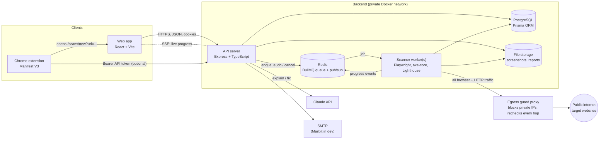
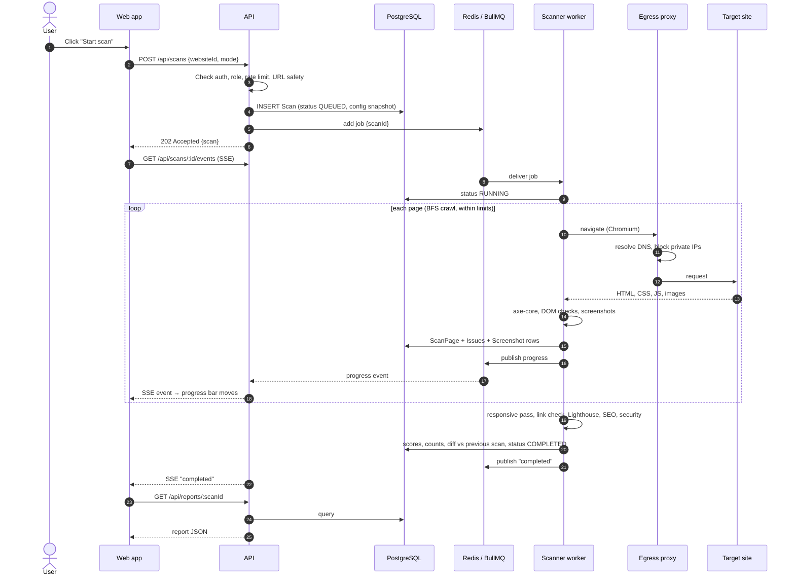

# 01 · System Architecture

> **In one sentence:** a React dashboard talks to an Express API; the API saves
> requests in PostgreSQL and drops "scan jobs" into a Redis queue; separate
> scanner workers pick up those jobs, drive a real Chromium browser through a
> security proxy, run the checks, and write results back to PostgreSQL and file
> storage. The dashboard shows live progress, then the results.

---

## 1. The big picture



### Components

| Component | What it does | Why it is separate |
|---|---|---|
| **Web app** (`apps/web`) | All 21 pages: dashboard, reports, settings. Single-page app. | Static files; can be served by nginx or a CDN. |
| **API** (`apps/api`) | Authentication, permissions, CRUD, reports, exports, AI calls, live progress stream. Never opens a browser. | Has to answer quickly. A slow or crashing browser must not take the API down with it. |
| **Scanner worker** (`apps/scanner`) | Takes jobs from the queue and runs the whole scan pipeline. | Scans are slow (minutes), use a lot of CPU and RAM, and sometimes crash. Workers can be restarted or scaled (`docker compose up --scale scanner=3`) on their own. |
| **Egress guard proxy** (`apps/egress-proxy`) | Small HTTP/HTTPS forward proxy. Every request the browser or scanner makes passes through it, and it refuses private or internal IPs. | The single choke point for SSRF protection; see [05-security.md](05-security.md). |
| **PostgreSQL** | Everything that is structured data. | Relational data with real relations (user → project → website → scan → issue). |
| **Redis** | BullMQ job queue, progress pub/sub, rate-limit counters. | Fast in-memory store built for exactly these jobs. |
| **File storage** | PNG screenshots, raw Lighthouse JSON, generated PDFs. | Binary files do not belong in Postgres. Local Docker volume behind a `StorageProvider` interface, so S3 can be added later without touching callers. |
| **Chrome extension** (`apps/extension`) | Quick checks on the page you are looking at, inside your own browser. | Runs on the user's machine and needs no server for basic checks. |

---

## 2. How the pieces talk to each other

| From → To | How | Example |
|---|---|---|
| Web → API | REST + JSON over HTTPS. Auth via **HttpOnly cookies** (JS cannot read them, which protects against token theft by XSS). | `POST /api/scans { "websiteId": "..." }` |
| API → Web (live) | **Server-Sent Events** (SSE): one long HTTP response the server keeps writing to. Simpler than WebSockets, and we only need server → browser. | `GET /api/scans/:id/events` streams `{"progress":42,"step":"Checking accessibility (3/10)"}` |
| API → Worker | **BullMQ job** in Redis. The API only writes `{ scanId }`; the worker loads everything else from the DB. | `scanQueue.add('scan', { scanId })` |
| Worker → API | **Redis pub/sub** channel `scan:{id}:events`, plus progress columns written to the `Scan` row (so a page refresh still shows the right state). | Worker publishes progress, API forwards it to SSE. |
| API → Worker (cancel) | DB status `CANCELLING` + Redis message `scan:{id}:cancel`. The worker checks between steps and aborts. | |
| Worker → Internet | Through the egress proxy only. Docker networking gives the worker no other route out. | |
| API → Claude | `@anthropic-ai/sdk` on the server. The API key exists only in the API container's environment. | |

**Why not let the API call Playwright directly?** A crawl of 20 pages × 5
viewports + Lighthouse can take 3–10 minutes. An HTTP request cannot stay open
that long, and one heavy scan would slow every other user's requests. A queue
turns this into: *accept quickly (202), work in the background, report progress.*

---

## 3. Scan data flow (end to end)



### Scan pipeline (what the worker does, in order)

Each stage is its own module in `apps/scanner/src/pipeline/stages/`. Between
stages (and between pages) the worker calls `checkCancelled()`.

| # | Stage | What happens | Output |
|---|---|---|---|
| 0 | **Preflight** | Re-validate the URL (DNS → public IP), fetch `robots.txt` and `sitemap.xml`, request `http://` to see whether it redirects to HTTPS, read the main document's security headers. | Site-level SEO + security issues |
| 1 | **Crawl + page checks** (desktop 1920×1080) | Breadth-first crawl from the start URL. For each page: navigate, wait for load, record console/JS errors and failed requests, extract metadata and links, run **axe-core**, run **custom DOM checks**, full-page screenshot, store each issue's bounding box. | `ScanPage`, `Issue` rows, screenshots |
| 2 | **Responsive** | For the first *N* pages (`responsivePageLimit`), reload at 1366, 768, 390 and 320 wide; run the layout checks; screenshot each. | `RESPONSIVE` issues + viewport screenshots |
| 3 | **Link check** | HEAD (falling back to GET) every unique link found, with a concurrency limit and a per-scan cap. | Broken link issues (UI + SEO) |
| 4 | **Lighthouse** | For the first *N* pages (`lighthousePageLimit`), run Lighthouse in its own Chrome (also through the proxy). | `PerformanceResult` + performance issues |
| 5 | **Cross-page analysis** | Duplicate titles/descriptions across pages; mixed content summary. | SEO / security issues |
| 6 | **Issue screenshots** | For the most severe issues (capped, e.g. 50 per scan), a cropped screenshot with the element outlined. Other issues use the page screenshot plus the stored bounding box (drawn by the frontend). | `ISSUE_CROP` screenshots |
| 7 | **Visual regression** | If baselines exist for this website, compare (pixelmatch) and store the result. | `VisualComparison` rows |
| 8 | **Finalize** | Fingerprint issues, update `TrackedIssue` (new / recurring / resolved), compute scores and counts, link `previousScanId`, write notifications, set final status. | Final `Scan` row |

### Live progress and cancellation in detail

- **Progress** is a weighted sum: crawl 50%, responsive 15%, links 10%,
  Lighthouse 20%, the rest 5%. The worker writes `progress` + `currentStep` to
  the DB (at most once a second) and publishes the same event to Redis.
- **Cancellation is cooperative.** BullMQ (open-source edition) cannot kill a
  running job, so the API sets `status = CANCELLING` and publishes a cancel
  message. The worker's `AbortController` fires, the current Playwright context
  is closed (which aborts any in-flight navigation), results so far are kept,
  and the status becomes `CANCELLED`. A cancel normally takes effect within ~1 s.
- **Crash safety.** BullMQ marks jobs "stalled" when a worker dies. A stalled
  scan is retried **once**; if that fails it becomes `FAILED` with an error
  message. Hard caps: 60 s per page, 15 min per scan (configurable).

---

## 4. Scoring (how the numbers are calculated)

Scores are **0–100, higher is better**, stored on the `Scan` row.

| Score | Source | Formula |
|---|---|---|
| Performance, Best Practices, Lighthouse SEO | Lighthouse | Average of Lighthouse category scores over the pages it ran on. |
| Accessibility | Our axe results | `100 − Σ penalty`, penalty per *unique rule failure per page*: critical 10, serious 5, moderate 2, minor 1, averaged over pages, floored at 0. (The Lighthouse a11y score is shown separately.) |
| UI health | Our DOM checks | Same penalty model using our severities (critical 10, high 5, medium 2, low 1). |
| SEO (ours) | Our SEO checks | Same penalty model. |
| Security | Header checks | Start at 100, subtract per missing control (e.g. no HTTPS −40, missing CSP −15, missing HSTS −10 ...). |

These are **heuristics we define**, not industry standards (except Lighthouse's).
The report UI says so and links to the formula. Exact weights live in one place
(`packages/shared/src/scoring.ts`) so they can be tuned and unit-tested.

**Severity mapping**

| axe impact | Our severity |
|---|---|
| critical | CRITICAL |
| serious | HIGH |
| moderate | MEDIUM |
| minor | LOW |
| (incomplete / needs review) | INFO + `detection = NEEDS_REVIEW` |

---

## 5. Comparing scans: fingerprints

To say "this issue is **new**", "this one was **resolved**", "this one is
**recurring**", we need to recognise *the same problem* in two different scans.
Database IDs don't help: every scan creates new rows.

So each issue gets a **fingerprint**:

```
sha256( websiteId | category | ruleId | normalizedPagePath | viewport | stableSelector )
```

- `normalizedPagePath`: `/products?id=1#top` → `/products?id=1` (hash removed, query sorted).
- `stableSelector`: the CSS selector with fragile parts (`:nth-child(7)`) reduced
  where an `id`, `data-testid` or `aria-label` exists. It isn't perfect: a
  redesign that moves an element can look like "resolved + new". The docs say
  this plainly.

Then, per website, `TrackedIssue` keeps one row per fingerprint:

| Situation in the new scan | Result |
|---|---|
| Fingerprint never seen before | **New** (TrackedIssue created) |
| Seen before and seen again | **Recurring** (`occurrenceCount++`, `lastSeenScan` updated) |
| Was OPEN, not seen now, and the page *was* scanned this time | **Resolved** (`resolvedInScan` set) |
| Not seen because the page wasn't scanned this time | Unchanged (we only resolve what we re-checked) |

User decisions ("Ignore", "False positive") are stored on `TrackedIssue`, so they
carry over to future scans automatically.

---

## 6. Technology choices and why

| Need | Choice | Why this | Alternatives considered |
|---|---|---|---|
| Frontend framework | **React + TypeScript + Vite** | Most common stack in industry; Vite gives instant dev reloads. | Next.js: SSR not needed for a logged-in dashboard; it adds complexity. |
| Styling / components | **Tailwind CSS + shadcn/ui** | shadcn copies accessible Radix-based components *into* our repo, so we own and can edit them. That matters for an accessibility product: our own UI must pass our own checks. | MUI: heavier, harder to make look like Linear or Vercel. |
| Server state | **TanStack Query** | Caching, refetching, loading and error states for API calls with very little code. | Redux: too much boilerplate for server data. |
| Forms | **React Hook Form + Zod** | The same Zod schemas validate on the frontend *and* backend (shared package). | Formik. |
| Routing | **React Router** | Standard, as requested. | |
| Charts | **Recharts** | Declarative React charts, as requested. | |
| API | **Express + TypeScript** | Simple, huge ecosystem, easy to explain. | NestJS: great but much more abstract for a learner. Fastify: faster, less familiar. |
| Validation | **Zod** | One schema → TypeScript types + runtime validation + OpenAPI docs. | Joi, class-validator. |
| API docs | **OpenAPI 3** generated from Zod (`@asteasolutions/zod-to-openapi`) + Swagger UI at `/api/docs` | Docs can't drift from the code. | Hand-written YAML. |
| Database | **PostgreSQL + Prisma** | Strong relational integrity, JSON columns where flexible data is needed; Prisma gives typed queries and migrations. | MongoDB: weaker for relational reporting queries. |
| Queue | **Redis + BullMQ** | Retries, concurrency limits, stalled-job detection, repeatable (cron) jobs for schedules. | pg-boss (Postgres-based): fewer moving parts but smaller ecosystem. |
| Browser automation | **Playwright** | Reliable waits, multiple viewports, request interception, screenshots, PDF generation. | Puppeteer: Chromium-focused, fewer conveniences. |
| Accessibility rules | **axe-core** | Industry standard, low false-positive policy, WCAG 2.0/2.1/2.2 tags, used by Lighthouse itself. | Pa11y (uses axe or HTML_CodeSniffer underneath). |
| Performance | **Lighthouse** (Node API) | Official Google metrics (FCP, LCP, CLS, TBT, SI) and opportunities. | WebPageTest: external service. |
| Visual diff | **pixelmatch + pngjs** | Small, fast, well-known; returns a diff image and changed-pixel count. | Resemble.js. |
| PDF export | **Playwright `page.pdf()`** on an HTML report template | We already ship Chromium; HTML + CSS make a better-looking PDF than drawing PDFs by hand. | pdfkit, react-pdf. |
| Auth | **JWT in HttpOnly cookies + rotating refresh tokens**, **argon2id** hashing | Stateless short-lived access token, revocable sessions, modern password hashing. | Sessions in Redis: also fine; JWT was requested. |
| Email | **Nodemailer** (SMTP) + **Mailpit** container in dev | Reset emails really get sent in dev, and you can read them at `localhost:8025`. | |
| Logging | **pino** + request IDs | Fast structured JSON logs; one request ID across API and worker logs. | winston. |
| AI | **Claude API** via `@anthropic-ai/sdk`, server-side only, model `claude-sonnet-5-5` by default to keep costs manageable (configurable with `CLAUDE_MODEL`), structured JSON output | Reliable structured explanations; the key never reaches the browser. | |
| Tests | **Vitest** (unit/integration, web + api), **Supertest** (HTTP), **Playwright Test** (scanner + E2E), **Testing Library** (components) | Vitest shares Vite config; Playwright Test runs real browsers. | Jest: slower with ESM + TS. |
| Monorepo | **npm workspaces** | Already installed (npm 11), no extra tool to learn. | pnpm/Turborepo: faster, but one more tool; can switch later. |
| Containers | **Docker Compose** | One command starts Postgres, Redis, Mailpit, API, worker, proxy, web. | |

### Versions

Exact versions installed and tested together in Phase 2 are listed in
**[VERSIONS.md](VERSIONS.md)**: Node 24, TypeScript 6.0, React 19.3, Vite 8,
React Router 8, Tailwind 4, Express 5, Prisma 7.10, PostgreSQL 17, Redis 7.4,
Vitest 5. Packages for later phases (Playwright, axe-core, Lighthouse, BullMQ,
@anthropic-ai/sdk, Recharts) are pinned when their phase starts.
