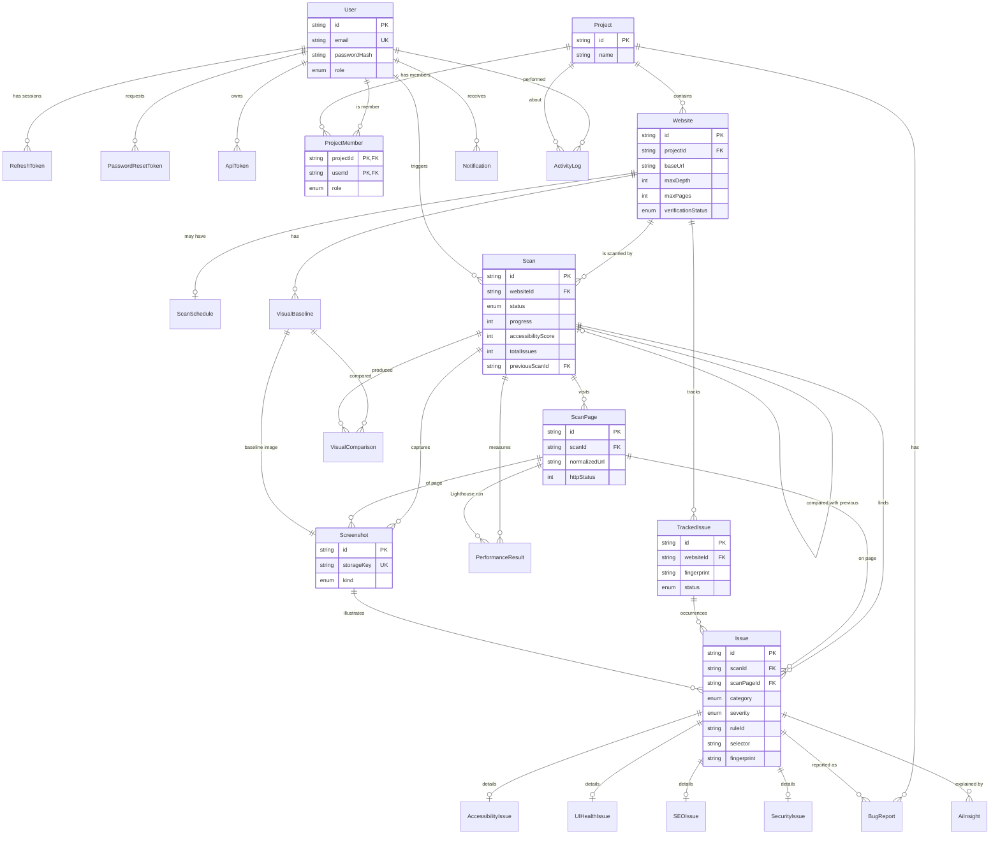

# 03 · Database Design

The Prisma schema is in
**[packages/db/prisma/schema.prisma](../packages/db/prisma/schema.prisma)**. It was
applied as migration `20261102115607_init` (24 tables, 46 foreign keys, 68 indexes,
20 enums), and its relationships are verified by
[packages/db/test/relations.test.ts](../packages/db/test/relations.test.ts).
Plain-language walkthrough: [09-phase-2-setup.md §5](09-phase-2-setup.md#5-how-the-database-works-in-this-project).

## 1. ER diagram

*(The diagram leaves out a few columns to stay readable; the Prisma file is the
source of truth.)*

## 2. Tables in plain language

| Table | One row = | Key relations |
|---|---|---|
| `User` | A person with a login | has many memberships, tokens, notifications |
| `RefreshToken` | One logged-in session (hashed token) | → User (cascade) |
| `PasswordResetToken` | One "forgot password" link (hashed) | → User (cascade) |
| `ApiToken` | A personal access token for the extension or CI (hashed) | → User (cascade) |
| `Project` | A group of websites (e.g. "Marketing sites") | has members, websites, bug reports |
| `ProjectMember` | "User X has role R in project P" | composite PK (projectId, userId) |
| `Website` | A site to scan + its crawl settings | → Project (cascade) |
| `ScanSchedule` | "Scan this website every Monday 09:00" | 1:1 with Website |
| `Scan` | One run of the scanner | → Website (cascade), → previous Scan |
| `ScanPage` | One URL visited during a scan | → Scan (cascade); unique (scanId, normalizedUrl) |
| `Issue` | One finding (any category) | → Scan, → ScanPage, → TrackedIssue, → Screenshot |
| `AccessibilityIssue` / `UIHealthIssue` / `SEOIssue` / `SecurityIssue` | Extra fields for that category | 1:1 with Issue, PK = issueId |
| `TrackedIssue` | The same problem across many scans | unique (websiteId, fingerprint) |
| `PerformanceResult` | One Lighthouse run for one page and form factor | → ScanPage (cascade) |
| `Screenshot` | Metadata of one PNG in file storage | → Scan / ScanPage (cascade) |
| `VisualBaseline` | The approved image for page + viewport | unique (websiteId, pageUrl, viewport) |
| `VisualComparison` | One baseline-vs-current comparison | → VisualBaseline (cascade) |
| `BugReport` | A written-up bug (copied fields) | → Project (cascade), → Issue (set null) |
| `AiInsight` | Cached Claude answer | unique (issueId, kind) |
| `Notification` | An in-app message | → User (cascade) |
| `ActivityLog` | Audit trail entry | → User / Project (set null; logs survive) |

## 3. Design decisions worth explaining in an interview

### Base `Issue` table + per-category detail tables
The brief asked for `AccessibilityIssue`, `UIHealthIssue`, `SEOIssue` and
`SecurityIssue`. If those were four **independent** tables, every cross-category
feature (dashboard totals, "all critical issues", scan comparison, bug reports,
AI explanations, screenshots) would need four queries and a `UNION`, and
`BugReport`/`AiInsight` would need four foreign keys.

So the shared columns (severity, selector, page, fingerprint...) live in one
`Issue` table, and each category keeps its own fields in a 1:1 **detail table**
whose primary key *is* the `issueId` (called *class table inheritance*).
Performance and responsive findings don't need extra columns, so they use
`Issue.details` (JSON) instead of more tables.

### Denormalized counts on `Scan`
`totalIssues`, `criticalCount`, scores... could be computed with `COUNT(*)`
every time, but the scan list and dashboard show them for many scans at once.
They are written **once** when a scan finishes and never change afterwards, so
copying them is safe and makes those pages fast.

### `TrackedIssue` for history
Issue rows are per-scan snapshots. `TrackedIssue` is the long-lived identity of
a problem (by fingerprint). It makes "new / resolved / recurring" one query and
keeps "ignored / false positive" decisions between scans.

### JSON columns, used sparingly
Used only for data that varies in shape and is never filtered on in SQL:
`Scan.config` (settings snapshot), console errors, Lighthouse opportunities,
bounding boxes, visual ignore regions. Everything we filter or sort by is a
real column with an index.

### Cascades, chosen per relation

| When you delete... | ...this happens | Why |
|---|---|---|
| a User | sessions, tokens, memberships, notifications deleted; created projects/websites/scans/bug reports keep existing with creator = null; logs keep with user = null | Team data must not disappear because one person left |
| a Project | its websites → scans → pages → issues → screenshot rows, bug reports deleted | The project *owns* that data |
| a Scan | its pages, issues, screenshots, performance results deleted; `TrackedIssue` scan links set to null; bug reports keep their copied fields | |
| an Issue | its AI insights deleted; bug reports keep (issue = null) | |

**Files are not database rows.** When rows with screenshots are deleted, a
cleanup job (`storage-gc` queue) deletes orphaned files whose `storageKey` no
longer exists in `Screenshot`. That job is part of Phase 6.

### Indexes (and the query each one serves)

| Index | Serves |
|---|---|
| `Scan(websiteId, createdAt DESC)` | Website history, "latest scan per website" |
| `Scan(status)` | Scan Center "running/queued" |
| `Issue(scanId, category, severity)` | Every report page's filter |
| `Issue(scanId, fingerprint)` unique | No duplicate findings within one scan |
| `TrackedIssue(websiteId, fingerprint)` unique | Scan comparison |
| `ScanPage(scanId, normalizedUrl)` unique | Crawler never stores a page twice |
| `Notification(userId, readAt)` | Unread badge |
| `ActivityLog(projectId, createdAt DESC)` | Activity feeds |

## 4. Migrations and seed data (Phase 2/3)

- `npm run db:migrate` → `prisma migrate dev` (creates SQL migration files that
  are committed to Git).
- `npm run db:seed` → creates **only** a demo admin user, a demo project and
  two websites pointing at our **local fixture sites**. It does **not**
  invent scan results: you click "Scan" and the real scanner produces them.
  (This follows the "no fake results" rule.)
- Tests use a separate database (`DATABASE_URL_TEST`), reset before each
  integration suite.
