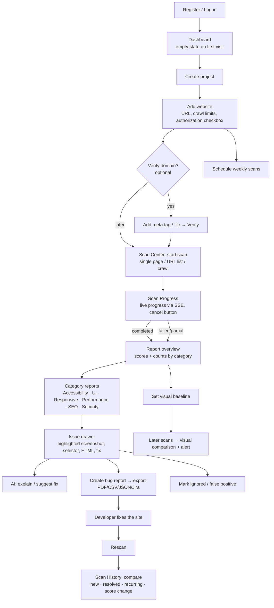
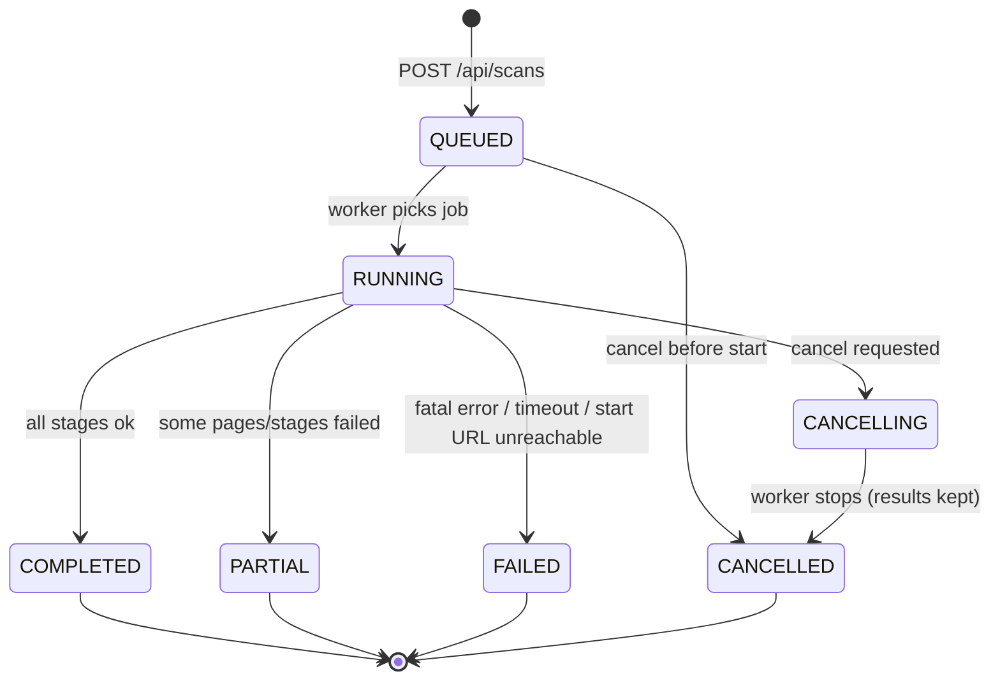

# 07 · User Workflow & Pages

## 1. Main journey



## 2. Scan lifecycle (state machine)



## 3. Chrome extension journey

1. Open any page → click the extension icon → **Scan this page**.
2. Popup shows counts (critical/high/medium/low) and the issue list.
3. Click an issue → the page scrolls to the element, which is outlined.
4. **Copy** → issue details as Markdown for a ticket or chat.
5. **Open full report** → opens the dashboard's Scan Center with the URL filled
   in (or starts the server scan directly if an API token is configured).

## 4. Page map (all 21 required pages)

| # | Page | Route | Main data (API) |
|---|---|---|---|
| 1 | Login | `/login` | `POST /auth/login` |
| 2 | Registration | `/register` | `POST /auth/register` |
| 3 | Forgot password (+ reset) | `/forgot-password`, `/reset-password?token=` | `POST /auth/forgot-password`, `/auth/reset-password` |
| 4 | Dashboard | `/` | `/dashboard/summary`, `/dashboard/trends` |
| 5 | Projects | `/projects`, `/projects/:id` | `/projects`, members |
| 6 | Website management | `/websites` | `GET /websites` (search, filter, paginate) |
| 7 | Add website | `/websites/new` | `POST /websites` |
| 8 | Website details | `/websites/:id` | website, schedule, latest scan, tracked issues, verify |
| 9 | Scan Center | `/scans` (+ `/scans/new?url=`) | start scans, list running/queued/recent |
| 10 | Scan progress | `/scans/:id` | `GET /scans/:id` + SSE `/events` |
| 11 | Accessibility report | `/scans/:id/accessibility` | `/reports/:id/accessibility` |
| 12 | UI health report | `/scans/:id/ui-health` | `/reports/:id/ui-health` |
| 13 | Responsive report | `/scans/:id/responsive` | `/reports/:id/responsive` |
| 14 | Performance report | `/scans/:id/performance` | `/reports/:id/performance` |
| 15 | SEO report | `/scans/:id/seo` | `/reports/:id/seo` |
| 16 | Security report | `/scans/:id/security` | `/reports/:id/security` |
| 17 | Visual regression | `/visual`, `/visual/:baselineId` | `/visual/*` |
| 18 | Bug reports | `/bug-reports`, `/bug-reports/:id` | `/bug-reports/*` |
| 19 | Scan history | `/history`, `/websites/:id/history` | `/scans`, `/scans/:id/compare` |
| 20 | User profile | `/profile` | `/auth/me`, change password |
| 21 | Settings | `/settings` | theme, API tokens, AI status, (admin) users |

Every page has a **loading skeleton**, an **empty state** with a next action,
an **error state** with retry, and keyboard-accessible controls. The app's own
pages are scanned by the tool's E2E tests ("eat our own dog food").

## 5. Layout

```
┌──────────────┬─────────────────────────────────────────────────────┐
│  ◉ WHC       │  Search…            🔔 3   ◐ theme   (avatar ▾)      │
│              ├─────────────────────────────────────────────────────┤
│  Dashboard   │  Page title                         [Primary action]│
│  Projects    │  ─────────────────────────────────────────────────  │
│  Websites    │  ┌────────┐ ┌────────┐ ┌────────┐ ┌────────┐         │
│  Scan Center │  │ card   │ │ card   │ │ card   │ │ card   │         │
│  History     │  └────────┘ └────────┘ └────────┘ └────────┘         │
│  Visual      │  ┌─────────────────────────┐ ┌──────────────────┐    │
│  Bug Reports │  │ chart                   │ │ list             │    │
│  ─────────   │  └─────────────────────────┘ └──────────────────┘    │
│  Settings    │  ┌──────────────────────────────────────────────┐    │
│              │  │ table (sortable, filterable, paginated)      │    │
└──────────────┴──┴──────────────────────────────────────────────┴────┘
```
Neutral palette (zinc/slate), one accent colour, severity colours (critical
red, high orange, medium amber, low blue, info grey) always paired with an
icon + text label (never colour alone, since that would fail our own a11y checks).
