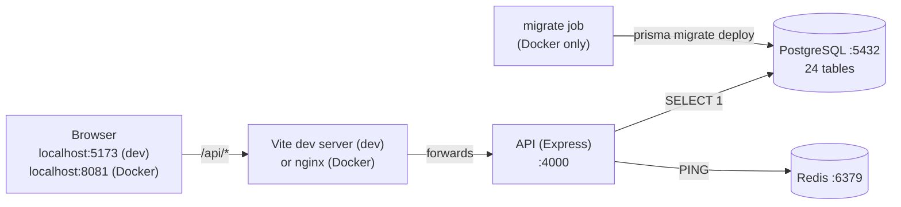

# 09 · Phase 2 explained: how the project is set up

This page explains *what* was built in Phase 2 and *why*, in plain language.
Commands to run everything are in the [README](../README.md).

---

## 1. What exists after Phase 2



| Piece | Folder | Status |
|---|---|---|
| Shared code | `packages/shared` | ✅ health-report schema, viewports, severities |
| Database package | `packages/db` | ✅ full schema (24 models), first migration, typed client, relationship tests |
| API | `apps/api` | ✅ Express skeleton, config validation, logging, errors, health endpoints |
| Web | `apps/web` | ✅ React shell, sidebar, light/dark theme, live System Status page |
| Docker | `docker-compose.yml`, `docker/` | ✅ postgres, redis, mailpit, migrate, api, web, all healthy |
| Scanner, egress proxy, extension | `apps/scanner` … | ⏳ Phases 4 and 7 (not created yet, on purpose) |

---

## 2. The monorepo: one repository, several packages

**npm workspaces** let one `npm install` set up every package and link them
together. In the root `package.json`:

```json
"workspaces": ["packages/shared", "packages/db", "apps/api", "apps/web"]
```

When `apps/api/package.json` lists `"@whc/db": "*"`, npm doesn't download it.
Instead it creates a **link** `node_modules/@whc/db → packages/db`. Edit a file in
`packages/db/src` and the API sees the change immediately.

**"Internal packages" (no build step).** `packages/shared` and `packages/db`
point straight at their TypeScript source (`"exports": { ".": "./src/index.ts" }`).
This works because every consumer already compiles TypeScript:

| Consumer | Compiles TS with |
|---|---|
| `npm run dev` (API) | **tsx**: runs `.ts` files directly, restarts on save |
| `npm run dev` (web) / web build | **Vite** |
| API production build | **tsup**: bundles `src/server.ts` + `@whc/*` source into `dist/server.js` |
| Tests | **Vitest** |
| Type checking | **tsc** (`noEmit`: only checks, never writes `.js`) |

---

## 3. Configuration files, one by one

| File | What it does |
|---|---|
| `package.json` (root) | Workspace list, shared dev tools, and root scripts such as `npm run dev` and `npm run check`. `allowScripts` lists the only packages allowed to run install scripts (see [VERSIONS.md](VERSIONS.md)). |
| `package-lock.json` | Exact version of every installed package. **Commit it**: it makes installs identical on every machine. |
| `tsconfig.base.json` | TypeScript rules shared by all workspaces: `strict` mode, `Bundler` module resolution (imports without `.js` endings), `noEmit`. Each workspace's `tsconfig.json` *extends* it and adds only what differs (e.g. the web adds DOM types + JSX). |
| `eslint.config.js` | Lint rules. Includes two **security rules** from the design: no `$queryRawUnsafe` (SQL injection) and no `dangerouslySetInnerHTML` (XSS from scanned HTML). |
| `.prettierrc.json` | Code formatting (quotes, semicolons, line width). `npm run format` applies it. |
| `.editorconfig` / `.gitattributes` | Consistent indentation and **LF line endings**. Windows uses CRLF; Linux containers need LF. |
| `.env.example` → `.env` | All settings. `.env` holds your real values and is **git-ignored**. Docker Compose reads the same `.env`. |
| `.nvmrc` | Says "use Node 24" for version managers. |
| `packages/db/prisma/schema.prisma` | The database design: models, enums, relations, indexes. |
| `packages/db/prisma.config.ts` | Prisma 7 CLI settings: where the schema and migrations are, and the database URL (read from `.env`). |
| `apps/api/tsup.config.ts` | Production bundling: our own code is bundled; npm packages stay in `node_modules`. |
| `apps/web/vite.config.ts` | React + Tailwind plugins, `@/` import alias, **dev proxy** `/api → localhost:4000`, test environment (jsdom). |
| `apps/web/components.json` | shadcn/ui settings (style `radix-nova`, where components go). |
| `docker-compose.yml` | Every container, their order (`depends_on` + health checks), ports, volumes. |
| `docker/*.Dockerfile` | How the API and web images are built (multi-stage: build → small runtime). |
| `docker/nginx.conf` | Serves the React build; forwards `/api/` to the API; SPA fallback; security headers. |
| `docker/postgres/init/01-create-test-db.sql` | Creates the `whc_test` database the first time Postgres starts. |

### Why does the browser call `/api/...` and not `http://localhost:4000/api/...`?
Because then the page and the API are on the **same origin** (same host and
port), which means no CORS problems, and in Phase 3 the login cookies just
work. Vite (in dev) and nginx (in Docker) forward `/api/*` to the API.

---

## 4. Dependencies: what each one is for

**API (`apps/api`)**

| Package | Job |
|---|---|
| express | HTTP server and routing |
| helmet | Adds security headers to every response |
| cors | Decides which browser origins may call the API |
| pino + pino-http | Fast JSON logging; one log line per request with a request ID |
| pino-pretty (dev) | Coloured, readable logs on your PC |
| ioredis | Redis client (health check now; queue and rate limits later) |
| zod | Validates environment variables at startup (and request bodies from Phase 3) |
| dotenv | Loads the root `.env` file on your PC |
| tsx (dev) | Runs TypeScript directly and restarts on file changes |
| tsup (dev) | Builds the production bundle |
| supertest (dev) | Sends fake HTTP requests to the app in tests, with no real port needed |

**Database (`packages/db`)**

| Package | Job |
|---|---|
| prisma (dev) | CLI: `validate`, `generate`, `migrate`, `studio` |
| @prisma/client | Runtime for the generated, fully typed query client |
| @prisma/adapter-pg (+ pg) | Prisma 7 connects to PostgreSQL through the standard `pg` driver |

**Web (`apps/web`)**

| Package | Job |
|---|---|
| react, react-dom | UI library |
| react-router | Page routing (URL → component) |
| @tanstack/react-query | Fetching server data: caching, loading/error states, auto-refresh |
| tailwindcss | Utility-first styling |
| shadcn + radix-ui | Accessible components (Button, Card, Badge, ...) copied into `src/components/ui` so we own the code |
| lucide-react | Icons |
| clsx + tailwind-merge | The `cn()` helper for combining class names |
| vitest + jsdom + Testing Library (dev) | Component tests in a simulated browser |

**Shared (`packages/shared`)**: only `zod`. The health-report schema there is
used by the API (to produce the response) *and* the web app (to check it).

---

## 5. How the database works in this project

### From schema to tables
```
schema.prisma ──(npm run db:migrate -- --name x)──► migrations/<timestamp>_x/migration.sql ──► tables in PostgreSQL
      │
      └──(npm run db:generate)──► packages/db/src/generated/prisma  (typed TypeScript client)
```
- A **migration** is a SQL file describing one change. Migration files are
  committed to Git, so every database (yours, a teammate's, Docker, production)
  is built the same way, in the same order.
- `migrate dev` (on your PC) creates *and* applies migrations.
  `migrate deploy` (Docker / production) only applies existing ones; it never
  invents changes.
- The **generated client** is not committed (it's re-created by `db:generate`).

### Using it from code
```ts
import { createPrismaClient } from '@whc/db';

const prisma = createPrismaClient(process.env.DATABASE_URL!);

// Fully typed: your editor autocompletes fields, and typos are compile errors.
const scans = await prisma.scan.findMany({
  where: { website: { project: { members: { some: { userId } } } } }, // only my projects
  include: { website: true },
  orderBy: { createdAt: 'desc' },
});
```
Prisma turns that into parameterized SQL, so user input can never become SQL code.

### Relationships verified by tests (`packages/db/test/relations.test.ts`)

| Test | What it proves |
|---|---|
| Loads the whole chain through nested includes | Issue → AccessibilityIssue, Screenshot, TrackedIssue, ScanPage, Scan → Website → Project → Members all connect |
| Finds scans by project membership | The authorization query pattern returns data for members and **nothing** for outsiders |
| Links a scan to the previous scan | The self-relation used for "compare with previous scan" |
| Visual baselines, comparisons, bug reports, AI insights | The remaining relations connect |
| Unique: email, fingerprint per scan, URL per project | Duplicates are rejected by the database itself (`P2002`) |
| Delete project | Cascades to websites, scans, pages, issues, details, tracked issues, screenshots |
| Delete scan | Tracked issues survive; their scan links become `null` |
| Delete user | Sessions and memberships go; projects, scans and audit logs stay (creator becomes `null`) |
| Delete issue | Bug report survives with its copied text; AI insights are removed |

Tests run against a **separate database** (`whc_test`), and `test/global-setup.ts`
applies the migrations to it automatically before the tests start.

---

## 6. Health checks

| Endpoint | Checks | Answers |
|---|---|---|
| `GET /api/health/live` | Only "is the process alive?" | Always `200 {"status":"ok"}` while running. Docker uses this. |
| `GET /api/health` | PostgreSQL (`SELECT 1`) + Redis (`PING`), in parallel, each with a 2-second timeout | `200` if both are up, `503` if anything is down, with per-dependency status and response time |

Example (everything up):
```json
{
  "status": "ok",
  "service": "whc-api",
  "version": "0.1.0",
  "environment": "development",
  "uptimeSeconds": 4,
  "timestamp": "2026-11-02T12:05:09.891Z",
  "checks": {
    "database": { "status": "up", "latencyMs": 3 },
    "redis": { "status": "up", "latencyMs": 2 }
  }
}
```
With Redis stopped, the same call returns **503** and
`"redis": { "status": "down", "error": "..." }`. When Redis comes back,
the API reconnects on its own. In production the error text is replaced by
`"unreachable"` so internal host names aren't leaked.

**Why two endpoints?** If the database is briefly down, Docker should *not*
restart the API, because restarting won't fix the database. So Docker's container health
check uses `/live`, while people and monitoring tools use `/api/health`.

---

## 7. How a request flows through the API

```
request
  → pino-http      gives it an ID (X-Request-Id header), logs it
  → helmet         adds security headers
  → cors           allows only our own frontends
  → express.json   parses JSON bodies (max 1 MB)
  → router         /api/health → health.routes.ts → health.service.ts
  → notFound       no route matched → 404 JSON
  → errorHandler   any error → { "error": { code, message, requestId } }
```
`app.ts` *builds* this chain; `server.ts` supplies the real database and Redis
and starts listening. Tests call `createApp()` with **fake** dependencies, which
is why most API tests need no database at all.

---

## 8. Debugging common problems

| Symptom | Likely cause → fix |
|---|---|
| `Invalid environment configuration: DATABASE_URL ...` | `.env` missing or wrong → `Copy-Item .env.example .env` |
| `ECONNREFUSED 127.0.0.1:5432` / health shows database down | Docker services not running → `npm run services:up` |
| `Port 5173/4000 is already in use` | A previous `npm run dev` is still running → close that terminal, or find it with `Get-NetTCPConnection -LocalPort 4000` |
| `Cannot find module './generated/prisma/client'` | Client not generated → `npm run db:generate` |
| `npm run db:migrate` seems to hang | It's waiting for you to type a migration name → always pass one: `npm run db:migrate -- --name add_x` |
| Page says "API unreachable" | API not running, or crashed → check the `[api]` lines in the `npm run dev` terminal |
| Tests in `packages/db` fail with "database whc_test does not exist" | The Postgres volume was created before the init script existed → `docker compose exec postgres createdb -U whc whc_test` |
| Docker: `api` keeps restarting | `docker compose logs api` shows the reason (usually env vars) |
| Want to look at the data | `npm run db:studio` opens Prisma Studio in the browser |
