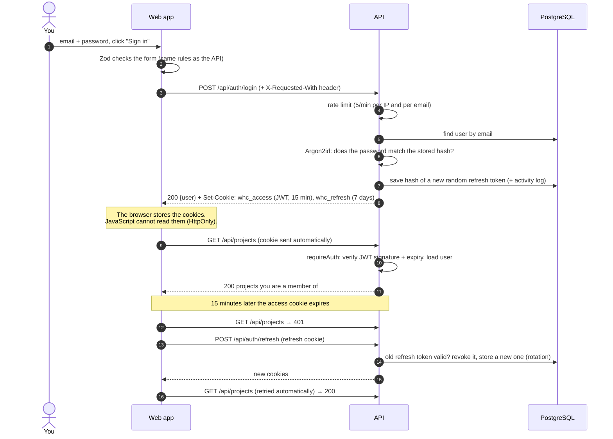
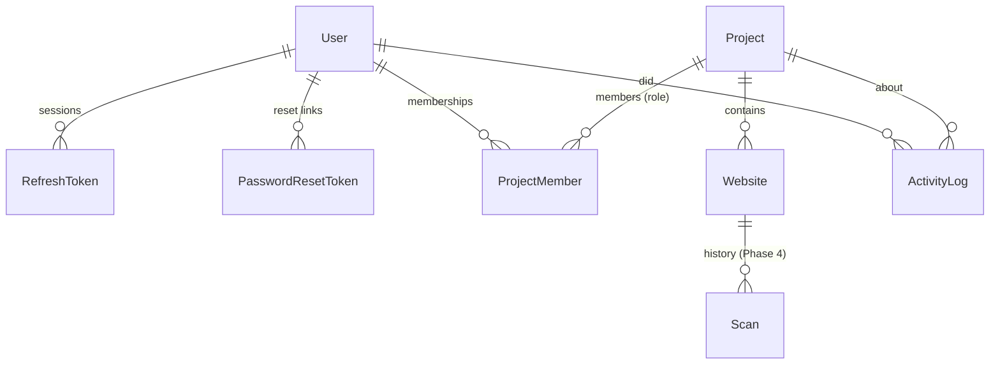

# 10 · Phase 3 explained: accounts, roles, projects and websites

This page explains how sign-in, permissions, projects and websites work, in
plain language. Commands are in the [README](../README.md).

---

## 1. What was built

| Area | Backend (API) | Frontend (web) |
|---|---|---|
| Accounts | Register, sign in, sign out, session refresh, "who am I", edit name, change password, forgot/reset password by email | Sign-in, Create account, Forgot password, Reset password pages; user menu with Sign out |
| Protection | `requireAuth` on every non-public route, CSRF header check, rate limits, account disabling | `RequireAuth` route guard; automatic silent session refresh |
| Roles | Per-project OWNER / EDITOR / VIEWER, global ADMIN; checked in the service layer on every request | Buttons hidden when your role can't use them (the API still decides) |
| Projects | Create, list (search, pagination), details with real statistics, edit, delete (type the name), members, activity log | Projects page, project details page (stats, websites, members, activity) |
| Websites | Add with URL safety (syntax + DNS), authorization confirmation, list, details, edit (move between projects), delete, scan history | Websites page (search, project filter), Add/Edit website form, details page with honest "no scans yet" state |
| Admin | List users, change role, disable account (signs them out); `npm run admin:promote` | Not yet (API + command only) |

---

## 2. The authentication flow, step by step



### Why two tokens?

| | Access token | Refresh token |
|---|---|---|
| What it is | A **JWT** (signed JSON) | A random 43-character string |
| Lives | 15 minutes | Until 7 days after sign-in |
| Sent to | every `/api/...` request | only `/api/auth/...` |
| Stored on the server? | No: the signature proves it's genuine | Yes, as a SHA-256 hash (`RefreshToken` table) |
| Can be revoked instantly? | No (but it expires fast, and the user is re-checked in the DB on each request) | Yes: logout, password change, admin disabling |

Short-lived access token = fast checks without a database lookup for the token
itself. Revocable refresh token = real "sign out" and stolen-session protection.

### How JWT works in this app

A JWT has three parts separated by dots: `header.payload.signature`.

```
header   {"alg":"HS256","typ":"JWT"}
payload  {"role":"USER","sub":"<user id>","iss":"whc-api","aud":"whc-web","iat":1793620000,"exp":1793620900}
signature = HMAC-SHA256(header + "." + payload, JWT_ACCESS_SECRET)
```

- The payload is only **base64-encoded, not encrypted**, so we put nothing secret in it
  (just the user ID and role).
- The **signature** is what makes it trustworthy: only the API knows
  `JWT_ACCESS_SECRET`, so only the API can create a valid signature. Change one
  character of the payload and verification fails.
- `apps/api/src/lib/jwt.ts` checks the signature, the expiry (`exp`), the issuer
  and audience, and **only accepts HS256** (this blocks the classic `"alg": "none"` attack).
- After verification, `requireAuth` still loads the user from the database, so a
  **disabled account is locked out immediately**, not 15 minutes later.

### Session expiry and sign-out

| Event | What happens |
|---|---|
| 15 minutes pass | Access cookie expires → next request refreshes silently |
| 7 days after sign-in | Refresh token expires → you must sign in again (rotation keeps the original expiry, so a session can't be stretched forever) |
| Sign out | This device's refresh-token family is revoked in the DB, cookies cleared |
| Password change | All *other* sessions revoked; this device gets new tokens |
| Password reset by email | **All** sessions revoked |
| Admin disables the account | All sessions revoked; next request → 401 |
| An old (already rotated) refresh token is used again | Likely theft → the whole session family is revoked (10-second grace for two tabs refreshing at once) |

### Passwords

- Hashed with **Argon2id** using Node.js's built-in `crypto.argon2` (no extra
  package), with OWASP-recommended settings (19 MiB memory, 2 passes).
- Stored as `argon2id$v=19$m=19456,t=2,p=1$<salt>$<hash>`, so settings can change later.
- Rules (shared by browser and API): 10–128 characters, not in a common-password
  list, not equal to your email.
- "Wrong password" and "unknown email" give the **same** message and take about
  the same time, so nobody can test which emails have accounts.

### CSRF and other browser protections

| Protection | How |
|---|---|
| Cookies unreadable by JavaScript | `HttpOnly` |
| Other sites can't send our cookies | `SameSite=Lax` (access) / `Strict` (refresh) |
| Cross-site form posts blocked | Every POST/PUT/PATCH/DELETE must carry `X-Requested-With: whc-web` (a cross-site form can't add it); CORS only allows our own origins |
| HTTPS-only cookies in production | `Secure` flag (`COOKIE_SECURE`) |
| Guessing attacks slowed | Redis rate limits: login 5/min per IP and per email; registration 10/hour per IP; password reset 5/hour |

---

## 3. Roles and permissions

There are two kinds of role:

- **Global role** (`User.role`): `ADMIN` or `USER`. Admins can manage users and
  act as an owner in every project.
- **Project role** (`ProjectMember.role`): what you can do inside one project.

| Action | Viewer | Editor | Owner | Admin |
|---|:-:|:-:|:-:|:-:|
| See the project, its websites, members, activity | ✅ | ✅ | ✅ | ✅ |
| Add, edit, delete, move websites | | ✅ | ✅ | ✅ |
| Rename / describe the project | | ✅ | ✅ | ✅ |
| Add/remove members, change roles | | | ✅ | ✅ |
| Delete the project | | | ✅ | ✅ |
| Leave a project | ✅ | ✅ | ✅ (if another owner exists) | |
| Manage user accounts | | | | ✅ |

(In the brief's terms: **Admin** = `ADMIN`, **Project Owner** = `OWNER`,
**Member** = `EDITOR` or `VIEWER`.)

**Enforced by the backend, not the buttons.** Every service method calls
`requireProjectRole(...)` in `apps/api/src/modules/projects/project-access.ts`:

```ts
const { role } = await requireProjectRole(prisma, user, projectId, 'EDITOR', 'add websites');
//  not a member        → 404 "Project not found"  (doesn't reveal it exists)
//  member, role too low → 403 "You need the editor role in this project to add websites."
```

List queries filter in the database itself:

```ts
// visibleProjectsWhere(user) → { members: { some: { userId: user.id } } }
prisma.website.findMany({ where: { project: visibleProjectsWhere(user) } });
```

So another user's projects never even leave the database. The tests prove this
for every endpoint (`projects.test.ts`, `websites.test.ts`: "cross-user isolation").

Safety rules: a project always keeps at least one owner; admins can't demote or
disable themselves.

**The first admin:** there are no built-in accounts. Register normally, then run
`npm run admin:promote -- you@example.com`.

---

## 4. Database relationships used in Phase 3



| Relationship | Meaning | On delete |
|---|---|---|
| `User` → `RefreshToken` | One row per sign-in session (only a **hash** of the token) | User deleted → sessions deleted |
| `User` → `PasswordResetToken` | One row per reset email (hashed, 30 min, single use) | Cascade |
| `User` ↔ `Project` via `ProjectMember` | Many-to-many: a user can be in many projects, a project has many users, each pair has a **role** | Either side deleted → membership deleted |
| `Project` → `Website` | A website belongs to exactly one project; unique `(projectId, baseUrl)` | Project deleted → websites (and their scans) deleted |
| `ActivityLog` | Audit trail: who did what, when | User/project deleted → log kept, link set to null |

Examples of what gets logged: `auth.login`, `project.created`, `member.added`,
`website.created` (with `authorizationConfirmed: true`), `website.deleted`.

---

## 5. Website URL safety (SSRF layers 1 and 2)

Adding a website runs two checks before anything is saved:

1. **Syntax** (`packages/shared/src/url-safety.ts`, runs in the browser *and* the API):
   only `http`/`https`, standard ports, no `user:pass@`, no `localhost` or
   internal names, no private/reserved IP addresses, including disguised forms
   (`http://2130706433`, `http://0x7f.1`, `[::ffff:127.0.0.1]`). The URL is
   normalized: `Example.com/#x` → `https://example.com/`.
2. **DNS** (`apps/api/src/lib/hostname-guard.ts`): the name is resolved and
   rejected if **any** address is private. Verified live: `localtest.me` (a real
   public domain that points to `127.0.0.1`) is refused.

The **authorization checkbox** ("I own this website or have permission to test
it") is required when adding a site and again when its address changes; the
confirmation time is stored and logged.

Layer 3 (the egress proxy that re-checks every request during a scan, including
redirects and DNS changes) is part of Phase 4.

---

## 6. Frontend: how pages talk to the API

- `src/lib/api-client.ts`: one `api()` function for every call: sends cookies
  and the CSRF header, turns errors into `ApiError` (with per-field `details`),
  and on a `401` refreshes the session **once** and retries. If several requests
  fail at the same moment, they share one refresh call.
- `src/features/auth/auth-context.tsx`: asks `GET /api/auth/me` who is signed
  in (the browser can't read HttpOnly cookies itself).
- `src/features/auth/route-guards.tsx`: `RequireAuth` sends signed-out visitors
  to `/login?next=/where/they/were`; `GuestOnly` keeps signed-in users off the
  login page. Only same-site `next` paths are followed (no open redirects).
- Forms use **React Hook Form + the shared Zod schemas**, so the browser shows
  the same messages the API would. Server errors are placed under the matching
  field (`src/lib/form-errors.ts`).
- Data hooks (`features/*/api.ts`) use **TanStack Query**: loading, error and
  empty states, plus cache refresh after every change.

---

## 7. Tests (Phase 3)

| Suite | Tests | What it proves |
|---|---|---|
| `packages/shared` | 73 | URL safety (31 bypass attempts rejected), IPv4/IPv6 classification, password/email/project/website rules |
| `apps/api` auth | 23 | Register, duplicate email, weak passwords, login success/failure, disabled accounts, protected routes, tampered and expired JWT, refresh rotation, stolen-token detection, logout, CSRF, rate limiting, password reset (single use, expiry), profile |
| `apps/api` projects | 16 | CRUD, real statistics, search/pagination, cross-user isolation, viewer/editor/owner/admin permissions, members, last-owner rule, activity log |
| `apps/api` websites | 21 | URL normalization, 8 unsafe URLs, DNS-to-private-IP, unknown domains, duplicates, authorization rule, update/move/delete, cross-user isolation, role permissions, empty scan history |
| `apps/api` admin + health | 12 | Admin-only access, disabling signs users out, health checks |
| `apps/web` | 21 | Protected-route redirect, login validation/failure/success, duplicate registration, password mismatch, projects list/empty/error/create, add-website URL safety and authorization |
| `packages/db` | 11 | Schema relationships and cascades (from Phase 2) |

API tests run against the separate `whc_test` database with real SQL; only email
(fake mailer), DNS (fake resolver) and the rate-limit store are replaced.

---

## 8. Debugging

| Symptom | Cause → fix |
|---|---|
| API won't start: `JWT_ACCESS_SECRET: still has the example value` | Docker/production refuses the placeholder → generate one: `node -e "console.log(require('crypto').randomBytes(48).toString('base64'))"` and put it in `.env` |
| Signed in, but every request says 401 | Cookies not sent: open the app at the **same origin** as the API (`localhost:5173` in dev, `localhost:8081` in Docker), not `127.0.0.1` |
| 403 `CSRF_HEADER_MISSING` from your own script | Add the header `X-Requested-With: whc-web` (browsers use the web app, which adds it) |
| 429 `RATE_LIMITED` while testing | Wait a minute, or set `RATE_LIMIT_ENABLED=false` in `.env` **for local testing only** |
| Reset email never arrives | Dev: open Mailpit at http://localhost:8025. Check `SMTP_HOST`/`SMTP_PORT` |
| "Project not found" for a project that exists | You're not a member (that's the 404-instead-of-403 rule). Ask an owner to add you |
| Can't add a website: "points to a private or internal network" | Its DNS resolves to a private IP. Only public sites can be scanned |
| See what's in the tables | `npm run db:studio` |
