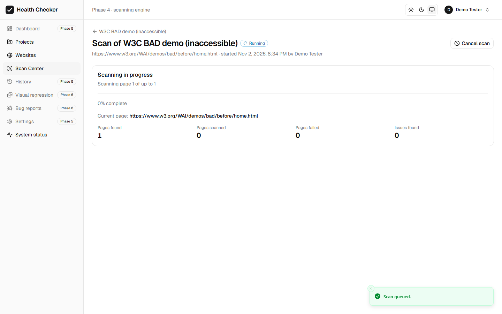
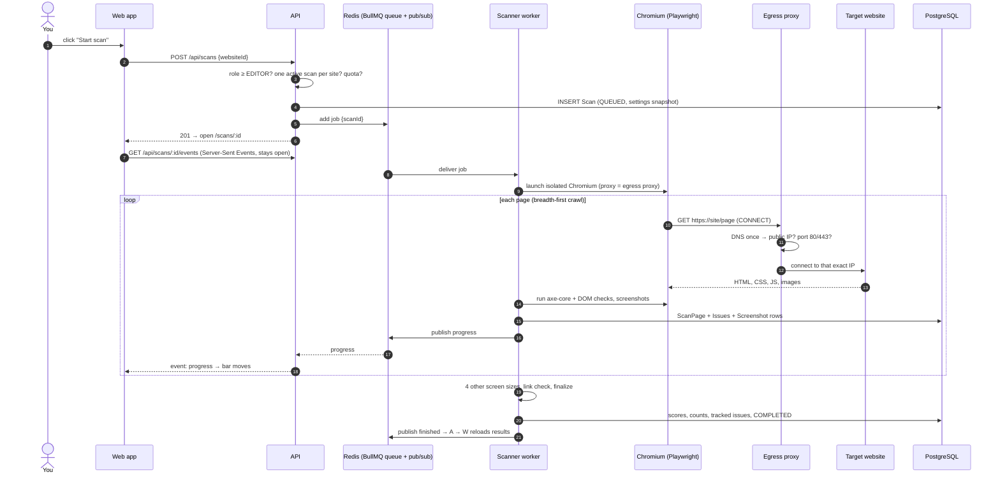

# 11 · Phase 4 explained: the scanning engine

How a scan works from the "Start scan" click to results in PostgreSQL, in plain
language. Commands are in the [README](../README.md).



---

## 1. The big picture



| Folder | Role |
|---|---|
| `apps/egress-proxy` | Security proxy: every request the scanner makes goes through it |
| `apps/scanner` | BullMQ worker: browser, crawler, checks, screenshots, results |
| `packages/dom-checks` | UI checks that run *inside* the web page (also for the Chrome extension later) |
| `apps/api/src/modules/scans` | Start / cancel / rescan / results / compare / live events |
| `apps/web/src/features/scans` | Start button, live progress, results, Scan Center |
| `tests/fixtures/sites` | Small websites with deliberate defects for automated tests |

---

## 2. How Playwright launches a browser

`apps/scanner/src/browser.ts`

```ts
const browser = await chromium.launch({
  headless: true,                                         // no window
  proxy: { server: 'http://egress-proxy:3128', bypass: '<-loopback>' },
  args: ['--disable-quic', '--force-webrtc-ip-handling-policy=disable_non_proxied_udp'],
});
const context = await browser.newContext({ viewport: { width: 1920, height: 1080 } });
const page = await context.newPage();
await page.goto('https://example.com', { waitUntil: 'load', timeout: 30_000 });
```

- **Playwright** controls a real Chromium through the Chrome DevTools Protocol, the same
  protocol your browser's developer tools use.
- **One browser per scan.** Closing it at the end (or when cancelled) kills every tab,
  request and process it started, so nothing leaks between scans. (Checked live: 0
  leftover browser processes after scans and a cancellation.)
- A **browser context** is like a fresh incognito profile: own cookies and storage.
  Each screen size gets its own context (`isMobile`, touch, viewport).
- `waitUntil: 'load'` waits for the page's `load` event. Then we wait up to 5 more seconds
  for the network to go quiet (`networkidle`), so **JavaScript-heavy pages** finish rendering.

## 3. How the scanner reads the DOM

The **DOM** is the live tree of elements the browser built from the HTML (plus everything
JavaScript changed). Code can only read real *layout* (sizes, positions, what is on top)
inside the page. So we send code into the page:

```ts
await page.evaluate(domChecksBundle);                      // defines window.__whcDomChecks
const result = await page.evaluate('window.__whcDomChecks.run({ mode: "all" })');
```

`packages/dom-checks/src/checks.ts` then uses normal browser APIs:

| Check | How it decides |
|---|---|
| Horizontal scrolling | `document.documentElement.scrollWidth > window.innerWidth` |
| Content wider than screen / cut off | element's `getBoundingClientRect().right > innerWidth`, skipping elements inside scrollable/clipping containers (carousels) and screen-reader-only text |
| Text clipping | text element with `overflow: hidden` and `scrollWidth > clientWidth`, skipping `text-overflow: ellipsis` and line-clamp (deliberate) |
| Covered controls (overlap) | `document.elementFromPoint(centerX, centerY)` returns a different element, skipping sticky/fixed headers and invisible custom checkbox inputs |
| Broken image | `img.complete && img.naturalWidth === 0` (lazy images that haven't loaded yet are skipped) |
| Empty button/link | no text, `aria-label`, `title`, or `alt` inside (skipped when axe already reported it) |
| Stretched image | rendered aspect ratio differs > 15% from the image's own |

Every finding returns a **CSS selector** (`#id`, `[data-testid]`, or a short unique path),
a shortened **HTML snippet** and a **bounding box** in page coordinates.

Outside the page, Playwright events record **console errors**, **uncaught JavaScript
exceptions**, **failed requests** and **HTTP error responses** (missing CSS → "Stylesheet
failed to load", etc.).

## 4. How axe-core finds accessibility issues

`apps/scanner/src/checks/axe.ts`

```ts
await page.evaluate(axe.source);   // inject the axe-core library into the page
await page.evaluate(`axe.run(document, { runOnly: { type: 'tag',
  values: ['wcag2a','wcag2aa','wcag21a','wcag21aa','wcag22aa','best-practice'] } })`);
```

axe-core (from Deque, also used inside Lighthouse) walks the DOM and the browser's
**accessibility tree** (what a screen reader would announce) and runs ~100 rules, for example:

| Rule | Checks | WCAG |
|---|---|---|
| `image-alt` | every `` has alternative text | 1.1.1 (A) |
| `button-name` / `link-name` | buttons and links have an accessible name | 4.1.2 / 2.4.4 |
| `label` | form fields have labels | 1.3.1 / 4.1.2 |
| `color-contrast` | text contrast ≥ 4.5:1 (3:1 for large text) | 1.4.3 (AA) |
| `aria-valid-attr-value` | ARIA attributes have valid values | 4.1.2 |
| `duplicate-id-aria` | IDs used by ARIA are unique | 4.1.2 |
| `html-has-lang` | the page declares its language | 3.1.1 |
| `heading-order` | heading levels don't skip (best practice) | - |

axe returns **violations** (definite failures → our issues, severity from axe's impact:
critical→CRITICAL, serious→HIGH, moderate→MEDIUM, minor→LOW) and **incomplete** results
(axe couldn't decide, e.g. text over an image → saved as INFO "Needs review").

> **Honest limit:** automated tools find roughly 30–40% of WCAG problems. Keyboard flow,
> meaningful alt text, reading order, captions and much more still need a person.
> The UI says so next to every accessibility list.

## 5. How the security proxy protects the application

A scanner visits URLs that users type in, which makes it a classic target for **SSRF**
(Server-Side Request Forgery): "scan `http://169.254.169.254/`" (cloud credentials),
"scan `http://localhost:5432`" (our database), or a harmless-looking site that
*redirects* there, or a domain whose DNS changes to `127.0.0.1` at the last moment.

Four layers stop this:

| Layer | Where | Stops |
|---|---|---|
| 1. URL rules | `packages/shared/src/url-safety.ts` (browser + API) | `localhost`, private IP literals in any notation, other schemes, odd ports, `user:pass@` |
| 2. DNS check when a website is added | `apps/api/src/lib/hostname-guard.ts` | names that resolve to private addresses |
| 3. **Egress proxy** (every request, every redirect hop) | `apps/egress-proxy` | everything above, plus redirects to internal addresses, sub-resources (``), links, **DNS rebinding** |
| 4. Docker network | `docker-compose.yml` → `scan-net` (`internal: true`) | the scanner has **no route** to the internet except via the proxy, even if code had a bug |

How the proxy decides (`apps/egress-proxy/src/policy.ts`): canonicalize the host
(`0x7f.1` → `127.0.0.1`) → port must be 80/443 → IP literal must be public → names like
`localhost`/`*.internal` refused → **resolve DNS once**; if *any* address is
private/loopback/link-local/reserved → refused → **connect to exactly that IP** (no second
lookup = no rebinding). Anything unexpected → refused ("fail closed"). Every refusal is
logged (`"egress blocked"` with host and reason).

Why not only Playwright's request interception? `page.route()` does **not** see redirect
hops, and it does nothing for Node-side requests (robots.txt, link checks). The proxy sees
everything, including the link checker, which explicitly uses the proxy too.

## 6. How BullMQ and Redis process jobs

- **Redis** is an in-memory database. **BullMQ** stores *jobs* in it: lists of waiting,
  active, completed and failed jobs.
- The **API is the producer**: `queue.add('scan', { scanId }, { jobId: scanId })`. Using the
  scan ID as job ID makes double-adds harmless.
- The **scanner is the consumer**: `new Worker('scans', processor, { concurrency: 1 })`.
  BullMQ hands a job to a free slot and keeps a **lock** on it while it runs.
- **Retries:** a normal error (e.g. the browser crashed) → BullMQ retries once after a
  15 s backoff. Before the retry, partial results of the failed attempt are deleted, so
  nothing is duplicated. Permanent problems (site unreachable, blocked) are *not* errors:
  the scan simply ends as FAILED with a clear message.
- **Crash safety:** if a worker process dies, its lock expires and BullMQ re-delivers the
  job ("stalled job").
- **Cancellation:** BullMQ can't kill a running job, so the API marks the scan CANCELLING
  and publishes the scan ID on the Redis channel `whc:scan-cancel`. The worker's
  `AbortController` fires, the **browser is closed immediately** (aborting any page load),
  results so far are kept, and the scan becomes CANCELLED (0.1 s in the live test). A
  database poll every 3 s backs up a missed message. A *queued* scan is simply removed
  from the queue.

## 7. How scan results reach PostgreSQL

For each page (`apps/scanner/src/pipeline/run-scan.ts`):

1. `ScanPage` row: URL, HTTP status, title, language, load time, console errors, failed requests.
2. Screenshot files (JPEG) → `STORAGE_DIR/scans/<scanId>/…`, plus `Screenshot` rows
   (kind `PAGE_FULL`, `VIEWPORT`, `ISSUE_CROP`).
3. Issues in **one transaction**: `Issue` rows + their `AccessibilityIssue` / `UIHealthIssue`
   detail rows (IDs generated by us, so fast bulk inserts work).
4. Running counters on the `Scan` row (progress, pages, issues) at most once per second.

At the end (`finalize.ts`):

- **Fingerprint** per issue: `sha256(website | category | rule | page path | screen size | element)`.
  Same problem → same fingerprint in every scan; one issue per fingerprint per scan (no duplicates).
- **TrackedIssue** (one per fingerprint per website): created when new; `occurrenceCount + 1`
  when seen again; **RESOLVED** when not found again *on a page that was re-checked*;
  re-opened if it comes back; **Ignored / False positive** decisions are kept across scans.
  Verified live: rescanning the W3C demo matched all 80 issues (80 recurring, 0 new, 0 resolved).
- Scores (our documented heuristic), severity counts, duration, previous scan link,
  final status: COMPLETED, PARTIAL (some pages failed or time limit), FAILED, or CANCELLED.

## 8. How frontend progress updates work

```
scanner ──publish──▶ Redis "whc:scan:<id>:events" ──▶ API (one subscription, fan-out)
     ──▶ GET /api/scans/<id>/events  (Server-Sent Events: text/event-stream)
     ──▶ browser EventSource ──▶ React state ──▶ progress bar, current URL, counters
```

- **Server-Sent Events** = one HTTP response that never ends; the server writes
  `event: progress\ndata: {...}\n\n` blocks. Simpler than WebSockets and enough for
  server → browser updates. nginx is configured not to buffer it.
- On connect the API first subscribes, then sends a **snapshot** (from Redis' latest event
  and the database), so a page refresh mid-scan shows the right state.
- On `finished` the page reloads the results. If the stream drops (e.g. the 15-minute
  login token expired), the page renews the session and reconnects; as a backup it also
  re-reads the scan every 5 seconds while it is active.

## 9. What's checked at the five screen sizes

The main crawl runs at **1920×1080**. For the first *N* pages (website setting
"Pages tested at 5 screen sizes"), the scanner reloads each page at **1366×768, 768×1024,
390×844 and 320×568** (mobile ones with `isMobile` + touch), runs the layout checks
(overflow, cut-off content, clipped text, covered controls, stretched images) and saves a
screenshot. Those issues have category RESPONSIVE and carry the screen size, so the same
element can be fine on a tablet and broken on a phone.

---

## 10. Debugging failed scans

| Symptom | Where to look / fix |
|---|---|
| Scan stays **QUEUED** | The scanner isn't running or can't reach Redis. Dev: is the `[scanner]` line "waiting for scan jobs" in the `npm run dev` output? Docker: `docker compose logs scanner` |
| "Executable doesn't exist" / browser won't start | Local: `npm run scanner:install-browser`. Docker: the image tag must equal the `playwright` npm version |
| Every page **FAILED** "Could not connect…" | Is the egress proxy running (`[proxy] Egress proxy listening`)? Is `EGRESS_PROXY_URL=http://127.0.0.1:3128` (not `localhost`)? |
| "Blocked by the security proxy" | Working as intended: the address or a redirect pointed at a private network. Proxy log: `"egress blocked"` with the reason |
| "did not finish loading within 30 seconds" | Slow site: raise `SCAN_NAV_TIMEOUT_MS`, or the site blocks bots |
| Scan crawls pages outside the section you wanted | Same host = same site. Set "Only include paths" (e.g. `/docs/*`) |
| No small-screen issues on an old site | Pages without `<meta name="viewport">` are rendered zoomed-out on phones (like real phones), so nothing overflows. A viewport audit arrives with Lighthouse (Phase 6) |
| Screenshots don't show | API and scanner must use the same `STORAGE_DIR` (relative paths resolve from the repo root; Docker uses the shared `storage` volume) |
| Want to watch the browser | `SCANNER_HEADLESS=false` in `.env`, restart `npm run dev` (local only) |
| Inspect raw data | `npm run db:studio` → tables `Scan`, `ScanPage`, `Issue`, `TrackedIssue`, `Screenshot` |

---

## 11. Tests

| Suite | Tests | Proves |
|---|---|---|
| `apps/egress-proxy` | 55 | Blocks localhost, `127.0.0.1` (decimal/hex/octal), `[::1]`, `::ffff:` mapped, private ranges, `169.254.169.254`, internal names, odd ports, names resolving to private IPs; HTTP and CONNECT; **redirect hops re-checked**; DNS failure fails closed; **DNS rebinding** (one lookup, connects to checked IP); blocked requests logged |
| `apps/scanner` scan tests | 14 | Real Chromium on fixture sites: 9 axe rules with WCAG data; crawl without duplicates (fragments, query order, redirects); robots.txt + non-HTML skipped; page data; missing CSS/JS/images, console + JS errors, broken links (404 + dead domain); **internal `/secret` endpoint never reached** (links, redirects, start URL); screenshots on disk; look-alike non-bugs not reported; small-screen issues only where they happen; clean page = 0 violations; identity across rescans (resolved/recurring); unreachable site; cancellation |
| `apps/scanner` queue tests | 5 | Real BullMQ + Redis: full round trip; retry without duplicates; no retry for permanent errors (safe message); cancelled-while-queued; cancel a running scan via Redis |
| `apps/api` scans | 14 | Start (queue), one active scan per site, queue outage → 503 + FAILED, unauthorized attempts (401/404/403), validation, cancel queued/running/finished, rescan, results, compare, screenshot access control, tracked-issue status, live SSE stream |
| `apps/web` scans | 5 | Start scan → progress page, viewers can't start, live progress + cancel, real results (HTML shown as text), failure message |
