# 12 · Phase 5: Dashboard, history, reports, settings, exports

This phase turns the scan data from Phase 4 into a product you can use every day:
a dashboard, scan history with compare, six report pages, an issue page with its
history, a richer website page, profile and settings, and PDF/CSV/JSON exports.

Rule for the whole phase: **every number on screen comes from the database.**
Nothing is estimated, sampled or hard-coded. Where we don't measure something yet
(performance, SEO, security: Phase 6), the page says "not measured".

---

## 1. What was added (map)

| Area | Page (URL) | API it uses |
|---|---|---|
| Dashboard | `/dashboard` (also where `/` and sign-in land) | `GET /api/dashboard/summary`, `GET /api/dashboard/trends` |
| Scan history | `/history` | `GET /api/scans?q=&projectId=&websiteId=&status=&from=&to=&page=` |
| Compare two scans | `/history/compare?base=A&target=B` | `GET /api/scans/B/compare?with=A` |
| Reports | `/scans/:id/reports/{accessibility,ui-health,responsive,performance,seo,security}` | `GET /api/reports/:id/<kind>` |
| Manual checklist | inside the accessibility report | `PATCH /api/reports/:id/accessibility/checklist` |
| Export | "Export" menu on every report | `GET /api/reports/:id/export?format=pdf\|csv\|json[&category=]` |
| Issue details | `/issues/:id` | `GET /api/issues/:id`, `PATCH /api/tracked-issues/:id` |
| Website page | `/websites/:id` (extended) | `GET /api/websites/:id/stats`, `/issues`, `GET /api/activity?websiteId=` |
| Profile | `/profile` | `PATCH /api/auth/me`, `POST /api/auth/change-password` |
| Settings | `/settings` | `GET/PUT /api/auth/preferences`, `GET /api/auth/sessions`, `DELETE /api/auth/sessions/:id`, `DELETE /api/auth/sessions/others` |

Database changes (migration `20261102155550_phase5_dashboard_indexes_preferences`):

- `User.notificationPreferences` (JSON, default `{}`): settings page choices.
- Index `Scan(createdAt)`: date-range filters on history and dashboard.
- Indexes `TrackedIssue(websiteId, firstSeenAt)` and `(websiteId, resolvedAt)`:
  "new vs resolved per day" chart.

---

## 2. How the dashboard metrics are calculated

Code: `apps/api/src/modules/dashboard/dashboard.service.ts`.

Step 1: **which websites?** Only websites in projects you can see (the same
`visibleProjectsWhere(user)` rule used everywhere), narrowed by the Project /
Website filters. Everything below is limited to these IDs, which is why another
user's data can never leak into your numbers (there is a test for that).

Step 2: **date range.** Default: the last 30 whole days (UTC). Maximum 366 days.

| Tile | Exact meaning |
|---|---|
| Projects / Websites | How many you can see (after filters) |
| Scans | Scans **started** in the date range (and with the chosen status) |
| Open issues | `TrackedIssue` rows with status `OPEN`: each problem once, even if 10 scans found it |
| Critical / High | Open tracked issues with that severity |
| Resolved | Tracked issues that became `RESOLVED` **during** the range (a later scan no longer found them) |
| Accessibility / UI health score | Average over websites of **each website's latest finished scan** (COMPLETED or PARTIAL). Failed/cancelled scans never count |
| Performance score | Average of real Lighthouse results. There are none until Phase 6, so it shows "Not measured" |

Why "latest scan per website" and not "all scans"? A website scanned 20 times
would otherwise weigh 20× more than one scanned once. PostgreSQL finds the latest
scan per website in one query:

```sql
SELECT DISTINCT ON ("websiteId") id FROM "Scan"
WHERE "websiteId" = ANY($1) AND status IN ('COMPLETED','PARTIAL')
ORDER BY "websiteId", "createdAt" DESC
```

Counting is done by the database (`count`, `groupBy`), never by loading rows into
Node and counting them in JavaScript.

## 3. How the charts get their data

`GET /api/dashboard/trends` returns **one point per day** in the range:

```json
{ "date": "2026-11-01", "completed": 2, "partial": 0, "failed": 1, "cancelled": 0,
  "other": 0, "accessibilityScore": 78, "uiHealthScore": 90,
  "newIssues": 5, "resolvedIssues": 2 }
```

The server runs three `GROUP BY day` queries (scans per status using
`count(*) FILTER (WHERE status = ...)`, new tracked issues by `firstSeenAt`,
resolved ones by `resolvedAt`), then **fills in the missing days with zeros**
so the x-axis has no holes. Days without finished scans have `accessibilityScore:
null`, never an invented value.

In the browser (`apps/web/src/features/dashboard/charts.tsx`) Recharts draws:

| Chart | Data | Notes |
|---|---|---|
| Open issues by severity | `summary.openBySeverity` | Severity names on the axis, so colour is not the only cue |
| Open issues by category | `summary.openByCategory` | One series, one colour |
| Scan activity | `trends.points` stacked by status | Status colours: green completed, amber partial, red failed, grey cancelled |
| Score trends | `accessibilityScore`, `uiHealthScore` lines | Fixed 0–100 axis, legend |
| Newly detected vs resolved | `newIssues`, `resolvedIssues` bars | Legend |
| Daily health summary | the same points as a **table** | Accessible alternative to the charts |

Colours are CSS variables in `src/index.css` (`--chart-1`, `--chart-good`, ...),
with separate validated values for light and dark mode. Every chart has a tooltip.

## 4. How components consume the API

The pattern is the same on every page:

```
component → hook (features/*/api.ts) → TanStack Query → api-client.ts → fetch → Express
```

```ts
// apps/web/src/features/dashboard/api.ts
export function useDashboardSummary(filters: DashboardFilters) {
  return useQuery({
    queryKey: ['dashboard', 'summary', filters],      // cache key: changes with filters
    queryFn: () => apiData(`/api/dashboard/summary${toQueryString(filters)}`),
    placeholderData: keepPreviousData,                 // keep old numbers while loading new
    staleTime: 30_000,                                 // reuse for 30 s
  });
}
```

The component then handles the three states explicitly: `isPending` → skeleton,
`isError` → `<ErrorState>` with "Try again", data → the page. After a change
(e.g. "Ignore issue") the mutation **invalidates** the related query keys so every
page showing that data refetches.

Filters (project, website, dates, status, search, page) are kept **in the URL**
(`useScopeFilters` in `components/common/ScopeFilters.tsx`), so a filtered view can
be bookmarked or shared and the browser's back button works.

## 5. How scan history is queried

`GET /api/scans` builds one Prisma `where` object. The visibility rule is **always**
part of it; filters are added only when given:

```ts
where: {
  website: { project: visibleProjectsWhere(user), ...(projectId && { projectId }),
             ...(q && { OR: [{ name: contains q }, { baseUrl: contains q }] }) },
  ...(websiteId && { websiteId }), ...(status && { status }),
  ...(from || to) && { createdAt: { gte: from, lte: to } },
}
```

It returns 20 rows per page plus `meta.total`, so the browser never downloads every
scan. Search waits 300 ms after you stop typing before sending a request.

Statuses always appear as an icon **and** a word: Completed, Partly completed,
Failed, Cancelled, Running, Queued.

**Compare:** tick two finished scans of the same website. The API matches issues by
**fingerprint** (rule + page + screen size + element), giving three lists:
newly detected, resolved, still present.

## 6. How report filtering works

Each report has two parts:

1. **Summary data** computed by the server for the whole scan
   (`reports.service.ts`): e.g. the accessibility report groups issues by WCAG
   criterion (with the official name and level), by rule and by page, and counts
   severity. The UI health report groups by check type and reads console errors and
   failed requests from the scanned pages. The responsive report counts issues per
   screen size and pairs each screenshot with the same page's screenshot from the
   previous scan (before / after).
2. **The issue list**, which is filtered **on the server** and paginated (100 per
   page): `GET /api/scans/:id/issues?category=&severity=&q=&trackedStatus=&checkType=&viewport=&page=`.
   Search looks in title, rule, page URL and CSS selector. Unknown filter values
   are rejected with 400, not ignored.

Performance, SEO and Security reports call their endpoints too. The API checks the
database; today it finds no rows and answers `available: false` with an honest
message. The page shows that message, no score.

## 7. How issue tracking works

- Every detected issue has a fingerprint. All occurrences with the same
  fingerprint on the same website share one **TrackedIssue** (status OPEN /
  RESOLVED / IGNORED / FALSE_POSITIVE, first and last seen, how many scans).
- A scan that no longer finds an OPEN issue marks it RESOLVED (Phase 4 logic).
- **Ignore / False positive / Reopen** (editors and owners only) call
  `PATCH /api/tracked-issues/:id` and write an activity-log entry with `from` and `to`.
  The decision survives future scans because it is stored on the tracked issue.
- The issue page (`GET /api/issues/:id`) builds a **timeline**: every scan the
  problem was detected in, every status change (who, when, from → to), and when it
  was resolved.
- HTML snippets from scanned sites are untrusted: they are always shown as text,
  never rendered (a test checks this).

## 8. How export generation works

`GET /api/reports/:scanId/export?format=...&category=...` first checks you may view
the scan, then:

| Format | How | Contents |
|---|---|---|
| **CSV** | Built in the API (`reports/export.ts`) | One row per issue: severity, category, rule, title, page, screen size, selector, WCAG, tracking status, first/last detected, description, HTML, fix, ID. UTF-8 with BOM so Excel shows accents. **CSV-injection safe**: a value starting with `= + - @` gets a leading `'` so Excel never runs it as a formula |
| **JSON** | Built in the API | Project, website, scan (status, dates, duration, scores, counts), every issue with its details, every page |
| **PDF** | Rendered by the **scanner** service | Header (project, URL, date, status), summary tiles, pages table, issues with fixes and up to 15 element screenshots, the rest in a table (max 500 issues; the PDF says when it is truncated and points to CSV/JSON) |

Why does the scanner make the PDF? It already has Chromium. The API adds a job to
the `exports` BullMQ queue and waits (max 90 s); the scanner loads the data,
builds a self-contained HTML page (every value escaped, screenshots embedded as
`data:` URLs), prints it with **JavaScript disabled and every network request
blocked**, saves it to shared storage and returns the file key. The API reads the
file and streams it as a download. The API's storage mount is **read-only** (it cannot
write or delete files), so the scanner removes export files older than 10 minutes: before
every new export and every 5 minutes in the background.

If no scanner is running, PDF export answers **503 "PDF export needs the scanner
service"**; CSV and JSON still work.

In the browser, `lib/download.ts` fetches the file (so errors are shown as a toast
instead of a JSON page) and saves it with the server's file name.

## 9. Profile and settings

- **Profile:** change name (updates the header immediately), change password
  (current password required; new one validated with the same Zod rules as sign-up;
  confirmation checked in the browser; other devices are signed out).
- **Theme:** light / dark / system, stored in the browser (`localStorage`).
- **Notifications:** your choices are saved to `User.notificationPreferences`.
  Sending notifications is Phase 6; the page says nothing is delivered yet.
- **Sessions:** each sign-in is a refresh-token "family". The list shows device
  (from the user agent), IP, sign-in time and last activity; you can sign out one
  device or all others (this device is kept).

## 10. Performance choices

- Pagination everywhere (20 scans / 100 issues per request).
- Counting and grouping inside PostgreSQL, with indexes for the date-range queries.
- `DISTINCT ON` for "latest scan per website" instead of loading all scans.
- Dashboard responses cached in the browser for 30 s; previous results stay on
  screen while new filters load.
- Search requests debounced (300 ms).

## 11. Tests added

| Suite | What it proves |
|---|---|
| `apps/api/src/modules/dashboard/phase5.test.ts` (23) | Dashboard totals/scores/severity/category equal hand-computed values from seeded rows; filters; **other users see zero**; trends per day incl. empty days; history filters (website, project, status, date, search, pagination); issue filters + 400 on bad check type; issue history timeline + outsider 404; website stats and tracked issues; website activity; accessibility report + checklist save; UI health report; honest "not available" reports; CSV rows + formula escaping; JSON + category filter; PDF via a fake renderer; sessions list / revoke one / revoke others; preferences defaults + validation; profile name + password change |
| `apps/scanner/test/pdf-export.test.ts` (6) | HTML escaping of scanned content; table for extra issues; embedded screenshots; **real Chromium produces a PDF and makes zero network requests**; **scripts don't run** (a script cannot change the PDF title metadata); old export cleanup |
| `apps/web/src/features/phase5.test.tsx` (11) | Dashboard shows API numbers and re-queries on filter change; empty state; history shows durations/status, filters, compare selection; issue page shows untrusted HTML as text and confirms "Ignore"; accessibility report + checklist; "not available" performance report; CSV download; profile name/password incl. mismatch; theme switching; preferences; sessions; mobile menu navigation |

## 12. Known limitations

- Performance, SEO and security reports have no data until the Phase 6 scanners.
- Notifications are stored, not sent (Phase 6).
- OpenAPI/Swagger docs were not part of this phase's requirements; still planned (Phase 8).
- The PDF contains at most 500 issues and 15 screenshots (CSV/JSON have everything).
- Changing your email address is not supported yet.
- Web tests mock the network. The real-browser checks below were run by hand-written
  Playwright scripts against Docker; turning them into a committed E2E suite is Phase 8.
- Signed-in devices show the IP the API sees. Behind Docker's port mapping on Windows
  that is the Docker gateway (e.g. `172.21.0.1`), not your real IP.
- Sites without `<meta name="viewport">` (like the W3C demo) render zoomed-out on
  phones, so the responsive report shows 0 layout issues for them (Phase 4 limitation).
- The PDF embeds element screenshots only for issues that have one (the W3C demo PDF
  has 10); page screenshots are not embedded to keep the file small.

---

## 13. How Phase 5 was verified

### Automated (`npm run check`)

| Package | Tests |
|---|---|
| shared | 73 |
| db | 11 |
| egress-proxy | 55 |
| scanner | 25 (incl. 6 PDF export) |
| api | 109 (incl. 23 Phase 5) |
| web | 37 (incl. 11 Phase 5) |
| **Total** | **310 passed, 0 failed**, plus Prisma schema validation, typecheck and ESLint |

### Docker, end to end (production images, `http://localhost:8081`)

A script registered three real users (owner, viewer, outsider), added the W3C "BAD"
demo (3 pages), ran **two real scans through the Docker scanner and egress proxy**
(COMPLETED, 3 pages, 179 issues, ~45 s each) and checked 50 things through the API,
comparing numbers with PostgreSQL directly:

| Area | Result |
|---|---|
| Dashboard open / critical issues | 179 / 52, equal to `SELECT count(*)` on TrackedIssue |
| Dashboard accessibility score | 68, equal to the latest scan's stored score |
| Trends | 30 days returned; today has the scan, 179 newly detected |
| History | scan listed with duration and pages; search, status and website filters |
| Six report pages | all 200; a11y violations 157 = database; 5 viewports with screenshots; performance/SEO/security `available: false` |
| Issues | severity/category filter; ignore → reopen; history shows both changes |
| Website stats / tracked issues / activity | open 179 = database; activity has created, scan started, status changes |
| CSV | 179 records = 179 issues in DB, 15 columns, 0 unescaped formula cells |
| JSON | 179 issues, scan ID matches |
| PDF | 200, valid `%PDF`, ~198 KB, generated in under 1 s; accessibility-only variant |
| Rescan + compare | 0 new, 0 resolved, 179 still present (site unchanged) |
| Viewer | can read dashboard/report/issue and export CSV; **403** for start scan, status change, checklist edit, delete website |
| Outsider | **404** for report, issue, website stats, PDF export; dashboard shows 0 |
| Account | name change; preferences saved; 2 sessions listed; "sign out others" revoked 1 (its refresh then got 401); password change (old rejected, new accepted) |

The one first-run failure was in the script itself (it counted CSV *lines*, but HTML
snippets contain line breaks inside quoted cells); a real CSV parser confirmed 179 records.

**PDF checks:** the PDF downloaded through the app was opened and rendered page by page
(23 pages: title, project, URL, status, duration, score tiles, pages table, issue cards
with severity, element, WCAG, tracking status, HTML as text, fix and cropped screenshot).
The deployed scanner bundle contains `javaScriptEnabled: false` and aborts every
non-`data:` request; automated tests prove zero network requests and that scripts don't
run. **Cleanup** was verified in Docker: two export files were back-dated by 20 minutes,
the next export removed them (and their folder), and the API container got
"Read-only file system" when trying to write to storage.

### Real browser (Playwright Chromium against Docker), 31 checks

Sign-in lands on the dashboard with the real numbers and 5 charts (tooltips work); dark
theme; history with compare selection; all six report pages; before/after screenshots
on the rescan; checklist saved from the UI; **CSV, JSON and PDF downloaded through the
Export menu**; issue page timeline; false positive → reopen with confirm dialog and
toasts; website page stats; settings and profile; **mobile (390×844)**: sidebar hidden,
Menu button navigates, no horizontal scrolling on dashboard, history, report, issue and
settings pages; **Viewer UI**: no Ignore/False positive/Start scan/Edit/Delete buttons,
checklist controls disabled. The only browser console messages were the expected 401s
when the login page asks "who is signed in?" before anyone has.

**Docker logs:** no errors in api, scanner, egress-proxy, web or redis; one expected API
warning (`COOKIE_SECURE=false` for local http). PostgreSQL's only errors are
`duplicate key` lines from the automated test suites, which provoke them on purpose
in the test database.

**Bug found and fixed during verification:** the dashboard header showed the range end
as the next day in time zones ahead of UTC; it now shows UTC days like the charts.
Issue status changes now record the website ID so they appear in the website's activity.

### Screenshots

| | |
|---|---|
| 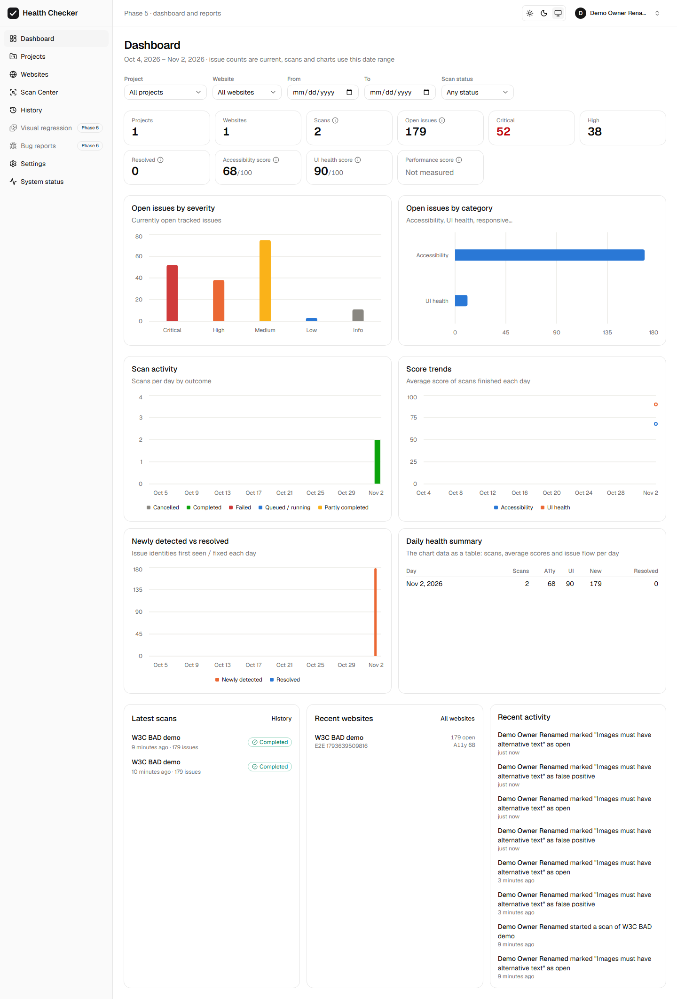 | 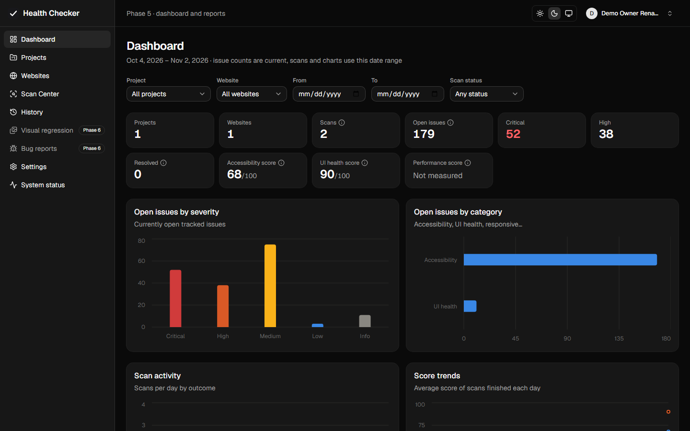 |
| 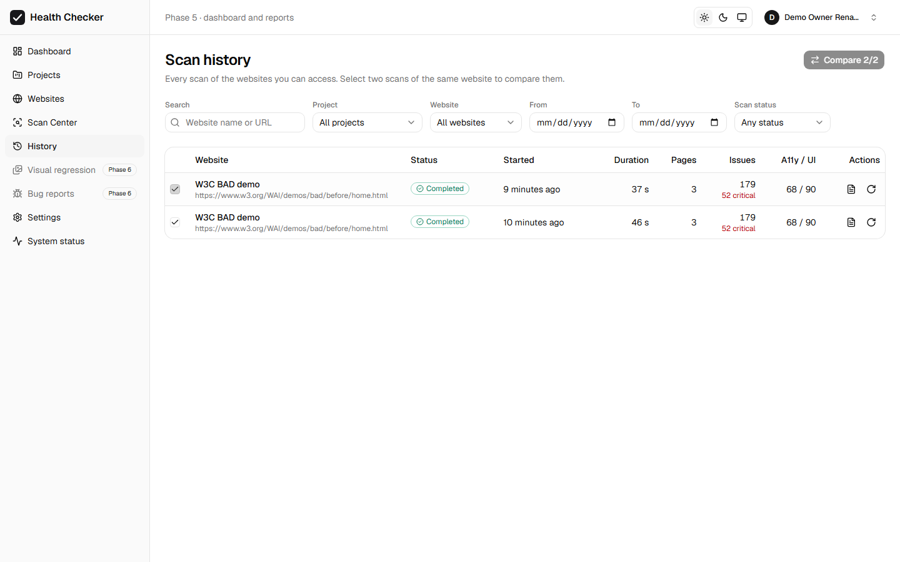 | 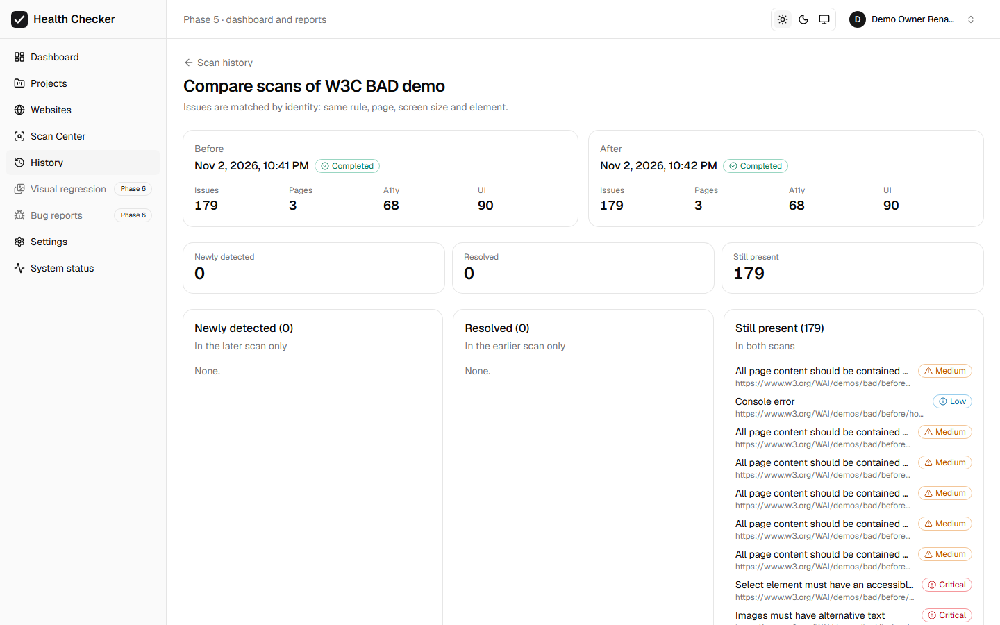 |
| 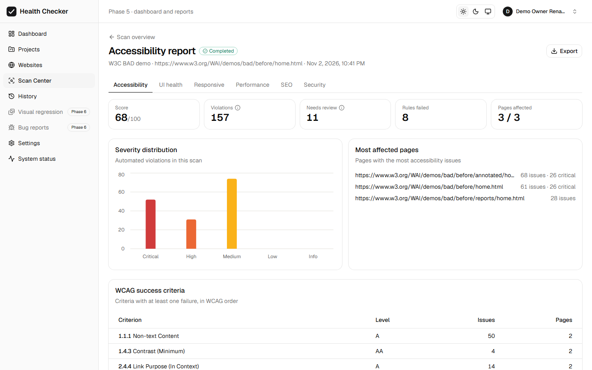 | 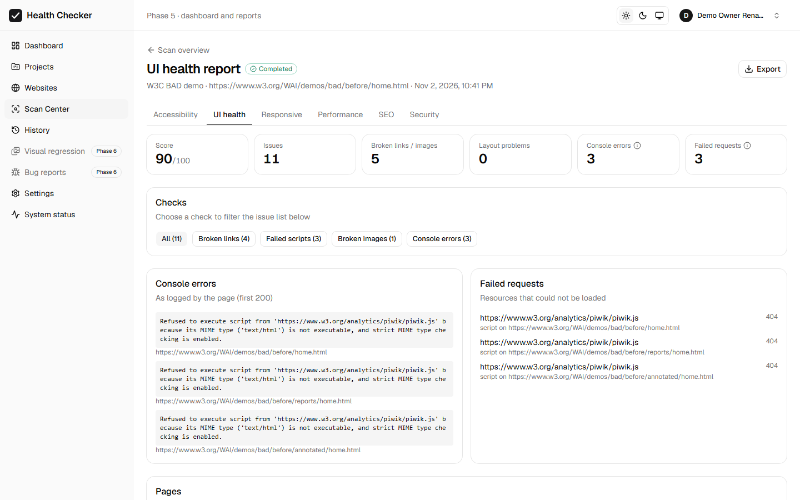 |
| 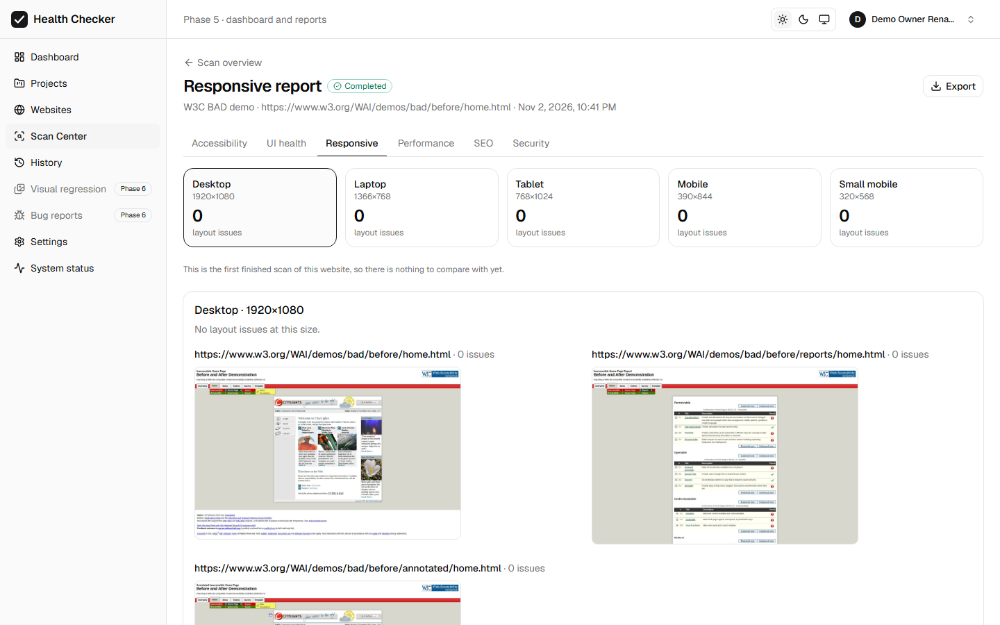 | 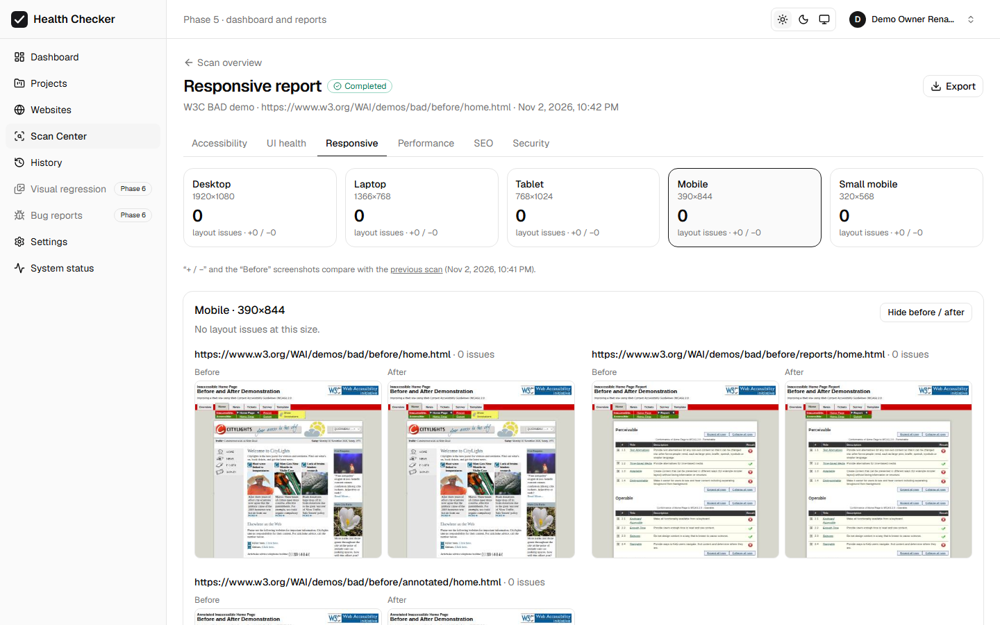 |
| 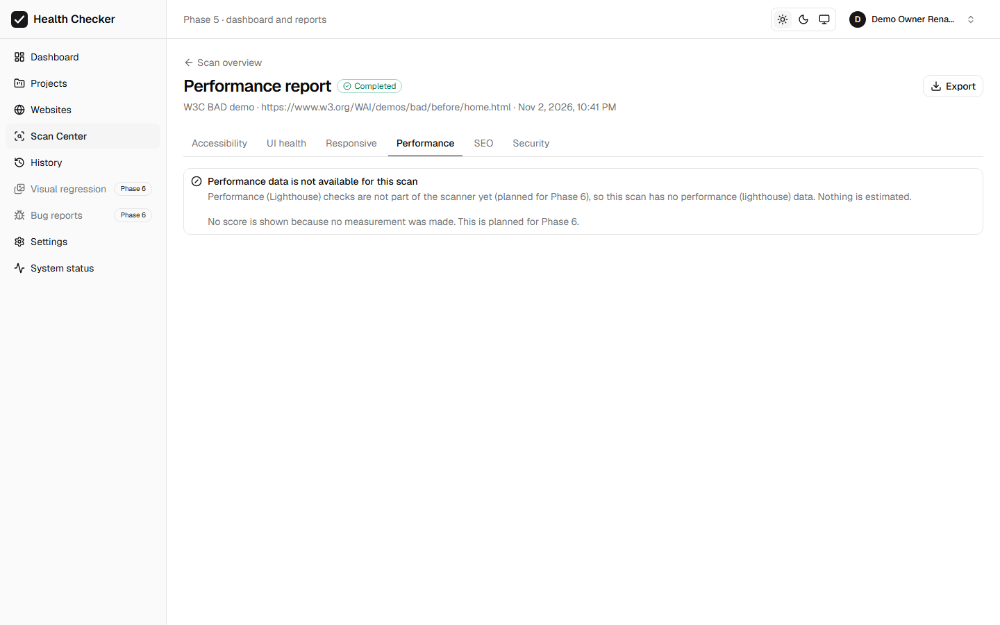 | 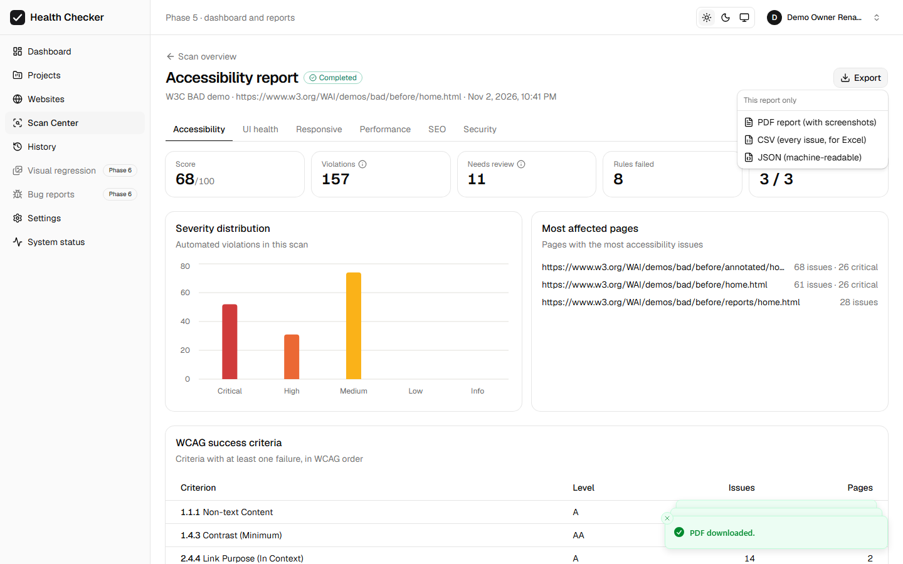 |
| 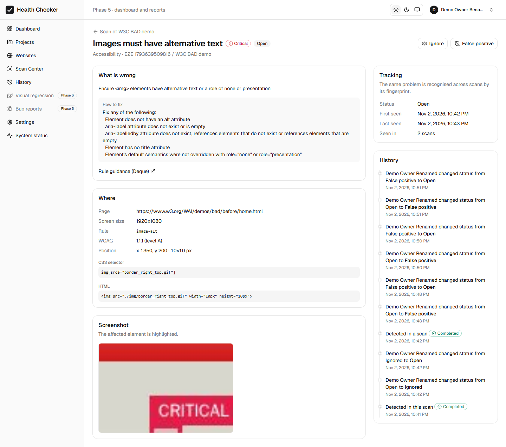 | 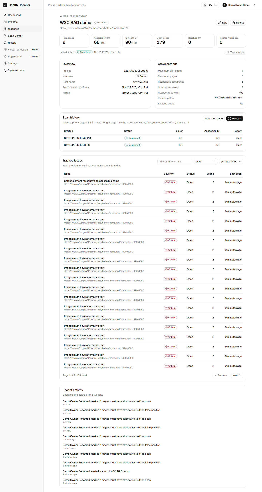 |
| 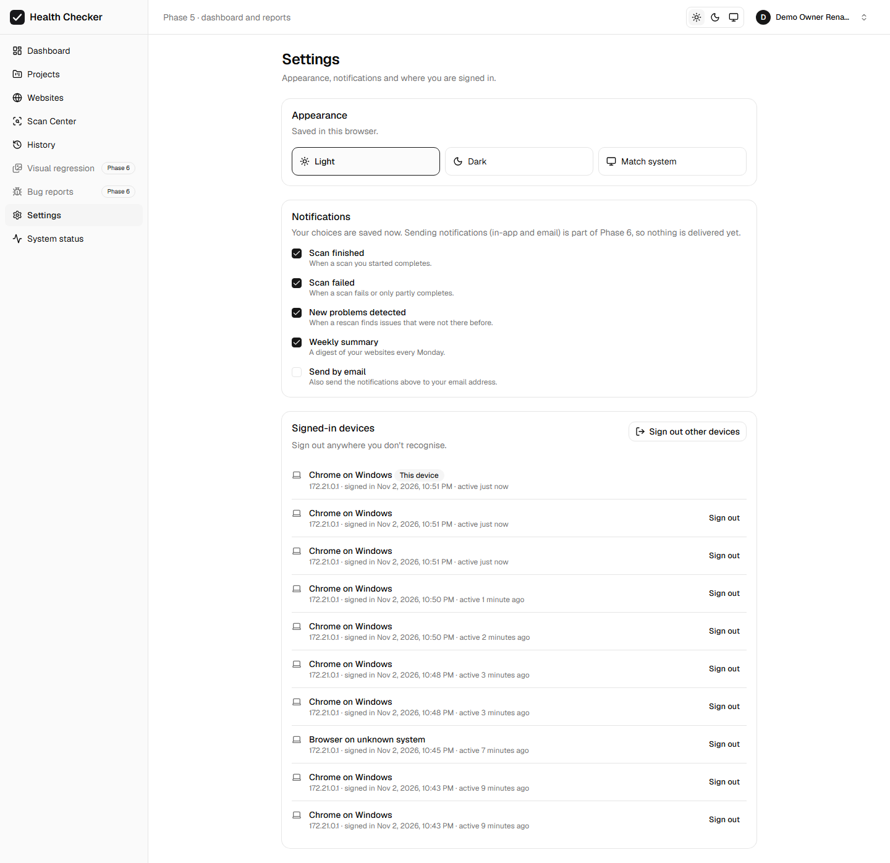 | 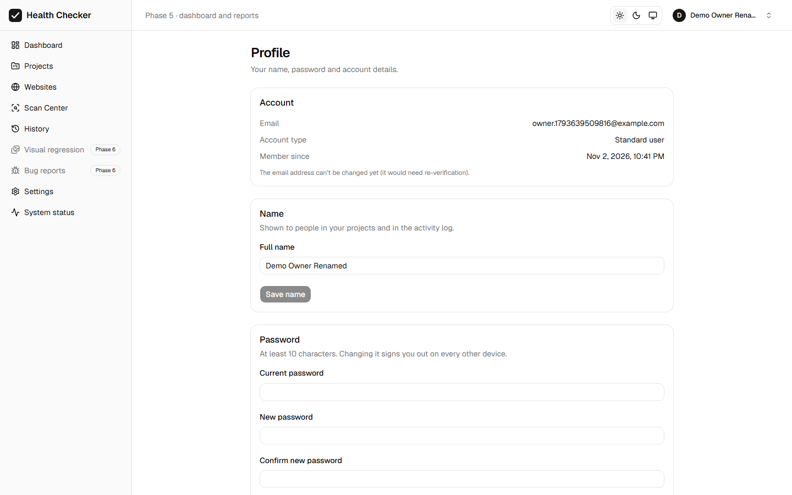 |
| 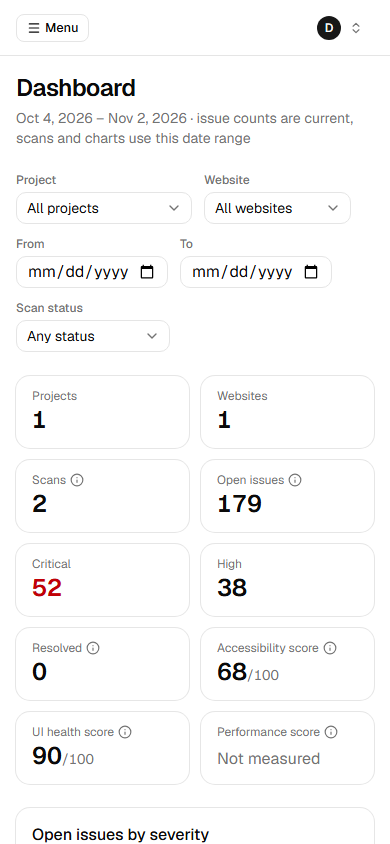 | 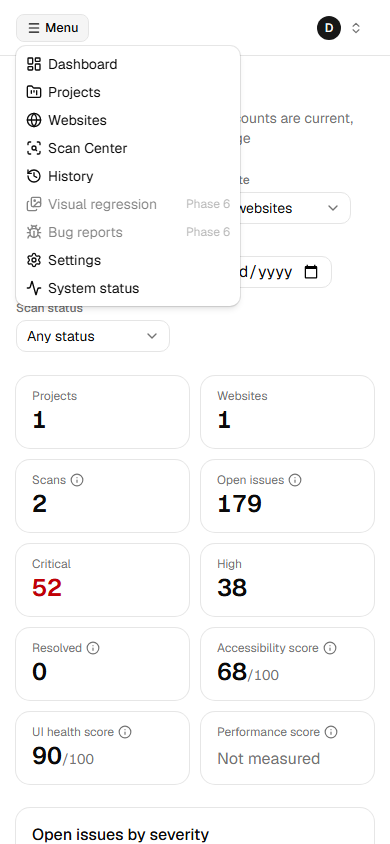 |
