# 13 · Phase 6: Advanced audits, AI, visual regression, bug reports, notifications

Phase 6 adds five new kinds of results to every scan and three tools around them:

| Feature | What you get | Where |
|---|---|---|
| **SEO audit** | Titles, descriptions, headings, canonical, robots directives, Open Graph, image alt, robots.txt, sitemap, duplicates across pages | Reports → SEO |
| **Security configuration audit** | HTTPS, certificate, http→https redirect, security headers, cookie flags, mixed content, version disclosure, each with a **finding level** | Reports → Security |
| **Performance (Lighthouse)** | Lighthouse scores, LCP, CLS, TBT, FCP, Speed Index, opportunities, slowest requests, history | Reports → Performance |
| **Visual regression** | PNG snapshots, baselines you choose, noise-tolerant comparison, before / after / diff | Reports → Visual, website page, sidebar |
| **Bug reports** | Structured reports built only from what the scanner recorded; copy as Markdown / Jira, download | Issue page → Create bug report, sidebar |
| **AI explanations** | Claude Sonnet explains an issue for beginners: why it matters, how to reproduce and fix it, with code | Issue page (optional) |
| **Notifications** | In-app (bell + page) and e-mail, with the real delivery outcome | Header bell, /notifications, Settings |
| **Storage cleanup** | Removes files nothing uses any more; optional retention | Scanner, hourly |

The rule from earlier phases still holds: **nothing is estimated or invented.** When
something could not be measured, the page says so and shows no number.

---

## 1. How a scan runs now

```
crawl pages (desktop)  →  other screen sizes  →  visual snapshots  →  broken links
→  Lighthouse  →  SEO  →  security  →  save scores  →  track issues  →  notifications
```

Every network request still goes through the **egress proxy**, which blocks private
and internal addresses (SSRF protection), including the new ones:

| New request | How it stays safe |
|---|---|
| Lighthouse | Drives a separate Chromium launched with the same proxy and lockdown flags as scans |
| robots.txt, sitemap.xml, the `http://` redirect check | The scanner's proxy-only HTTP client (as for link checks) |
| Certificate check | `CONNECT host:443` **through the proxy**, then a TLS handshake. The proxy re-checks the address; a test proves a tunnel to `127.0.0.1` is refused |

The scanner container is still only on the internal `scan-net` network.

New scores on each scan (all **our heuristics**, not certifications):

| Score | How |
|---|---|
| SEO | Same model as accessibility: 100 minus a penalty per problem, averaged over pages |
| Security | 100 minus a weight per failed check, counted once each (no HTTPS −40, invalid certificate −40, insecure form −20, mixed content −15, no CSP −15, no redirect / HSTS / frame protection −10, …) |
| Performance | Average Lighthouse performance score of the pages it ran on |

Scans made before Phase 6 have no SEO/security/performance data: their pages say
"No data for this scan" and the scores are empty, never 0 or 100.

---

## 2. SEO audit

Code: `apps/scanner/src/audits/seo.ts` (pure rules) and `audits/site-files.ts` (fetching).

The in-page check (`packages/dom-checks`) now also reads meta robots, Open Graph tags,
the heading outline and images without `alt`. The scanner turns that into issues:

| Check | Severity | When |
|---|---|---|
| Missing title | High | Empty or no `<title>` |
| Title length | Low | Outside 10–60 characters |
| Missing / short / long meta description | Medium / Low | Missing, or outside 50–160 characters |
| Duplicate title / description | Medium / Low | Same text (case and spaces ignored) on 2+ scanned pages |
| Missing h1 / several h1 | Medium / Low | |
| Skipped heading level | Low | e.g. h2 → h4 |
| Missing / invalid canonical | Low / Medium | Not a web address, or another website |
| noindex | Medium | `meta robots` or the `X-Robots-Tag` header (may be intended; ignore it then) |
| Missing Open Graph | Low | og:title / og:description / og:image |
| Images without alt | Low | Count per page (the accessibility report lists each image) |
| robots.txt missing / blocks everything | Low / High | HTTP status, `Disallow: /` for all crawlers |
| No XML sitemap | Low | The `Sitemap:` line in robots.txt (same host only) or `/sitemap.xml`; must be XML |

**Honesty rule:** if robots.txt or the sitemap **could not be requested** (blocked,
timeout), that is "could not be checked", never "missing".

This is technical on-page SEO only: no rankings, backlinks or content quality.

## 3. Security configuration audit

Code: `apps/scanner/src/audits/security.ts`, `audits/tls.ts`.

**Passive only.** We read what any visitor receives: response headers, the
**attributes** of cookies (never their values), the certificate and the page's own
HTML. No attack payloads, port scans, login attempts or exploit checks.

Every finding has a **level**:

| Level | Meaning | Examples |
|---|---|---|
| **Confirmed** | An insecure configuration we directly observed. Not a tested exploit. | Invalid/expired certificate, no HTTPS at all, scripts or forms using `http://` on an https page |
| **Warning** | A recommended protection is missing | No CSP, no HSTS, no frame protection, no nosniff, http not redirected, cookie without `Secure` on https, certificate expiring within 14 days |
| **Observation** | Worth knowing, often fine | Version numbers in `Server` / `X-Powered-By`, no Referrer-Policy (browsers default to a safe value), weak CSP sources, cookie without HttpOnly/SameSite |

Details:

- Header findings are reported **once per website** with the list of affected pages
  (headers usually come from one server config), not once per page.
- Mixed content is read from the page's HTML: Chrome blocks or upgrades such requests,
  so network logs alone would miss them.
- **Cookie values are never stored.** Since Phase 4 the scanner had kept full response
  headers, including `Set-Cookie` values; Phase 6 removes them before saving. A test
  sets a cookie with a secret-looking value and proves it appears nowhere in the database.

## 4. Performance (Lighthouse)

Code: `apps/scanner/src/audits/lighthouse.ts`. Lighthouse **13.5.0**, pinned (13.6.0
was only six days old).

- Mobile preset with simulated slow 4G and CPU slowdown, as PageSpeed Insights does.
- Pages per scan: the lower of the website's "Lighthouse pages" setting and
  `SCAN_MAX_LIGHTHOUSE_PAGES` (default 3), **one page at a time** (parallel runs skew timings).
- Stored: four category scores, FCP, LCP, CLS, TBT, Speed Index, opportunities (including
  Lighthouse 13 "insight" audits with time savings), slowest requests, warnings, and the
  full JSON (embedded screenshots removed; downloadable from the report).
- **INP is never shown as a number**: it needs real visitors. TBT is the lab stand-in,
  and the report says so.
- Issues are created only for metrics outside the "good" range (web.dev thresholds: LCP
  2.5 s, CLS 0.1, TBT 200 ms, FCP 1.8 s, Speed Index 3.4 s; "poor" above 4 s / 0.25 / 600 ms / 3 s / 5.8 s)
  and for opportunities saving at least 0.5 s.
- If Lighthouse fails, the page shows the reason and no score. A dropped network
  connection (busy public sites) gets **one** retry; page problems are not retried.
- Lab results vary by a few points between runs.

## 5. Visual regression

Code: `apps/scanner/src/audits/visual.ts`, `apps/api/src/modules/visual/`.

1. **Snapshots:** each scan takes PNG snapshots (desktop 1920×1080 and mobile 390×844) of the
   first `SCAN_VISUAL_PAGES` pages (default 3), plus every page that has a baseline.
   Animations, transitions and the text caret are frozen, fonts are awaited, and height
   is capped at 4,000 px.
2. **Baselines change only by explicit action.** In Reports → Visual an editor clicks
   **Use as baseline** (or later **Accept as new baseline**). The scanner copies the image
   into a website-owned file. The API cannot write storage (read-only mount), so it asks the
   scanner through the job queue. Scans only ever *read* baselines; a test proves the
   baseline is unchanged after scans with real differences.
3. **Comparison that ignores noise:**
   - pixelmatch with anti-aliasing detection (anti-aliased edges don't count);
   - the image is split into 32×32 blocks; a block counts as changed only when 8 or more of its pixels differ (stray pixels are dropped);
   - **Unchanged** = identical; **Minor** = below the baseline's threshold (default 0.5 %); **Changed** = above it, or the page got more than 5 % taller or shorter.
4. **Ignore areas:** CSS selectors (clock, carousel, ads). Their areas are measured on the
   current page and blanked in **both** images (rectangles are available through the API).
5. The report shows baseline, this scan and a red diff image, plus the changed regions.

Limits: very dynamic pages need ignore selectors; content below 4,000 px is not compared;
only desktop and mobile sizes.

## 6. Bug reports

Code: `apps/api/src/modules/bug-reports/builder.ts`.

A report is built from a stored issue. Nothing is invented:

| Field | Source |
|---|---|
| Browser | Exact Chromium version recorded by the scan ("not recorded" for older scans) |
| Viewport | The issue's screen size (Lighthouse issues: "Mobile (Lighthouse emulation)") |
| Steps | Open URL at size → find the CSS selector → the check that failed (axe rule, the resource and its HTTP status, the response header to read, Lighthouse) |
| Expected | Only where the check defines it: axe requirement, SEO expected value, recommended header, Lighthouse threshold, what a UI check guarantees. **Otherwise empty**, shown as "Not determined by the scanner" |
| Actual | axe failure summary, SEO found value, observed header value, measured metric |
| Screenshot | The element crop, else the page screenshot |
| Priority | From severity (critical P1 … low/info P4), editable |

One open report per issue (asking again opens it). Editors can edit fields and status.
Everyone in the project can read, **Copy Markdown**, **Copy for Jira** (wiki markup) and
download `.md` / Jira text / JSON. Creating Jira tickets automatically is not part of this phase.

## 7. AI explanations (Claude Sonnet)

Code: `apps/api/src/lib/ai-provider.ts`, `apps/api/src/modules/ai/`.

- **Model:** `claude-sonnet-5-5` by default (`CLAUDE_MODEL`). Official SDK `@anthropic-ai/sdk`
  1.3.0, **structured outputs**: the answer must match a fixed JSON shape (summary, why it
  matters, who is affected, how to reproduce, how to fix, code example, limitations), and it is
  validated again before saving. Reasoning effort is set to "low" (an explanation, not deep analysis).
- **What is sent:** only from the server, built from the database. The browser sends just the
  issue ID. Rule, WCAG, severity, description, selector and a **redacted** HTML snippet.
  Removed first: URL query strings and fragments, `value=`/`data-*`/inline handler values,
  e-mail addresses, long token-like strings; the HTML is cut to 1,200 characters.
  **Never sent:** cookies, headers, screenshots, other pages, user data.
- **Prompt injection:** page content is inside `<untrusted_page_data>` and the instructions
  say never to follow anything written there. Answers are shown as text and code blocks
  only, never as HTML.
- **Cost controls:**
  - one answer per issue, **reused** for the same problem in later scans (no new call);
  - `AI_USER_HOURLY_LIMIT` (20/hour per user);
  - `AI_DAILY_REQUEST_LIMIT` (200/day for everyone);
  - `AI_MAX_OUTPUT_TOKENS` (2,500);
  - token usage stored per answer and shown in `/api/ai/status`.
- **Errors:** typed SDK errors become friendly messages (bad key, busy, unavailable,
  refused, incomplete). Nothing is saved on failure.
- **Optional:** with no `ANTHROPIC_API_KEY` the card says "not set up on this server" and
  everything else works. The key stays in the API process: it is not part of the app config,
  never logged (log redaction added) and never sent to the browser.

### Enabling AI (PowerShell)

```powershell
cd C:\Users\Lenovo\Desktop\website
notepad .env          # set ANTHROPIC_API_KEY=sk-ant-...   (never commit this file)
docker compose up -d --force-recreate api      # Docker
# or restart "npm run dev" for development

# Optional: one real call to Claude to check the key (costs a few cents)
$env:RUN_LIVE_AI_TEST = "1"; npm run test -w @whc/api -- src/modules/ai; Remove-Item Env:RUN_LIVE_AI_TEST
```

## 8. Notifications

Code: `apps/scanner/src/notifications.ts`, `apps/api/src/lib/notification-email.ts`.

- When a scan finishes, the **user who started it** gets in-app notifications, following
  their Settings:
  - **Scan finished** (completed);
  - **Scan failed** (failed or partly completed);
  - **Changes detected**: new problems, fixed problems that came back, or visual changes
    above the threshold, compared with the previous scan. Never on a website's first scan.
- **E-mail:** the scanner cannot reach a mail server (it is on the internal network), so it
  queues a job; the **API** sends it with the existing mailer and records the real outcome:
  SENT (with time), FAILED (short safe reason, after 3 attempts), or NOT_REQUESTED.
  The UI says "E-mail sent" **only** for SENT.
- Weekly summary e-mails are **not built yet** (they need scheduled jobs). The setting is
  shown as unavailable.

### E-mail setup

Development and Docker use **Mailpit** (inbox: http://localhost:8025); no real e-mail
leaves the machine. For real delivery set in `.env`:

```
SMTP_HOST=smtp.your-provider.com
SMTP_PORT=587
SMTP_USER=...
SMTP_PASSWORD=...
MAIL_FROM="Website Health Checker <no-reply@your-domain.com>"
APP_URL=https://your-app-address      # used for links in e-mails
```

## 9. Storage cleanup

Code: `apps/scanner/src/maintenance.ts`. Runs when the scanner starts and every hour.

| What | When |
|---|---|
| `scans/<id>/` folders | The scan no longer exists (deleted scan or website) and the folder is over 1 hour old |
| Baseline images | No baseline uses the image row (deleted website), or no row points to the file (replaced baseline) |
| Temporary PDF exports | Older than 10 minutes |
| Retention (`SCAN_RETENTION_DAYS`, **0 = off**) | Page/issue screenshots and raw Lighthouse JSON of older scans. Never deleted: each website's latest scan, bug report screenshots, visual snapshots, and the Lighthouse numbers themselves |

## 10. New settings

| Variable | Default | Purpose |
|---|---|---|
| `SCAN_LIGHTHOUSE_ENABLED` | `true` | Lighthouse on/off |
| `SCAN_MAX_LIGHTHOUSE_PAGES` | `3` | Upper limit of Lighthouse pages per scan |
| `SCAN_LIGHTHOUSE_TIMEOUT_MS` | `90000` | Per page |
| `SCAN_VISUAL_PAGES` | `3` | Pages with visual snapshots (0 = off) |
| `SCAN_RETENTION_DAYS` | `0` | Retention cleanup (0 = keep) |
| `AI_USER_HOURLY_LIMIT`, `AI_DAILY_REQUEST_LIMIT`, `AI_MAX_OUTPUT_TOKENS` | `20`, `200`, `2500` | AI cost controls |

## 11. Database changes (5 migrations)

| Migration | Adds |
|---|---|
| `phase6_seo_audit` | SEO check types; `ScanPage.seoData`; `Scan.siteChecks` |
| `phase6_security_audit` | Security check types; `SecurityFindingLevel`; `SecurityIssue.findingLevel` |
| `phase6_visual_regression` | `VisualComparison.status` + `details` |
| `phase6_bug_reports` | `Scan.browserVersion` |
| `phase6_notifications` | `Notification.emailStatus`, `emailedAt`, `emailError`, `metadata` |

The other Phase 6 tables (`PerformanceResult`, `VisualBaseline`, `BugReport`, `AiInsight`,
`Notification`) were designed in Phase 2 and are now used.

## 12. New API endpoints

| Endpoint | Purpose |
|---|---|
| `GET /api/reports/:scanId/seo` · `security` · `performance` | Real reports (were placeholders) |
| `GET /api/reports/:scanId/lighthouse/:resultId` | Raw Lighthouse JSON (download) |
| `GET/POST /api/visual/websites/:id/baselines`, `PATCH/DELETE /api/visual/baselines/:id`, `POST …/replace`, `GET …/comparisons`, `GET /api/visual/scans/:scanId`, `GET /api/visual/baselines` | Visual regression |
| `POST/GET /api/bug-reports`, `GET/PATCH/DELETE /api/bug-reports/:id`, `GET …/export?format=markdown\|jira\|json` | Bug reports |
| `GET /api/ai/status`, `GET /api/ai/issues/:id`, `POST /api/ai/issues/:id/explain` | AI |
| `GET /api/notifications`, `GET …/unread-count`, `POST …/:id/read`, `POST …/read-all` | Notifications |

Exports (`/api/reports/:id/export`) accept the new categories PERFORMANCE, SEO and SECURITY;
PDFs show the new scores and security finding levels.

---

## 13. How Phase 6 was verified

### Automated: `npm run check`, **417 passed, 0 failed, 1 skipped**

| Package | Tests | New in Phase 6 |
|---|---|---|
| shared | 73 | |
| db | 11 | |
| egress-proxy | 55 | |
| scanner | 78 | SEO rules 12, security rules + real TLS through the proxy 18, Lighthouse 6, visual 7, notifications 4, cleanup 2, full-scan tests: SEO, security (cookie value never stored), **real Lighthouse through the proxy**, visual baseline flow |
| api | 151 + 1 skipped | Reports (SEO, security, performance, Lighthouse download), visual 6, bug reports 9, AI 12 (+ 1 opt-in live), notifications 4 |
| web | 49 | SEO, security, performance, visual, bug reports, AI, notifications pages |

The skipped test is the **opt-in live Claude call**: no API key is configured yet.

### Docker, end to end (production images, http://localhost:8081): 26 checks

Two real scans of the W3C "BAD" demo (2 pages) through the Docker scanner and proxy:

| Check | Result |
|---|---|
| Scan + scores | Completed in ~40 s; SEO 95, security 97, performance 98–99; Chromium 156.0.8078.80 recorded |
| SEO | robots.txt HTTP 200; sitemap HTTP 404 (reported); 5 checks; counts = database |
| Security | Real certificate read **through the proxy** (w3.org, TLSv1.3, 32 days left); `http://www.w3.org/` → 301 to https; one Observation (no Referrer-Policy) |
| Lighthouse | Ran inside the Linux container through the proxy: LCP ≈ 0.9–1.4 s, TBT 139–152 ms; raw JSON (≈ 270 KB) downloads |
| Visual | 4 snapshots; Viewer refused (403); baseline created by the scanner worker, file present; rescan **Unchanged, 0 %**; baseline untouched |
| Notifications | In-app notification; e-mail **really received by Mailpit** and recorded as SENT |
| Bug report | Viewer refused; built from a real issue with the Chromium version; Markdown and Jira exports |
| AI | Not configured → 503 `AI_NOT_CONFIGURED`, the rest works |
| PDF | Security-only PDF generated in Docker |
| Storage cleanup | Deleted a scanned website through the API, backdated its files and baseline image row by 2 hours (to stand in for "older than 1 hour"), restarted the scanner: both scan folders, the orphan baseline row and its file were removed |

**Problems found and fixed during Docker verification:**

1. In one run, w3.org dropped connections and Lighthouse could not load the page
   (`ERR_TUNNEL_CONNECTION_FAILED`, seen in the proxy log as "socket ended by the other party").
   It was handled honestly (no score, reason stored). Lighthouse now retries such network
   errors once; the re-run measured both scans.
2. Deleting a website left its baseline image row behind, so the cleanup kept the file. The
   cleanup now removes baseline image rows no baseline uses, then the files.
3. Small: header still said "Phase 5"; bug report scan dates now say "(UTC)".

### Real browser (Playwright Chromium against Docker): 20 checks

All six reports plus the Visual tab render real data. The performance trend chart is
shown. The AI card says "not set up". Create bug report opens the existing report, and
Copy Markdown fills the clipboard. Notifications show "E-mail sent". Weekly summary is
shown as unavailable.

On a 390×844 phone, seven new pages have no horizontal scrolling. A Viewer sees no
baseline, bug report or edit buttons. No page errors and no unexpected HTTP errors.

**Docker logs:** no warnings or errors in scanner, proxy, web or redis since the final
rebuild; one expected API warning (`COOKIE_SECURE=false` for local http). Searched all
logs for API keys, cookie values and passwords: none.

### Not verified (and why)

- **Live Claude API:** no key yet. Verified with a fake provider; the opt-in live test is ready.
- **A "Changed" visual result and a "Changes detected" notification in Docker:** a public
  site cannot be changed on demand. Both are verified by automated tests with a real browser
  on a fixture page (snapshot → baseline → unchanged → real change detected) and the
  notification rules.
- **Real (non-Mailpit) SMTP delivery:** needs your mail server settings.

## 14. Known limitations

- Lighthouse: mobile only, lab data, ±few points between runs; ~10–30 s per page; INP not measurable.
- SEO: technical on-page checks only; sitemap contents are not validated beyond being XML.
- Security: passive configuration checks, not a penetration test; only the start page's host
  certificate and redirect are checked; cookies only from the main documents of scanned pages.
- Visual: desktop + mobile only, 4,000 px height, ignore regions by selector (rectangles via API only).
- Bug reports: no automatic Jira ticket creation; no PDF for single bug reports (scan PDFs exist).
- AI: needs an Anthropic key; explanations are AI-written and labelled as such.
- Notifications: only the user who started the scan; weekly summaries and scheduled scans
  are deferred.
- Retention cleanup is off by default.

## Screenshots

| | |
|---|---|
| 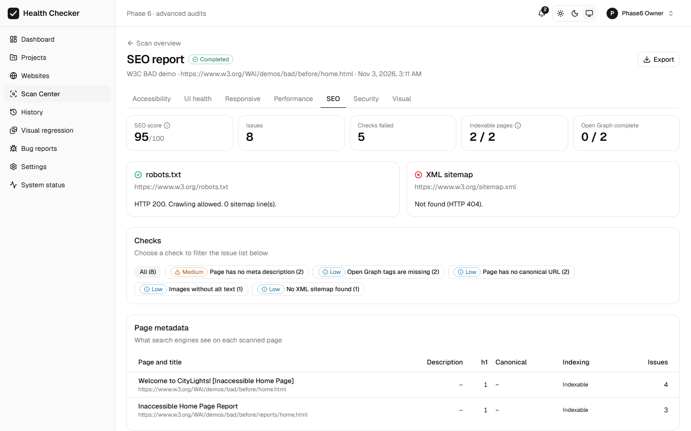 | 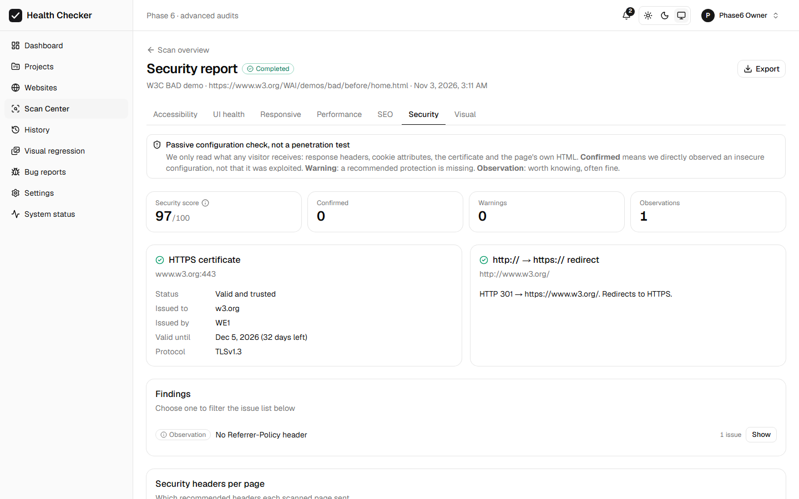 |
| 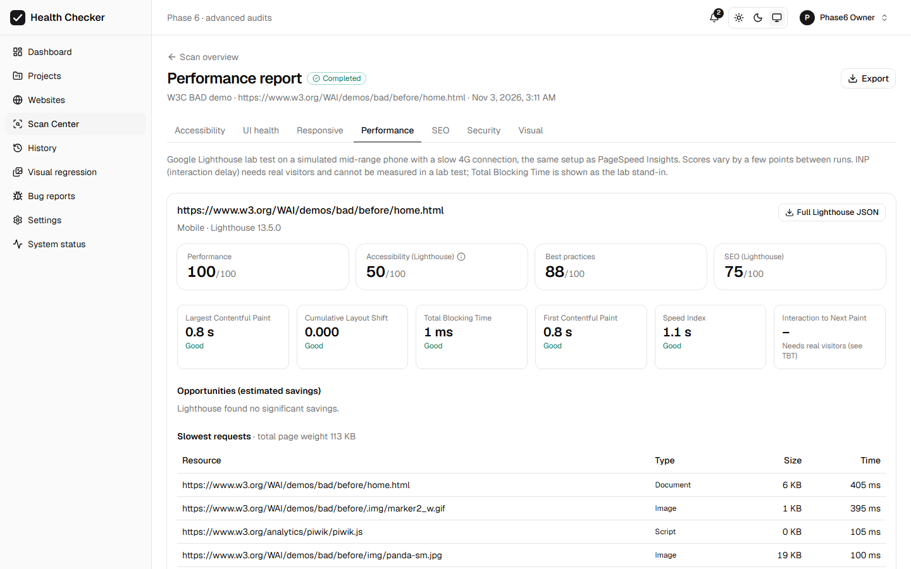 | 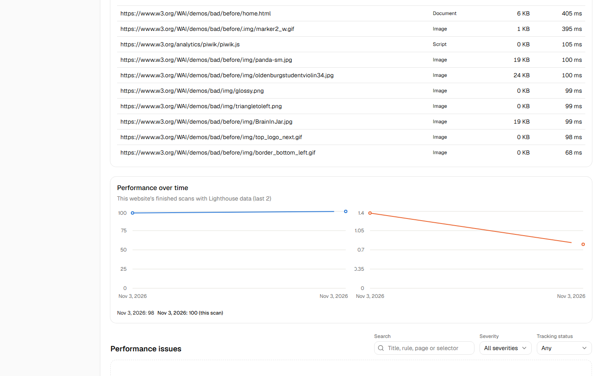 |
| 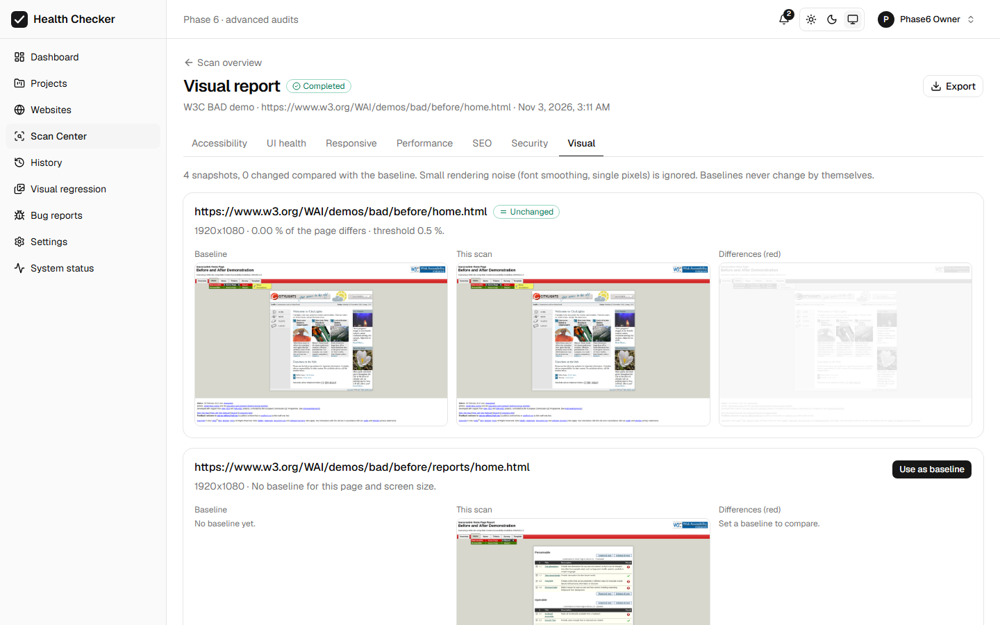 | 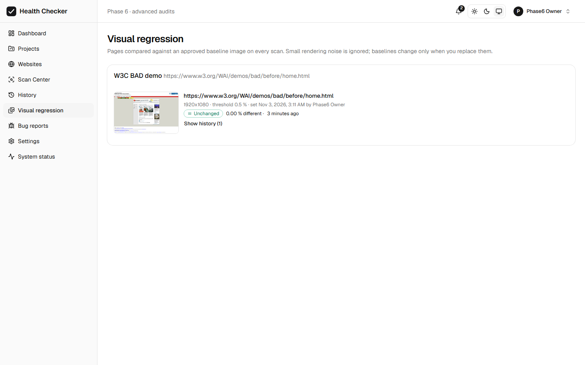 |
| 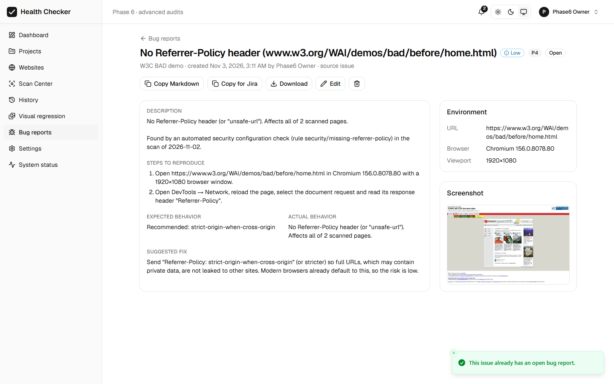 | 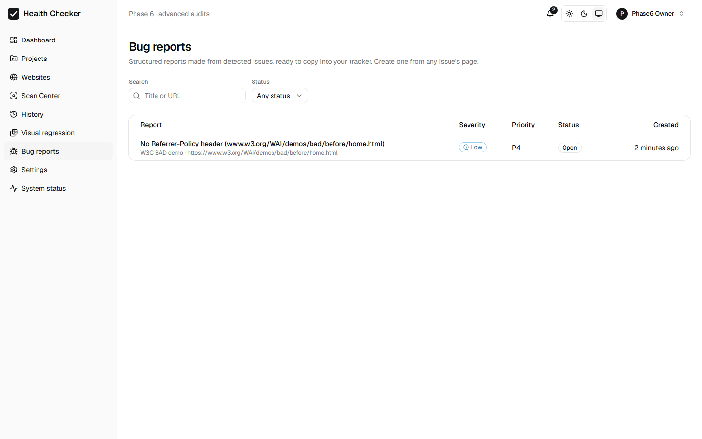 |
| 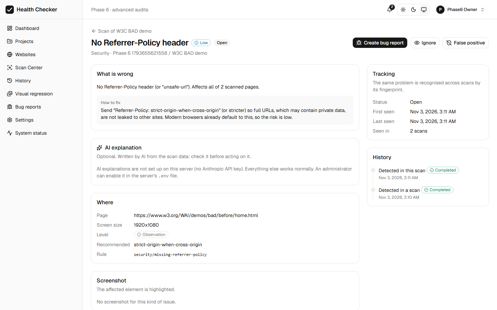 | 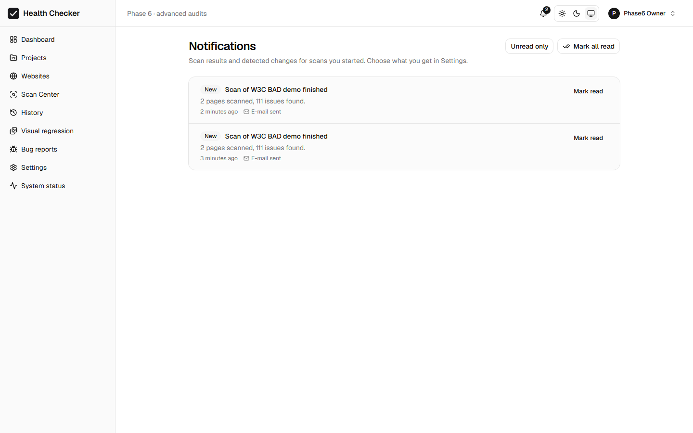 |
| 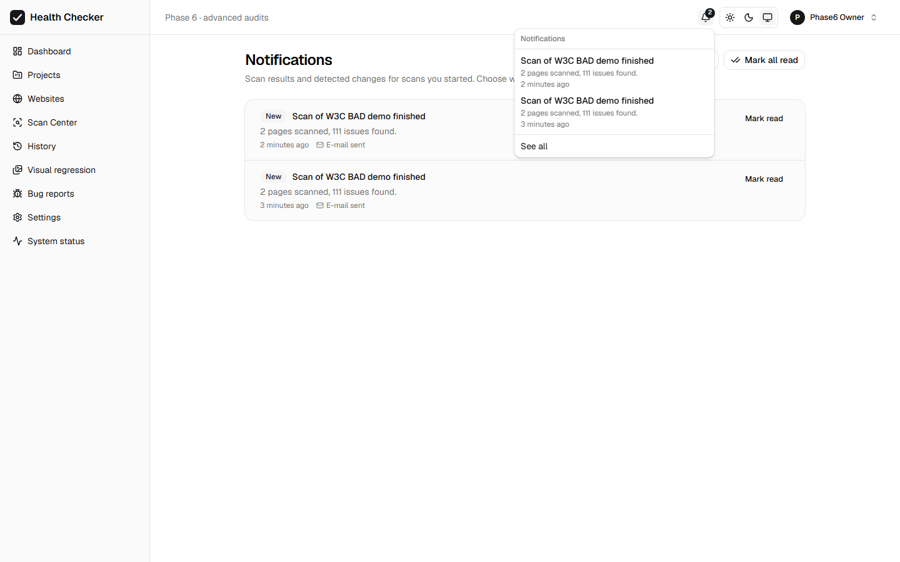 | 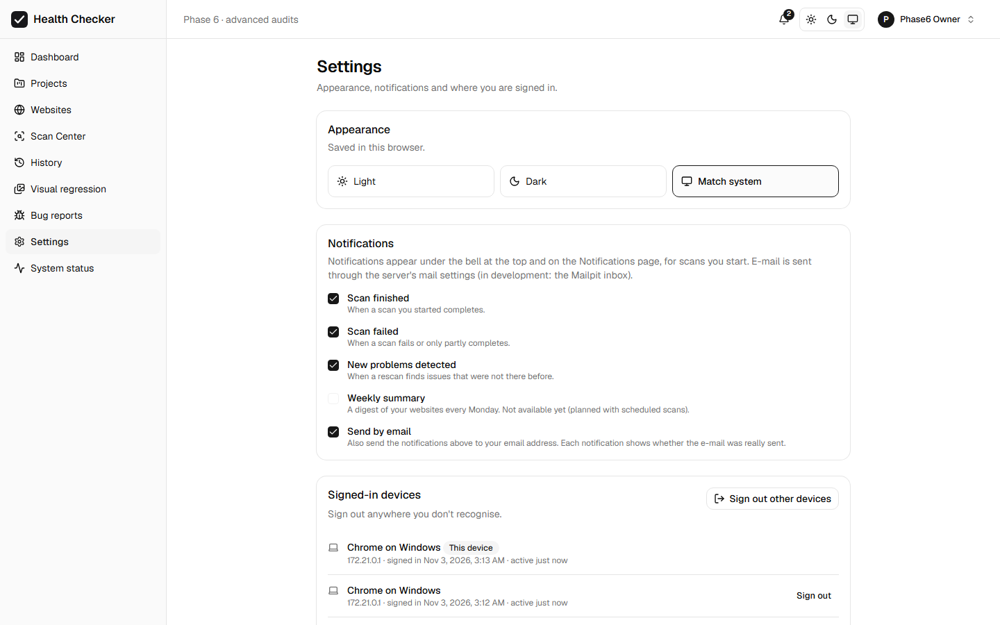 |
| 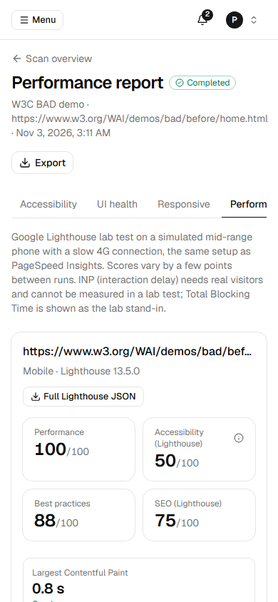 | |
