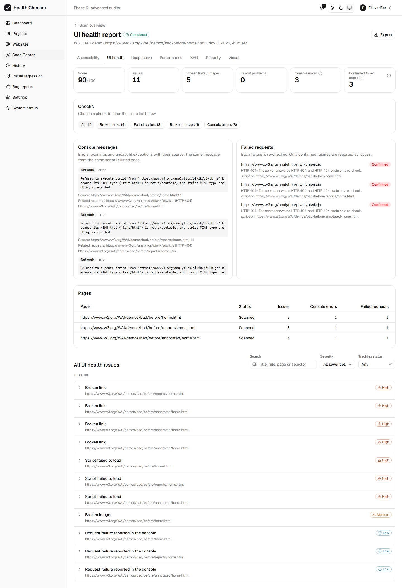
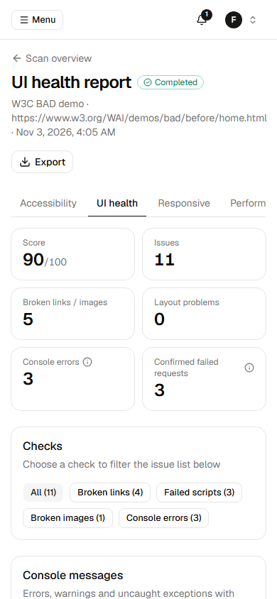

# Scanner reliability fixes: resource verification and console classification

Done after Phase 6 and before Phase 7. It fixes two sources of false or misleading
results. SSRF protection is unchanged: every re-check goes through the same egress proxy
and policy as the browser.

## 1. Broken images, scripts, stylesheets and links

### The problem

The browser reports a failed resource with a Chrome network error such as
`net::ERR_FAILED`. That error only means "this did not load". Chrome reports the same kind
of error for dropped connections, cut-off downloads, timeouts, responses it refuses and
connections our proxy refused. Before this fix:

| Where | What went wrong |
|---|---|
| `checks/collectors.ts` | Every failed request became an issue (`BROKEN_IMAGE`, `FAILED_SCRIPT`...), with no second look |
| `checks/collectors.ts` | Every `ERR_TUNNEL_CONNECTION_FAILED` was treated as "blocked by policy", even when the site was simply unreachable, so a real problem was hidden as "our policy" |
| `pipeline/run-scan.ts` link check | "Unreachable" (any connection failure) was reported as a broken link; one HEAD 404 was enough (some servers answer HEAD wrongly); a single 5xx was reported |
| DOM check | An image that did not display was reported without knowing why |

### How it works now

**The proxy says why it did not deliver a response.** Two headers are set
(`packages/shared/src/egress.ts`): `x-whc-egress-blocked` and `x-whc-egress-reason`. For
HTTPS, a client only sees the CONNECT status code, so each reason has its own status:

| Reason | Status | Meaning |
|---|---|---|
| `policy` | 403 | Private, internal or reserved address, or a port that is not allowed (SSRF protection) |
| `dns-not-found` | 502 | The domain does not exist |
| `dns-error` | 503 | DNS failed temporarily |
| `unreachable` | 504 | Could not connect, or the connection broke |

**Every failed resource is re-checked once** (`checks/verify-resources.ts`). The re-check
is a GET through the egress proxy, with an 8 s timeout. A page gets at most 15 re-checks,
4 at a time. The result is a **verdict** (`audits/resource-check.ts`):

| Verdict | When | Issue? |
|---|---|---|
| `CONFIRMED` | The site answered with an error (4xx; or 5xx on the first try **and** on the re-check); the domain does not exist; the HTTPS certificate is invalid; Chrome refused the response (`ERR_BLOCKED_BY_ORB/RESPONSE`); the server sends something that is not an image for an `` | Yes |
| `INCONCLUSIVE` | Timeout, connection refused or reset, temporary DNS failure, HTTP 429, a 5xx only once, or the resource **loaded fine on the re-check** | No; listed in the report |
| `BLOCKED_BY_POLICY` | Our proxy refused it (private or internal address) | No; listed in the report |

The verdict and a one-sentence reason are stored on each failed request
(`ScanPage.failedRequests`). They also appear in the issue description, for example: "…
could not be loaded. The server answered HTTP 404, and HTTP 404 again on a re-check."

**Images the DOM check finds broken** (`complete` but `naturalWidth = 0`) are handled as
follows:
- **The server sent a non-image content type.** For example, an HTML error page served
  with status 200. This is confirmed without a re-check.
- **The server sent `image/*`, but the image does not display.** This can be a corrupt
  file or an interrupted download, so it is re-checked. If the re-check returns a
  non-image type, the image is confirmed. If the image loads normally, the result is
  inconclusive. This case came up in the regression fixture: Chrome fired no
  `requestfailed` event for a download that was cut off.
- `data:` images that cannot be decoded are confirmed.

**Links** (`checkLink`): HEAD first. If HEAD does not succeed, GET confirms it.
- **Confirmed broken:** 404/410; 5xx on both HEAD and GET; a domain that does not exist;
  an invalid certificate.
- **Not reported:** 401/403/405/407/429. These are logins, or servers that refuse
  automated requests.
- **Visited pages:** a page the browser loaded with 404/410 counts as confirmed. A visited
  page with a 5xx is re-checked.
- **Unverified links** (inconclusive or blocked by policy) are saved in
  `Scan.siteChecks.links` and shown in the UI health report under "Links that could not
  be verified".

## 2. Console errors

### What is captured

`checks/collectors.ts` now records:
- **Console errors and warnings:** the original text, plus the script URL, line and
  column, from Playwright's `ConsoleMessage.location()`. Lines and columns are counted
  from 1.
- **Uncaught exceptions:** the message, the first 6 stack lines, and the file, line and
  column of the first stack frame.
- **Failed requests:** these stay a separate list. Each console message is **linked** to
  them in one of two ways:
  - `mentioned`: the message contains the request URL;
  - `same-service`: the request went to the same domain as a URL in the message, or as
    the third-party script that logged it, e.g. `api.storyblok.com` for a message
    linking to `www.storyblok.com`.

  The site's own failures are not linked just because the site logged something.
- Chrome's "Failed to load resource" console line is still skipped, because the failed
  request itself is recorded and re-checked.

### Classification (`checks/console-classify.ts`)

| Kind | How it is recognised | Severity |
|---|---|---|
| `INTEGRATION_CONFIG` | Missing or invalid API key, access token, site key or client ID; "unauthorized"/"forbidden"; invalid domain or origin; "not configured". Also a 401/403 from **another** service that the message is linked to | MEDIUM (LOW for a warning) |
| `APPLICATION` | Anything else from the site's own scripts | Exception HIGH, console error MEDIUM |
| `THIRD_PARTY` | Logged by a script from another domain | Exception MEDIUM, console error LOW |
| `NETWORK` | "Failed to fetch", `net::ERR_*`, CORS; or the message names a failed request (e.g. "Refused to execute script from '…' because its MIME type…") | LOW (the request is reported on its own after its re-check) |
| `HARMLESS` | Deprecation, violation and intervention notices, source-map warnings, unused preloads; any other warning | Not an issue; kept on the page record |

Rules that keep real defects visible:
- Uncaught exceptions are **never** classified as harmless.
- A 401 from the site's **own** API is not treated as a configuration error. It often
  means "not logged in", so the message stays `APPLICATION`.
- Only warnings that look like configuration problems become (LOW) issues.

**Grouping and duplicates:**
- On a page, messages with the same kind, normalized text and script path form one
  group: "Logged 2 times on this page". Normalizing removes numbers, ids, hashes and
  query strings.
- `INTEGRATION_CONFIG`, `THIRD_PARTY` and `NETWORK` problems are site-wide (a missing
  token is the same problem on every page). They have one fingerprint per scan, stable
  across scans.
- `APPLICATION` errors stay per page.
- The UI health report shows each message once, with "and N more page(s)".

**Storyblok example (regression test).** Message: "You need to provide an access token to
interact with Storyblok API. Read https://www.storyblok.com/docs/…". The scanner records:
- **Kind:** `INTEGRATION_CONFIG`, titled "Integration not configured correctly", severity
  MEDIUM.
- **Location:** source `…/storyblok/app.js:4:<column>`.
- **Related request:** the request to `api.storyblok.com` (HTTP 401, `same-service`).
  That request is reported separately as a confirmed failed request.

## 3. Tests

| Suite | Tests | What it proves |
|---|---|---|
| `apps/scanner/test/classification.test.ts` | 19 | Verdict rules (ERR_FAILED alone is never confirmed; 404 on the re-check, missing domain, invalid certificate and ORB are; 5xx needs two; 429 is inconclusive); image handling; the Storyblok message and its 401 request; site 401 ≠ configuration; site code, third-party, network, harmless; MIME-type echo; grouping; normalization; stack frames |
| `apps/scanner/test/reliability.test.ts` | 8 | Real Chromium and proxy on fixture pages. `tests/fixtures/sites/resources/` must report: a 404 image, an HTML page served as an image, a missing domain, a missing CSS file, a 404 link and an always-500 link. It must **not** report: a download cut off in the browser, an unreachable port, a private address. `tests/fixtures/sites/storyblok/`: the Storyblok token error with source, line, column and its 401 request; a grouped repeated error; an application exception (HIGH); a third-party widget exception; a harmless deprecation warning (no issue) |
| `apps/egress-proxy` | 59 | Policy is unchanged (all earlier SSRF tests pass); new tests cover reasons for 502/503/504, CONNECT status codes, and responses that break off mid-body |

The third-party hosts in the tests (`api.storyblok.com`, `widgets.thirdparty-cdn.test`)
are mapped to the local fixture server by the **test** proxy only (`testHostMap`, refused
when `NODE_ENV=production`). Storyblok is never contacted.

## 4. Docker verification

Rebuilt `egress-proxy`, `scanner`, `api` and `web`; all 9 checks passed.
- **From inside the scanner container:**
  - `10.0.0.1` and `169.254.169.254` → 403 `policy`.
  - `no-such-host.invalid` → 502 `dns-not-found`.
  - `https://www.w3.org/` → 200.
- **A real scan of the W3C BAD demo (3 pages):**
  - Every failed request has a verdict and every console message is classified.
  - 85 links checked, 4 confirmed broken, 0 inconclusive.
  - `piwik.js` (404 twice) is a confirmed `FAILED_SCRIPT`. Chrome's "Refused to execute
    script … MIME type" echo is now `NETWORK` (LOW), not a site-code error.
  - One confirmed broken image: the demo serves that URL as `HTTP 300 text/html`.

**Real browser:** the UI health report of that scan renders on desktop and on a 390 px
phone with no horizontal scrolling, no page errors and no failed API calls. It shows:
- console messages with their kind, source and line;
- failed requests with their verdict and reason;
- the "Confirmed failed requests" tile.

| Desktop | Phone |
|---|---|
|  |  |

## 5. Limitations

- A re-check happens a few seconds after the page load. An outage that recovers in
  between is reported as inconclusive, not broken.
- At most 15 re-checks per page. Beyond that, only the site's own 4xx answers count as
  confirmed.
- A corrupt file served as `image/*` that downloads completely on the re-check is
  reported as inconclusive. The scanner does not decode images itself.
- Classification uses text patterns and domains. An unusual configuration message can be
  classified as `APPLICATION`; it is still reported, never hidden.
- "Same service" compares the last two domain labels (three for `co.uk`-style suffixes),
  not the full public-suffix list.
- Scans made before this change have no verdicts or kinds. The report shows "Not
  re-checked" or "Not classified" for them.
