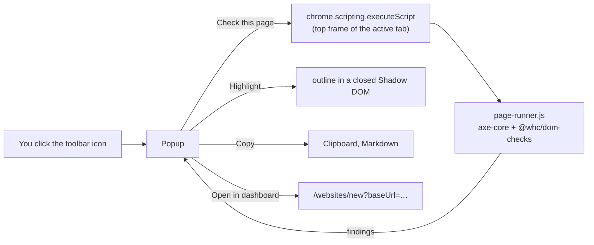
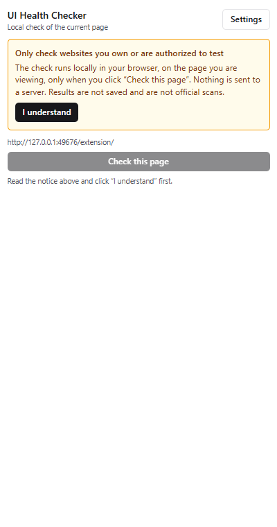
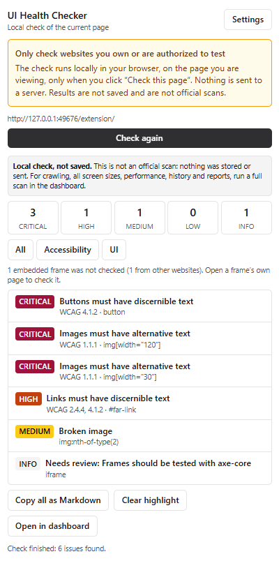
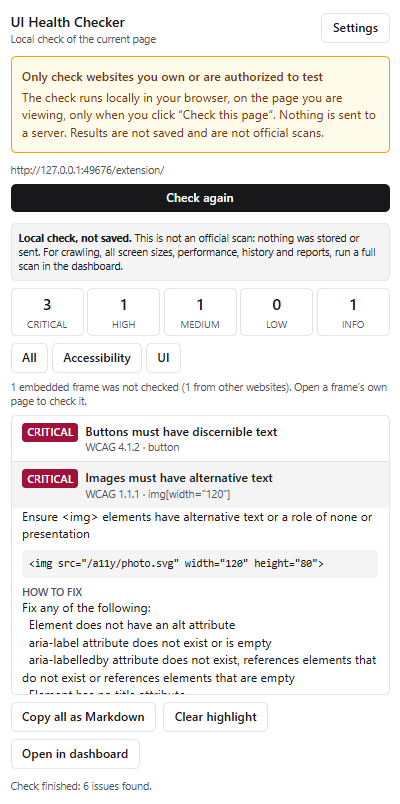
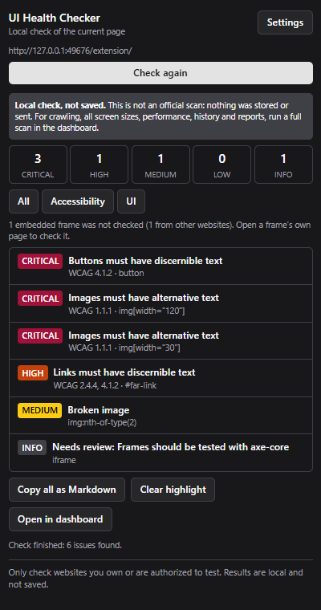
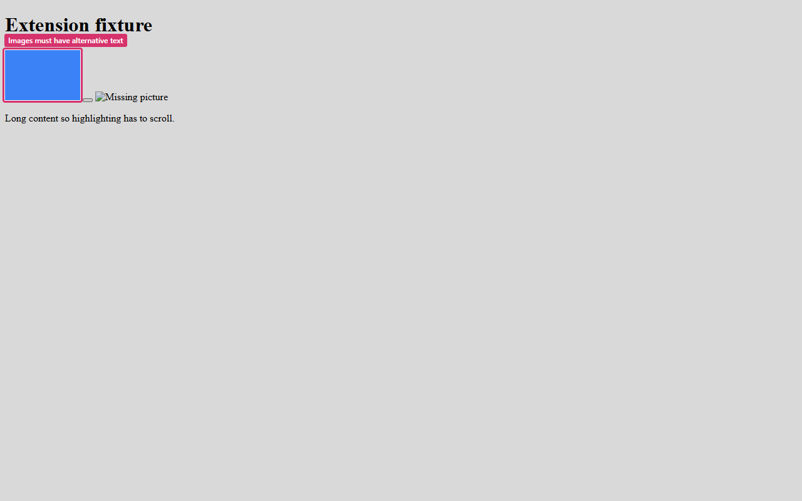
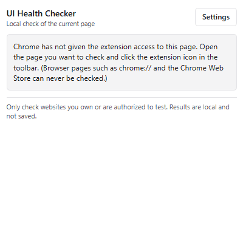
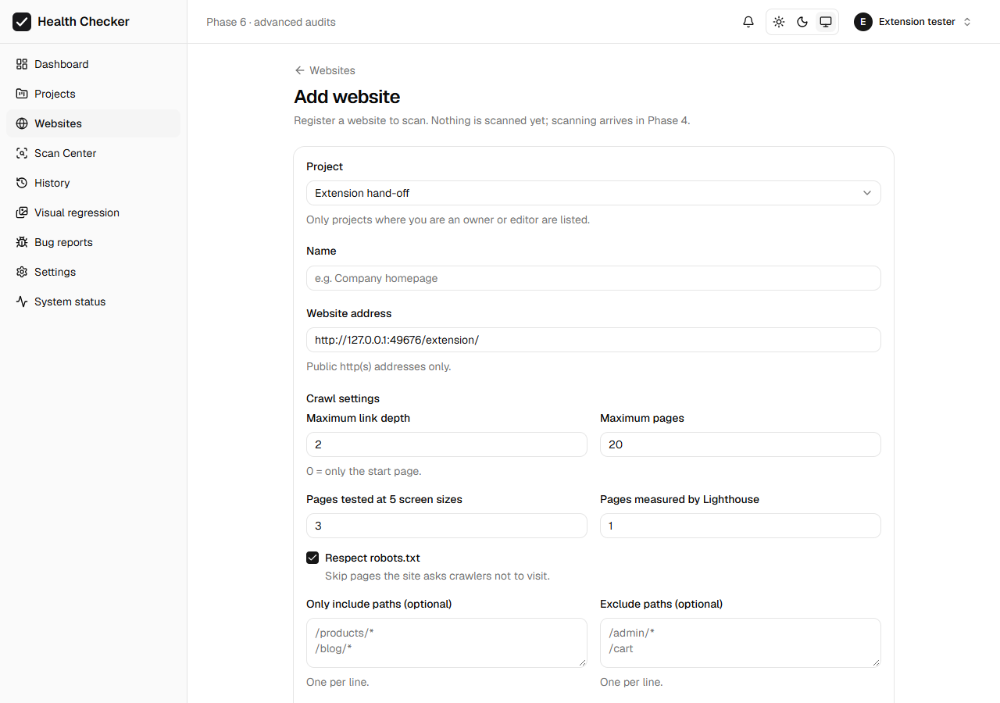

# Phase 7: Chrome extension

A toolbar button that checks the page you are viewing, right now, in your own browser.
It finds accessibility problems (axe-core, WCAG 2.0–2.2 A/AA) and UI problems (missing
labels, broken images, text cut off, covered controls, overflow). You can highlight each
problem on the page, copy it as Markdown, or open the dashboard to set up a full scan.

> **Local checks, not official scans.** The extension checks only the page in front of
> you, in its current state, including anything you are signed in to. Nothing is sent to
> a server and nothing is saved. For crawling, five screen sizes, Lighthouse, history,
> reports and tracked issues, run a scan in the dashboard.

## 1. How it works



1. **Click the icon.** Chrome opens the popup and grants the `activeTab` permission
   for that one tab. Until then the extension cannot read any page, not even its
   address.
2. **First use only:** an authorization notice ("Only check websites you own or are
   authorized to test…") must be acknowledged before the Check button works. It stays
   visible for the rest of that first use. After that, a short reminder line is always
   shown at the bottom.
3. **Check this page.** The popup injects `page-runner.js` into the tab's **top frame**,
   in Chrome's isolated world: the page's own scripts can't see or change it. The
   runner does three things:
   - runs **axe-core** with the shared rule set;
   - runs the **shared DOM checks**;
   - retries any image that looked broken, once.

   The results go back to the popup and stay in its memory only.
4. **Highlight on page.** Scrolls to the element and draws an outline with the issue
   title. The outline lives in a closed Shadow DOM, so the page's CSS can't hide it, and
   it ignores the mouse. **Clear highlight** removes it.
5. **Copy details / Copy all as Markdown.** Each copy includes:
   - the title, severity, rule, WCAG references and element;
   - the HTML snippet, in a code block that backticks inside it can't break;
   - the fix;
   - a note that it was a local check.
6. **Open in dashboard.** Opens `<dashboard>/websites/new?baseUrl=<page>`.
   - Only the page's origin and path are passed. Query strings and fragments are
     dropped, because they can hold session IDs or personal data.
   - If you are signed out, the login page brings you back to the form afterwards.
   - The form is pre-filled but still validates the address and requires the "I own
     this website" confirmation.

## 2. Reuse: no second scanning engine

| Shared piece | Where | Used by |
|---|---|---|
| In-page DOM checks (`runDomChecks`) | `packages/dom-checks/src/checks.ts` | Scanner: as the prebuilt `dom-checks.js` bundle. Extension: bundled into `page-runner.js` |
| axe rule set and options (`AXE_TAGS`, `AXE_OPTIONS`), unnamed-control skip list, `axeSelector` | `packages/dom-checks/src/axe-config.ts` (**moved from the scanner**) | Scanner `checks/axe.ts`, `scan-page.ts`; extension runner |
| Issue presentation: severities, titles, suggested fixes, WCAG references (`axeFindings`, `domFindingPresentation`, `UI_CHECK_TEXT`, `wcagFromTags`, `SEVERITY_RANK`) | `packages/dom-checks/src/presentation.ts` (**moved from the scanner's `issues.ts`**) | Scanner `axeToDrafts` / `domToDrafts`; extension popup and Markdown |
| axe-core | same version (4.14.0) | both |

The scanner keeps only what needs a server: IDs, fingerprints, screenshots, the
database, and the network, console and link checks.

**Proof that moving the code changed nothing:**
- All 105 scanner tests still pass.
- A Docker scan of the W3C BAD demo gave the same results before and after: 168
  accessibility issues, the same 9 rules, the same UI health counts.

**Scanner ↔ extension parity:** `apps/extension/test/extension.e2e.test.ts` checks the
same fixture page with both and requires the **same rule IDs**. Pages: `/a11y/`,
`/a11y/page2.html`, `/ui/`, `/clean/`, `/extension/`. The scanner side is
`scanPage()`, the real scanner page pipeline, without the database. The comparison
excludes the checks only the server can do (failed requests, console errors, broken
links).

## 3. Permissions, privacy and security

**Production manifest** (`apps/extension/src/manifest.ts`, tested on the built file):

| Permission | Why |
|---|---|
| `activeTab` | Access to the current tab, only after you click the icon, only until it navigates |
| `scripting` | Inject the checks into that tab |
| `storage` | Remember the dashboard address and that the notice was read |

These are **not** in the manifest, and tests check that they never are:
- host permissions or optional permissions;
- content scripts that run by themselves, or a background worker;
- `web_accessible_resources` or `externally_connectable` (websites can't talk to the
  extension);
- a custom CSP (the strict MV3 default applies; the popup has no inline scripts).

**Data:**
- The extension makes **no network requests of its own**. A test records every request
  in the browser and finds only the checked site, until you click "Open in dashboard".
- Nothing is collected before you click "Check this page".
- Results live in the popup's memory and disappear when it closes.
- `chrome.storage.local` holds only `dashboardUrl` and `noticeAcknowledged`. **Never**
  passwords, tokens, API keys or results; a test checks the stored keys.
- The dashboard address must be a plain `http(s)` URL, with no user name, password or
  query string.
- No AI calls and no keys in the extension.

**Existing protections are unchanged.** The server-side SSRF proxy, authentication and
authorization behave as before. The hand-off only pre-fills a form, which validates the
address the same way as before. The checks themselves run in your browser, on a page you
already opened; the extension never fetches other addresses.

**Pages that can't be checked:**
- **Browser pages** (`chrome://`, the Chrome Web Store, other extensions), and pages the
  extension was not given access to: the popup explains why and shows no Check button.
- **`file://` pages:** "only web pages".
- **Embedded frames are not checked.** The runner touches only the top frame and says
  "N embedded frames were not checked (M from other websites)". axe adds its own "Needs
  review: Frames should be tested with axe-core" item, as in server scans.
- A frame from another site does not stall the check. The test requires the whole
  check to finish in under 20 s; it passes.

## 4. Install, load and test (PowerShell)

```powershell
cd C:\Users\Lenovo\Desktop\website

# 1. Install dependencies (once, or after pulling changes)
npm install

# 2. Build the extension → apps\extension\dist
npm run extension:build
```

**Load it into Chrome:**
1. Open `chrome://extensions` in Chrome.
2. Turn on **Developer mode** (top right).
3. Click **Load unpacked** and choose `C:\Users\Lenovo\Desktop\website\apps\extension\dist`.
4. Click the puzzle-piece icon in the toolbar and pin **UI Health Checker**.
5. Open a website you own (or `https://www.w3.org/WAI/demos/bad/before/home.html`,
   the W3C's deliberately inaccessible demo), click the icon, read the notice, click
   **I understand**, then **Check this page**.

After changing the code, run `npm run extension:build` again and click the reload
arrow on the extension's card in `chrome://extensions`.

```powershell
# Package a ZIP (for sharing or the Chrome Web Store) → apps\extension\release\whc-extension-0.7.0.zip
npm run extension:package

# Run the extension's tests: manifest, helpers, popup, and a real Chromium
# with the extension loaded (includes the scanner parity test)
npm test -w @whc/extension

# Everything (types, lint, all test suites)
npm run check
```

The end-to-end tests use Playwright's Chromium. Install it once with
`npm run scanner:install-browser` if you haven't.

**Settings:** the **Settings** button in the popup changes the dashboard address. The
default is `http://localhost:8081`, the Docker setup; use `http://localhost:5173` for
`npm run dev`.

## 5. The three builds

| Folder | Command | Difference |
|---|---|---|
| `dist/` | `npm run extension:build` | **Production.** The one you load or ZIP |
| `dist-test/` | built by `npm test` | Adds access to `http://127.0.0.1/*` and a fixed key. Playwright cannot click the toolbar icon (which is what grants `activeTab`), so the tests open the popup as a page with `?tabId=` |
| `dist-keyed/` | built by `npm test` | The production manifest plus a key, so a test can find the production extension by ID and prove it **cannot** read a page without the click |

Tests assert that `dist-test` and `dist-keyed` differ from `dist` only in those
fields. The ZIP script refuses to package a manifest with host permissions or a key.
Neither folder is committed.

## 6. Tests

| Suite | Tests | What it proves |
|---|---|---|
| `test/manifest.test.ts` | 7 | Built production manifest: MV3; exactly `activeTab`/`scripting`/`storage`; no host access, content scripts, background, web-accessible resources, external messaging, key or custom CSP; no inline popup script; test and keyed builds differ only as described |
| `test/lib.test.ts` | 14 | Supported and unsupported pages; Chrome error messages; the hand-off drops the query and fragment; dashboard URL validation; Markdown (shared titles, WCAG, fixes, local-check note, backtick-safe code blocks, sorting) |
| `test/popup.test.tsx` | 9 | First-use notice blocks checks until acknowledged and stays visible; nothing is injected before a click; "Local check, not saved" note; frames note; reminder after first use; browser, no-access and file pages; injection errors; hand-off URL; only valid settings stored; results never stored |
| `test/extension.e2e.test.ts` | 13 | Real Chromium with the unpacked extension. **Parity on 5 fixture pages**; first use; cross-origin frame skipped and reported quickly; highlight scrolls and clears; copy as Markdown; no requests to anything but the checked site; hand-off URL without query or fragment; `chrome://` page explained; the production build cannot read or inject into a page without the click |
| `apps/web` `websites.test.tsx` | +1 | The dashboard pre-fills the address from `?baseUrl=` and still requires the authorization confirmation |

## 7. Verification

- **`npm run check`:** 492 tests passed, 1 skipped (the opt-in live AI test). Types and
  lint are clean.
- **Chromium:** Playwright's Chromium 156.0.8078.4, the same major version as the
  installed Google Chrome 156. Checks: the extension loads unpacked, the popup works,
  highlighting works in a real page, and the production build cannot read pages without
  the click.
- **Docker integration** (rebuilt `egress-proxy`, `scanner`, `api` and `web`):
  - The scanner verification script passed 9/9, with identical results before and
    after the code move.
  - The extension against the real dashboard passed 9/9. A signed-out hand-off goes to
    login (keeping `next=`), then to "Add website" with the address pre-filled and the
    authorization box unticked.
  - No errors in the popup.
- **ZIP:** `whc-extension-0.7.0.zip` (8 files, 281 KB) opens with Windows' own
  `Expand-Archive`. It contains the production manifest only. axe-core's MPL-2.0 license
  notice is kept in `page-runner.js`.
- **Not automated:**
  - Loading into **branded** Google Chrome through the "Load unpacked" button needs a
    person. Since Chrome 137, branded Chrome ignores the `--load-extension` flag that
    automation uses.
  - Clicking the real toolbar icon (which grants `activeTab`) cannot be automated by
    Playwright.

  The steps in section 4 cover both. Everything behind them (popup, injection,
  highlighting) was tested in Chromium.

## 8. Screenshots

| | |
|---|---|
|  |  |
|  |  |
|  |  |
|  | |

The popup screenshots were taken with the test build, opened as a page, because
Playwright cannot open the real toolbar popup. They show the same HTML the toolbar shows.

## 9. Limitations

- **Local and partial.** One page, in its current state, at your window size. Not
  saved and not tracked. Automated checks find only part of all accessibility problems.
- **Not seen by the extension:**
  - console errors, failed requests and broken links (they would need the `debugger`
    permission, which shows a warning bar, or host access to every site);
  - the contents of embedded frames (each frame's own page can be checked separately);
  - shadow DOM contents beyond what axe reaches.
- **Broken images** are retried once from the page. Unlike the server scanner, there is
  no proxy re-check and no HTTP status.
- **No sign-in from the extension.** Personal API tokens are deferred to Phase 8, so
  the extension can't start a server scan itself; the hand-off opens the dashboard form.
- **Not published to the Chrome Web Store.** The ZIP is ready, but publishing needs a
  developer account, a privacy policy and a store listing.
