# Phase 9: Website Health Scan and Website Comparison

Status: **in progress.**
- Milestone 0 (foundations) is complete.
- Milestone 1 (generic interaction explorer) is complete (section 5).
- Milestone 2, Checkpoint 1 (layout, fonts and icons, component consistency) is complete
  (section 6).
- Milestone 2, Checkpoint 2 (keyboard and form probes) is complete (section 7).
- Milestones 3 to 8 are planned (see section 8).
- This document grows with each milestone.

## 1. Product purpose

Phase 9 turns the checker into a generic QA automation tool with two modes on one shared
engine:

| Mode | Input | What it does | Where results live |
|---|---|---|---|
| **1 · Website Health Scan** | One authorized website | Finds UI, visual, interaction, navigation, form, responsive, accessibility, compatibility and performance problems by itself. No reference site or QA sheet is needed. | The existing `Scan` / `Issue` / `TrackedIssue` tables, extended |
| **2 · Website Comparison** | Two authorized websites (reference and target) | Compares pages, elements, text, layout, styles, interaction states and responsive behaviour. Differences are observations or potential defects, never confirmed automatically. | New comparison tables (from Milestone 4) |

A sample QA report (30 bugs found on a DocuSign clone) is **one optional acceptance
dataset** for Mode 2. Detection is generic: no detector contains fixture- or
report-specific logic, and a test enforces that (section 4.4).

## 2. Decisions approved before implementation

1. **Mode 1 extends `Scan` and `Issue`.** Existing history, reports, dashboard, scores
   and the Chrome extension keep working.
2. **Review is separate from the lifecycle.** The lifecycle statuses stay exactly as
   they were (`OPEN`, `RESOLVED`, `IGNORED`, `FALSE_POSITIVE`). A separate
   `reviewStatus` (`UNREVIEWED`, `CONFIRMED`, `INTENTIONAL`) holds the team's verdict,
   with an append-only history. A confirmed issue can still become `RESOLVED` later.
3. **The safe explorer is on by default** (5 pages × 30 eligible controls,
   configurable).
   - It only opens recognised disclosure controls: menus, tabs, accordions, expandable
     sections.
   - It never submits forms or clicks unknown or destructive actions (Send, Delete,
     Submit, Sign, Purchase, Save, Create…).
   - Skipped controls are recorded.
4. **Cross-browser checks are opt-in** (Firefox, WebKit). Results are labelled "engine
   difference"; Linux WebKit is not presented as Safari on macOS.
5. **The QA dataset runs on local reference and clone replicas only.** There is no
   automation of the production DocuSign service.
   - QA-016: the screenshot is followed (Clear and Apply).
   - QA-009: inconclusive (the evidence conflicts).
   - QA-029/030: the evidence mapping is corrected (the two links were swapped).
   - Viewports: `1280×960`, `1024×960`, `389×960`.
   - CSV import of QA sheets is optional.
6. **Safety:**
   - automatic interaction testing runs against isolated local fixtures;
   - writes are held and aborted, and WebSockets, downloads, pop-ups and external
     navigation are blocked;
   - server-side counters must show zero unintended writes.
7. **Acceptance targets apply to the deterministic fixtures.** 100% recall and zero
   false positives are required per detector category on the deterministic fixture
   sites, not on arbitrary websites.
8. **Stability:** existing behaviour, scores, reports, dashboard, API contracts and the
   extension are preserved. Any breaking change is identified before implementation.

## 3. Finding classification (both modes)

| Classification | Set by | Meaning |
|---|---|---|
| `DETECTED` | Tool | A deterministic rule failed, with objective evidence |
| `POTENTIAL_DEFECT` | Tool | Heuristic evidence suggests something is broken |
| `OBSERVATION` | Tool | A fact or difference worth reviewing; no evidence of breakage |
| `INCONCLUSIVE` | Tool | Could not be verified, or a person must decide |
| Review: `CONFIRMED` / `INTENTIONAL` (+ lifecycle `FALSE_POSITIVE`) | **People only** | The team's decision, with a note and history |

Rules for single-site issues (`classifyDraft` in `apps/scanner/src/issues.ts`; the
migration applies the same rules to older rows):

| Issue | Classification |
|---|---|
| axe violation / axe "needs review" | `DETECTED` / `INCONCLUSIVE` |
| Security `CONFIRMED` / `WARNING` / `OBSERVATION` | `DETECTED` / `POTENTIAL_DEFECT` / `OBSERVATION` |
| SEO rule | `DETECTED` |
| Performance (lab measurement) | `POTENTIAL_DEFECT` |
| Horizontal scroll, button or link without a name | `DETECTED` |
| Broken image, link, script, stylesheet or request, **confirmed by the re-check** | `DETECTED` |
| The same, from scans before re-checks existed | `POTENTIAL_DEFECT` |
| Console message from a third party, or a network echo | `OBSERVATION` |
| Other console messages and exceptions; other layout heuristics | `POTENTIAL_DEFECT` |

## 4. Milestone 0: foundations (complete)

### 4.1 Crawler extraction (no behaviour change)

The breadth-first crawl loop moved out of `runScan()` into
`apps/scanner/src/crawler/crawl.ts` as `crawlSite()`.

- **`crawlSite()` keeps only the bookkeeping:** queue, known addresses, depth,
  `maxPages`, the `3 × maxPages` bound, robots.txt, include/exclude patterns, the time
  limit and cancel checkpoints.
- **The per-page work is a `visit` callback.** `runScan` passes today's loop body
  unchanged; Mode 2 will pass a light "read the links" visitor.
- **Proof:**
  - 6 unit tests on a fake site: order, redirects, depth, patterns, robots, limits,
    cancel, bound;
  - all existing scanner tests;
  - a before/after Docker scan (section 4.6).

### 4.2 `capturePage()` / `analyzePage()`

`scanPage()` was split into two functions:
- **`capturePage()`** (`pipeline/capture-page.ts`) loads the page and collects facts:
  navigation, headers and cookie flags, the skip rules, axe, DOM checks, and resource
  re-checks.
- **`analyzePage()`** turns the facts into issue drafts, without a browser.

`scanPage()` still owns the collectors and screenshots and returns the same result.
Mode 2 will call `capturePage()` on both sites.

### 4.3 Database changes

Migration `20261103001300_phase9_m0_classification_review`. All changes are additive:

| Change | Purpose |
|---|---|
| Enum `FindingClassification`; `Issue.classification` (default `INCONCLUSIVE`, backfilled) | Evidence strength |
| Enum `ReviewStatus`; `TrackedIssue.reviewStatus`, `reviewedAt`, `reviewedById` | Team verdict, separate from the lifecycle |
| Table `IssueReview` (from/to status, from/to review, note, user, time) | Append-only decision history. A database trigger refuses edits; the only allowed change is clearing `userId` when a user is deleted. Rows go away only with their website (cascade). |
| `AiInsight.promptVersion` (existing rows `issue-explain/v1`) | Cached AI answers are reused only for the current prompt version |

A test runs the backfill SQL, taken straight from the migration file, against every
rule branch and requires the same result as `classifyDraft`.

On the development database, the backfill classified all 5,373 existing issues:
- 3,937 axe violations → `DETECTED`;
- 774 axe "needs review" → `INCONCLUSIVE`;
- older unverified resource failures → `POTENTIAL_DEFECT`.

### 4.4 API and UI

**API (backward compatible):**
- `PATCH /api/tracked-issues/:id` now also accepts `reviewStatus` and `note`. The
  original `{ status }` request still works.
  - Every change appends one `IssueReview` row, in the same transaction.
  - A false positive cannot also be confirmed or intentional: the API answers `409
    REVIEW_CONFLICT`.
- New `GET /api/tracked-issues/:id/reviews`: the history, for Viewers and up.
- Responses gain `classification` (issues) and `reviewStatus` (tracked issues).
- New filters: `?classification=` and `?reviewStatus=`.
- The issue timeline gains `REVIEWED` entries.

**UI:** the issue page shows a classification badge and a **Review** card containing:
- the evidence, explained in plain words;
- the team decision;
- Confirm defect / Intentional / Clear review, with an optional note;
- the decision history.

### 4.5 Fixture acceptance harness

- **Manifests (`tests/fixtures/manifests/*.json`)** list, per fixture page:
  - the seeded issues (rule, selector or resource, viewports, acceptable
    classification);
  - **negative controls** (look-alikes that must not be reported);
  - the **scored categories** (where the list is complete);
  - fixture-specific **forbidden tokens**.
- **`apps/scanner/test/harness/evaluate.ts`** computes recall and precision **per
  detector category**. Only `DETECTED` and `POTENTIAL_DEFECT` count as claims, and a
  weaker classification than expected counts as a miss.
- **`fixture-acceptance.test.ts`** scans every manifest's fixture with the real scanner
  and proxy. It requires 100% recall and zero false positives, and writes
  `.scanner-test-storage/fixture-acceptance.md`.
- **`harness.test.ts`** fails if detector code (`apps/scanner/src`,
  `packages/dom-checks/src`, `packages/shared/src`) contains a QA report ID, a fixture
  page title, or a manifest's forbidden token.

Milestone 0 results, on the 4 existing fixtures:

| Fixture | Category | Expected | Found | Recall | False positives | Precision |
|---|---|---|---|---|---|---|
| clean | UI health, responsive, accessibility | 0 | 0 | 100% | 0 | 100% |
| console (integration error, grouping, exceptions) | UI health | 5 | 5 | 100% | 0 | 100% |
| resources (broken files and links) | UI health | 6 | 6 | 100% | 0 | 100% |
| resources | Accessibility | 0 | 0 | 100% | 0 | 100% |
| ui (layout problems + look-alikes) | UI health | 5 | 5 | 100% | 0 | 100% |
| ui | Responsive (4 screen sizes) | 22 | 22 | 100% | 0 | 100% |
| ui | Accessibility | 2 | 2 | 100% | 0 | 100% |

The six generic fixture sites (e-commerce, SaaS dashboard, portfolio, news/blog, forms,
responsive landing page) and their corrected twins arrive with the detectors that need
them (Milestones 1–5).

### 4.6 Verification

- **`npm run check`:** types, lint and every suite pass (see the milestone report for
  counts).
- **Docker, before/after:**
  - The W3C BAD demo was scanned twice with the old images and once with the new ones
    (6 pages, depth 1, one responsive page).
  - The new run is **identical** to the first old run: same pages and order, the same
    22 rule groups and counts, the same scores and links.
  - The two old runs already differed from each other in the broken-link count (4 vs 1)
    because of network variance on w3.org.
- **Real browser against Docker:** the issue page shows the badge, the review workflow
  (confirm with a note, clear, mark intentional), three history rows in the database,
  plain-language timeline entries, no horizontal scrolling at 390 px, and no page
  errors.

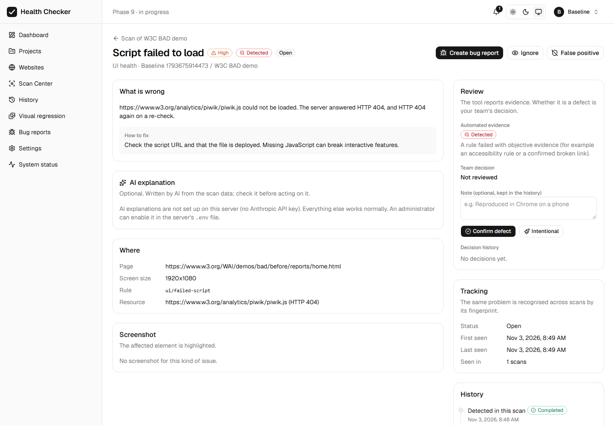
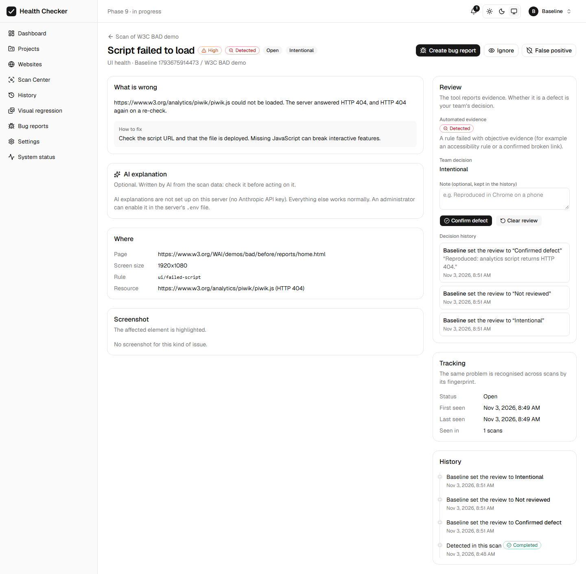

## 5. Milestone 1: the safe interaction explorer (complete)

This milestone adds a new stage to every health scan (Mode 1). On the first pages of a site, the explorer:

- opens menus, tabs and expandable sections;
- checks what opening them reveals.

It works on any website. Its rules use HTML and ARIA semantics plus a small "expand"
vocabulary. They contain no logic specific to a site, a page or a text.

### 5.1 What it explores and what it never touches

`packages/dom-checks/src/explore-rules.ts` decides, for each element, whether to explore it. The module is pure and unit-tested.

| Explored | Why |
|---|---|
| Buttons with `aria-haspopup` (menu, listbox, tree, grid) | open a menu |
| Buttons with `aria-expanded="false"` | accordions, disclosures |
| Buttons whose `aria-controls` points to a hidden region | disclosures |
| `
` of a closed `
` | expandable sections |
| Unselected `role="tab"` | tabs |
| Buttons named "Show more", "See all", "More", "Menu", "Filters", "Options", "Details" or "Expand" | expand wording |

The explorer never uses the controls below. Each one is recorded in the report with the reason it was skipped.

- **Controls whose name suggests a change of data.** The vocabulary is deliberately broad. It includes:
  - delete, remove;
  - purchase, buy, pay, checkout, order;
  - send, submit, sign, create, save, publish, post;
  - confirm, approve, cancel;
  - log out, reset, clear, apply;
  - add, upload, download, export, import;
  - share, invite, edit, update, enable, disable;
  - start, run, refresh, reload;
  - and more (`STATE_CHANGING_WORDS`).
- **Submit buttons.** This includes a `<button>` without a type inside a form, and `<input type="submit">`.
- **Links that navigate.** The crawler follows links using GET only, as in every scan.
- **Other excluded controls:**
  - dialog triggers (`aria-haspopup="dialog"`);
  - native form fields;
  - disabled, hidden or already-open controls;
  - controls whose action is unknown.
- **Controls beyond the limit.** The default is **5 pages × 30 controls**, set per website. The scanner caps it with `SCAN_MAX_EXPLORATION_PAGES` (at most 10) and `SCAN_MAX_EXPLORATION_CONTROLS` (at most 50).

### 5.2 Safety layer

The explorer uses its **own browser context**, never the scan's. That context goes through the same egress proxy, so SSRF protection is unchanged. Once the page has loaded normally, the safety layer is armed:

- **No writes.** Every request that is not GET, HEAD or OPTIONS is aborted. This covers forms, `fetch` POSTs and beacons.
- **GET is not assumed to be safe.** Only the resources a page needs to render can load: stylesheets, scripts, images, fonts and media. These are aborted, including those to the same site:
  - data requests (fetch/XHR);
  - event streams;
  - downloads.
- **No navigation.** Every page navigation is aborted. The only exception is the explorer's own reload of the same page.
- **No other channels.**
  - WebSockets never reach a server.
  - Pop-ups are closed.
  - Dialogs are dismissed ("Cancel").
- **Guards inside the page.** Chromium's download manager fetches files outside request routing, so the page itself also prevents:
  - form submission and `form.submit()`;
  - link clicks triggered by script (`a.click()`);
  - clicks on `<a download>` links.
- **Everything blocked is recorded** and shown in the report.
- **Downgrade rule.** If anything was blocked during an interaction, findings from that interaction are downgraded to **inconclusive**, because the page may behave differently for real users.

**How safety was verified.** On the fixture pages, destructive actions point to `/trap/*`:

- a POST;
- a navigation;
- a beacon;
- a fetch to another site;
- a pop-up;
- a download;
- a WebSocket.

The fixture server counts every non-GET request, every `/trap/*` request and every WebSocket upgrade. After every fixture scan, all three counts must be **zero**, and they are.

During development, one gap was found and fixed:

- **Problem:** a download link triggered by script reached the server, because downloads bypass Playwright's request routing.
- **Fix:** the in-page guard now stops the download before any request starts.

### 5.3 Checks

The checks use a new category, `FUNCTIONAL`, shown as "Interactions" in the UI.

| Check | How it is decided | Classification |
|---|---|---|
| Control does nothing | One of two cases. (1) After 2 attempts there is no new visible content, no state change and no real DOM change. (2) `aria-expanded` becomes `"true"` but nothing is shown. | Potential defect |
| Opened menu or panel is cut off | At least 5% of the opened layer (and at least 64 px²) is hidden. It may be hidden by a container with `overflow: hidden`, or by the edge of the window. The window counts horizontally, and vertically only for fixed layers. | Potential defect |
| Items covered | An item of the opened layer is covered at its centre by an element outside the layer. Parts already reported as cut off are not checked again. | Potential defect |
| Large empty area | The opened layer is at least 150 px tall and has an empty band of at least max(80 px, 40% of its height). | Observation |
| Menu cannot be closed | The menu stays open after all three attempts: pressing Escape, clicking outside it (on a point with nothing interactive) and clicking its control again. | Potential defect |
| Escape does not close a menu | The menu does close another way. | Observation |
| Tab panel not shown | The tab becomes selected, but the panel named by its `aria-controls` stays hidden. | Potential defect |
| Error while interacting | An uncaught exception happens during the interaction. It is classified like console errors: an error from a third party is an Observation. | Potential defect or Observation |
| Link to a missing section | A same-page `#fragment` has no matching id or name. `#`, `#top`, `#/…` and `#!…` count as valid. | Detected |
| Wrong current page in navigation | A navigation item is marked current (`aria-current`, or an active, current or selected class) but points elsewhere, while another item points to this page. Section prefixes are allowed. | Potential defect |
| Accessibility in opened states | axe runs on each opened layer. Only problems that are not already on the page are reported. | Detected (category Accessibility) |

**Evidence stored with every finding:**

- the control: name, role and selector;
- the steps the explorer actually performed up to that finding;
- measurements: the share cut off, the covered items, the empty band;
- any blocked actions;
- a highlighted screenshot of the opened state.

Bug reports use only these recorded steps.

### 5.4 Compatibility with existing results

**Scores.** Existing categories and **scores are unchanged**. Accessibility problems found only inside opened menus are listed, but they are excluded from the accessibility score. `totalIssues` and the severity counts now include interaction findings.

**Tracking.** An interaction finding is marked resolved only on a page that was explored again. Switching the explorer off, or lowering its page limit, never resolves one.

**Docker before and after** (W3C BAD demo, the same settings as in Milestone 0):

- Pages, crawl order, the 22 rule groups, counts, scores and links are all identical.
- The explorer ran on the first 5 pages. The 6th page was beyond the limit.
- It found no eligible controls, because the demo is a static site with no ARIA menus, tabs or disclosures. So there were zero findings.
- The scan took about 9 s longer (40 s → 49 s).

**API.** All changes are additive.

- New endpoint: `GET /api/reports/:scanId/functional`.
- Websites gain `explorationEnabled`, `explorationPageLimit` and `explorationControlLimit`. They are optional on input and default to true, 5 and 30.
- Issues gain `functional` details.
- The category filters and exports accept `FUNCTIONAL`.

**Existing websites.** They are explored by default from their next scan. The explorer can be switched off in each website's settings.

**Database.** The migration `20261103033735_phase9_m1_explorer` is additive:

- enum value `IssueCategory.FUNCTIONAL`;
- enum `FunctionalCheckType`;
- table `FunctionalIssue`;
- column `ScanPage.exploration`;
- three `Website` columns.

### 5.5 Fixtures and results

Three generic sites were added. Each has a **corrected twin**, served from the same file at `<site>/fixed.html`, so a twin cannot drift from its seeded page.

| Site | Seeded problems | Negative controls |
|---|---|---|
| `saas` (dashboard) | Wrong current navigation item; 3 header menus cut off by `overflow: hidden`; a menu that cannot be closed; a menu without Escape; a tab whose panel stays hidden; a control that does nothing; an error while opening a section; an unnamed button visible only in an opened menu | Help menu that overlaps the page on purpose; working tab; `
`; "Show more"; two controls whose tracking calls are blocked |
| `shop` (e-commerce) | Filter options under a sticky promotion bar; a sort list with a large empty area; a link to a missing section | Colour panel that overlaps the product grid on purpose; mini cart; `
`; "Back to top" (`#top`); a valid section link |
| `portfolio` | A link to a missing section; "Read more" that says it expanded but shows nothing; a filter panel past the edge of the window | Menu toggle; "Show more projects"; `
`; skip link |

**Fixture acceptance** (`fixture-acceptance.test.ts`: 30 tests over 10 fixture pages). The 10 pages are the 3 new sites, their 3 twins and the 4 earlier fixtures.

| Category | Fixture pages scored | Expected | Found | Recall | False positives |
|---|---|---|---|---|---|
| FUNCTIONAL | 10 | 15 | 15 | 100% | 0 |
| ACCESSIBILITY | 9 | 3 | 3 | 100% | 0 |
| UI_HEALTH | 10 | 16 | 16 | 100% | 0 |
| RESPONSIVE | 2 | 6 | 6 | 100% | 0 |

The server-side safety counters were 0 after all 10 scans.

These targets apply to these deterministic fixtures only, not to arbitrary websites.

### 5.6 Screenshots

**How the demo was produced.** The scanner in this repository scanned the local SaaS fixture:

- the results were stored in the development database;
- the Docker dashboard displayed them.

No third-party site was scanned.

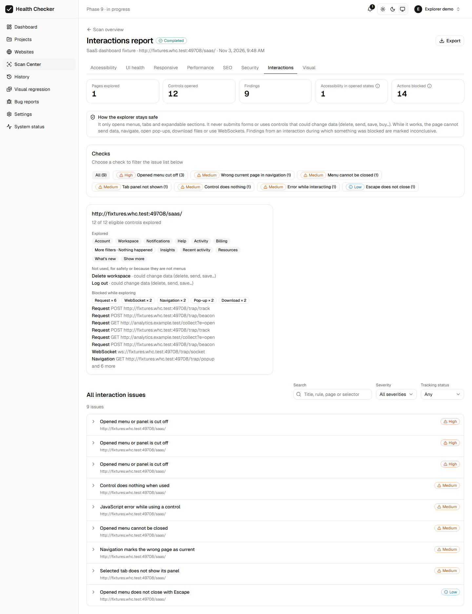
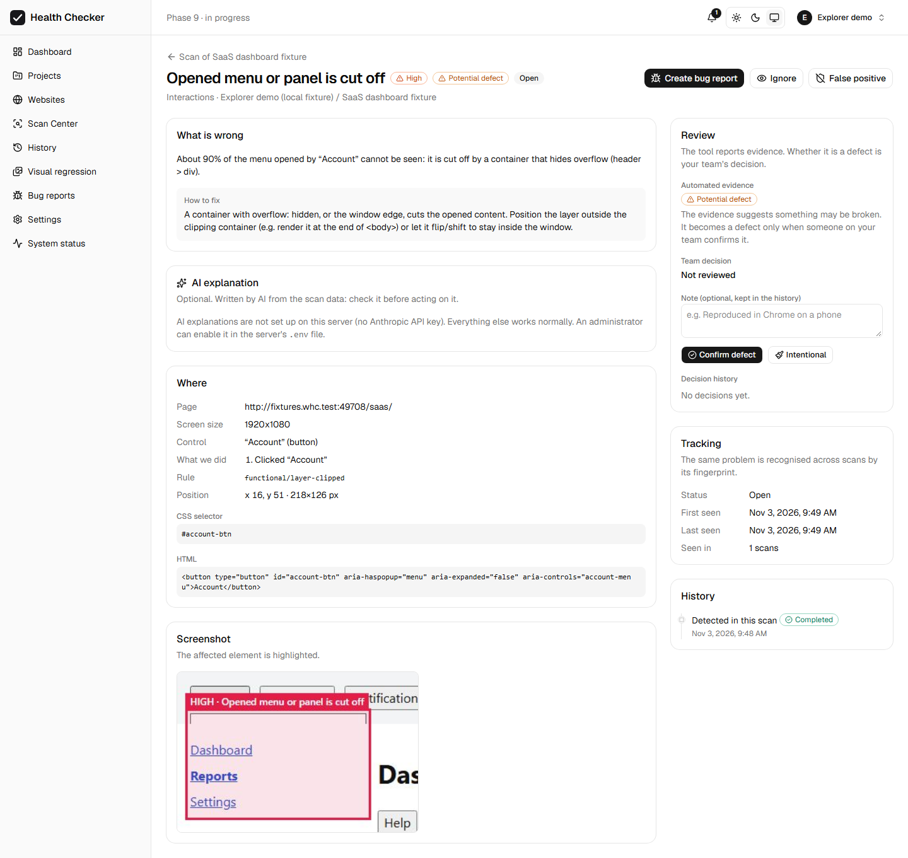
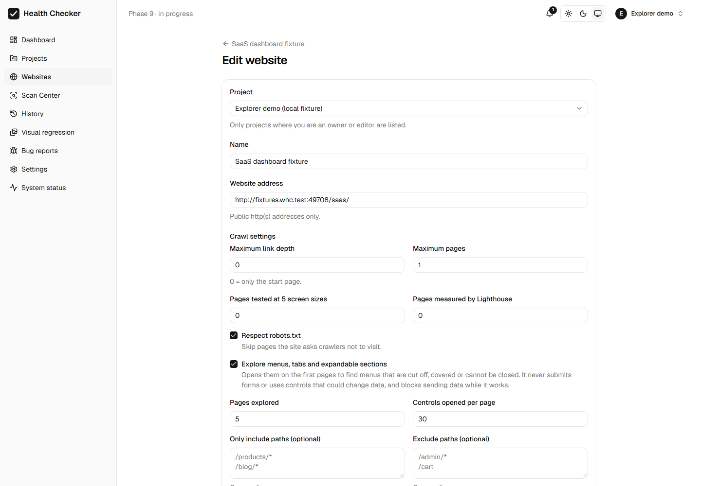

### 5.7 Limitations

- **Semantics-based.**
  - Custom widgets with neither ARIA nor the expand wording are not opened. Milestone 6 scenarios are meant for them.
  - Menus that open only on hover are explored only if a click also opens them.
- **English action vocabulary.** On sites in other languages:
  - controls that change data are still skipped, as long as they have no disclosure semantics (they almost never do);
  - the skipped list then gives their reason as "unknown action".
- **Blocked requests.** A menu that loads its items with fetch/XHR shows up empty. Its findings are marked **inconclusive**, not claimed.
- **Scope of this milestone.**
  - Desktop viewport only (1920×1080).
  - Dialogs are not opened.
- **Heuristic thresholds.** The thresholds (5% cut off, an 80 px empty band) were tuned to avoid false positives, so subtler problems can be missed.
- **Run time.** About 1 s per control, and more when the page has to be restored. On the W3C BAD demo, which has no eligible controls, the scan took about 9 s longer.

## 6. Milestone 2, Checkpoint 1: layout, fonts and icons, component consistency (complete)

Checkpoint 1 adds three groups of static checks and the groundwork that Checkpoint 2
(keyboard and form probes) will build on. The keyboard and form probes and dialog
exploration are **not** part of this checkpoint.

All new checks are generic: they rely on CSS, layout geometry, the `document.fonts` API
and ARIA semantics. They contain no logic for a particular site, fixture or QA report;
`harness.test.ts` checks this against every fixture's tokens.

### 6.1 Decisions applied

| Decision | How it is applied |
|---|---|
| New UI checks never change scores | `SCORED_UI_CHECKS` in `apps/scanner/src/finalize.ts` lists the 16 UI check types that existed before Milestone 2; only those count towards the UI health score. |
| Consistency on by default, as an observation | `Website.consistencyEnabled` defaults to `true`. A finding is a potential defect only with strong evidence (section 6.4); it is never `DETECTED`. |
| Existing behaviour unchanged | The new checks are a separate in-page entry point (`window.__whcDomChecks.extra`). `runDomChecks`, which the Chrome extension uses, is unchanged. Screenshots of new findings come from their own budget (20 per scan, at most 2 per page), so earlier issues keep theirs. |

### 6.2 Layout measurements (`UI_HEALTH`, and `RESPONSIVE` at the other screen sizes)

These add to the four existing layout checks, which are unchanged.

| Check | How it is decided | Classification |
|---|---|---|
| `TEXT_OVERFLOW_VISIBLE` | Text is taller than its box (`overflow: visible`), and the part that spills out is drawn over another element's content: text, a background, an image or a control. Spilling into empty space is not reported. | Potential defect |
| `TEXT_OVERLAP` | The drawn glyph boxes of two different text elements intersect, by at least 40 px² and 30% of the smaller one. Only the painted part of the text counts: text hidden by ellipsis, line-clamp or a scroll container is cut away first. | Potential defect |
| `FIXED_OUT_OF_VIEWPORT` | A fixed element extends more than 4 px above or below the window while at least half of it is visible, and text or controls in it lie fully outside the window, where they can never be reached. | Potential defect (HIGH when a control is unreachable) |
| `CONTROL_LABEL_CLIPPED` | The label of a button, block link, tab or menu item is more than 2 px wider or taller than the control's box, cut off or spilling out. | Potential defect |

Not reported, so that intended designs and responsive layouts stay silent:
- ellipsis and line-clamp;
- content inside horizontal scrollers such as carousels;
- `aria-hidden` and `role=presentation` decoration;
- faint watermarks (opacity below 0.3);
- screen-reader-only text;
- off-canvas panels and "peeking" sheets (less than half visible);
- inline links;
- hidden responsive variants, such as a desktop navigation hidden on mobile;
- fixed and sticky elements, for text overlap (their position depends on scrolling).

The checks run on every scanned page at desktop size, on the extra screen sizes of the
responsive pass, and on menus and panels the explorer opened (only problems not already
on the page; marked with the opened control, and resolved only where the explorer runs
again).

### 6.3 Fonts and icons

| Check | How it is decided | Classification |
|---|---|---|
| `FONT_LOAD_FAILED` | A face in `document.fonts` has status `error`. | `DETECTED` only when the failed request is verifiably one of that face's own `src` URLs and the re-check confirmed the failure; otherwise a potential defect |
| `FONT_FALLBACK_RENDERED` | Visible text asks for a web font (its first `font-family`), but no face of that family that covers the text has loaded. Not reported for `font-display: optional`, for `unicode-range` subsets the text does not need, or for system fonts. | Potential defect if the font failed; otherwise an observation |
| `ICON_BROKEN` | An `<svg><use href="#id">` whose symbol does not exist in the page. | `DETECTED` |
| `ICON_BROKEN` | An `<svg><use href="file.svg#id">` whose sprite file failed. | `DETECTED` if the re-check confirmed the failure |
| `ICON_BROKEN` | An external sprite that loaded but whose icon draws nothing. | Potential defect |
| `ICON_BROKEN` | Icon-font glyphs (Private Use Area characters) whose font failed and has no loaded face. | Potential defect |
| `ICON_MISSING` | A control named for screen readers (`aria-label`, `aria-labelledby` or `title`) with nothing visible inside it: no text, no image or SVG with a size, and no background or pseudo-element icon. | Observation |

**Font request correlation (requirement 1).** A generic "failed request" issue is
replaced only when the failed URL is exactly one of the `src` URLs of a font face that
**failed**, or the sprite file of a broken icon, **and** the re-check confirmed it.
Every other failed request is still reported as before. This covers, for example, a
missing first `src` whose second source loads, a stylesheet that cannot be read from
another origin, or an unconfirmed failure. Unit tests and the `studio` fixture check
this.

### 6.4 Component consistency

**Members.** These elements are collected per page, up to 400:
- buttons, including `role=button` and button-type inputs;
- links drawn as buttons (a box with padding and a background or border);
- text inputs, selects and textareas.

**What makes members comparable.** They are compared only if they share all of:
- the kind and tag (and input type);
- the **exact class list**, so variants such as `btn-primary` and `btn-danger` are separate groups;
- the **kind of container**: form, navigation, toolbar, table cell, header, footer, aside, open dialog, or main content;
- the **screen size**: desktop only.

**Members left out.** Elements in a state that is meant to look different:
- disabled;
- `aria-current`, `aria-pressed`, `aria-selected`, `aria-expanded`, `aria-checked` or `aria-invalid`;
- focused or hovered;
- carrying a state class such as `active`, `is-selected` or `btn--disabled`.

**Properties compared.**
- Padding, font family, size and weight, border radius and width, and text, background and border colours.
- Height only for text fields, selects and single-line text-only buttons, where content cannot decide it.
- Width never.

**When a difference is reported.**
- **Observation.** Groups of at least 4 members. A property counts only if at least 75% of the members agree on its value, and a member differs by more than the tolerance (4 px, 1 px of font size, 100 of weight, 2 px of radius, or a visibly different colour).
- **Potential defect (strong evidence).** All of the following:
  - at least 6 members, with at least 85% agreeing;
  - a large difference: 8 px or more of padding or height, or 2 px of font size;
  - the outlier sets that property itself, in its `style` attribute or in a rule for its `#id` only.

**Across pages.** Each page stores the usual look of each group in `ScanPage.components`.
When the same group appears on at least 3 pages and at least 75% of them agree, a page
that differs gets an observation.

### 6.5 Groundwork for Checkpoint 2

- **Side-effect watch** (`packages/dom-checks/src/side-effects.ts`, requirement 3). It
  records every DOM change while a probe step runs and puts each one in a bucket:

  | Bucket | Meaning |
  |---|---|
  | expected | Inside the probed component: the element, its wrapper (ancestors that contain no other control), its labels, and the elements it points to (`aria-controls`, `-owns`, `-describedby`, `-errormessage`, `-activedescendant`). |
  | announcement | Inside a live region. |
  | ambient | An attribute change on `<html>` or `<body>`. |
  | background | An element that also changed during a quiet baseline (clocks, carousels). |
  | unrelated | Anything else. |

  Checkpoint 2 marks a probe step inconclusive on unrelated changes. Browser tests cover
  every bucket.
- **Per-detector acceptance harness.** `evaluateDetectors()` reports recall and
  precision per detector. The Milestone 2 detectors are strict: on every fixture page,
  any finding of theirs that is not seeded counts as a false positive, observations
  included.
- **Fixture twins.** A fixture may write `{{seeded|fixed}}` where CSS alone cannot
  switch a difference (URLs, attributes). `?fixed` serves the corrected variant of any
  page, so twins of multi-page fixtures crawl corrected subpages.
- **Fonts for fixtures.** The fixture server serves real fonts from installed packages:
  Geist (SIL Open Font License) and Codicon, an icon font shipped with Playwright. No
  third-party font files are added to the repository.

### 6.6 Storage, API and UI (all additive)

- **Migration** `20261103061324_phase9_m2_cp1_layout_fonts_consistency`. It adds:
  - 9 `UiCheckType` values;
  - `ScanPage.components` (JSON);
  - `Website.consistencyEnabled` (default `true`).
- **Website API.** `consistencyEnabled` is optional on input; clients that do not send
  it keep the stored value.
- **Issue filters.** `checkType` accepts the new types.
- **`GET /api/reports/:scanId/ui-health`** gains `extraChecks`:
  - counts for layout, fonts and icons, and consistency, at all screen sizes;
  - the number of pages compared;
  - counts by classification.

  All existing fields are unchanged.
- **UI health report.** A "Layout, fonts, icons and consistency" card says these checks
  are not part of the score. The new checks also appear as filter buttons.
- **Website form.** A "Compare similar buttons and fields" setting.

### 6.7 Fixtures and results

| Fixture | Seeded problems | Negative controls |
|---|---|---|
| `magazine` (layout; scanned at all 5 screen sizes) | Text spilling from a fixed-height box onto the byline; a kicker drawn over its headline; a fixed newsletter panel whose Close button is below the window; a tag whose label does not fit | Ellipsis, line-clamp, an `aria-hidden` watermark over a heading, screen-reader text in a search button, a peeking bottom sheet, a card rail, a badge over an image, a fixed top bar, a navigation replaced by a menu button on small screens, two skip links parked far off the screen |
| `studio` (fonts and icons) | A missing display font (and the headline in a fallback font); a missing icon font (and its glyphs); a missing inline symbol; a missing sprite file; an icon button whose SVG has no size | A working text font, a working sprite, a working symbol, a Cyrillic `unicode-range` subset, system-font text, a glyph whose font loaded, an icon button with a visible icon. The text font's missing first source (the second loads) **must still be reported** as a failed request. |
| `admin` (consistency; 4 pages) | A button with its own inline padding (potential defect); a field rounded differently by a page rule (observation); one page restyling all buttons (cross-page observation) | Primary and danger variants, a pressed and a disabled button, buttons in a table, three chips (too few), a two-line button, the current navigation item |

Each has a corrected twin, so there are 6 new manifests.

**Fixture acceptance.** 16 fixture pages; 64 tests in `fixture-acceptance.test.ts`.

| Detector | Fixture pages | Expected | Found | Recall | False positives |
|---|---|---|---|---|---|
| layout | 16 | 20 | 20 | 100% | 0 |
| fonts-icons | 16 | 7 | 7 | 100% | 0 |
| consistency | 16 | 3 | 3 | 100% | 0 |
| explorer (M1) | 16 | 15 | 15 | 100% | 0 |
| UI_HEALTH (earlier checks) | 16 | 18 | 18 | 100% | 0 |
| ACCESSIBILITY | 9 | 3 | 3 | 100% | 0 |
| RESPONSIVE (earlier checks) | 4 | 22 | 22 | 100% | 0 |

- For the three new detectors, observations count as false positives too.
- The 10 fixture pages from Milestones 0 and 1 produce **no** finding from the new
  checks at all.
- The server-side safety counters stayed at 0 for every fixture.
- **These targets apply to these deterministic fixtures only, not to arbitrary
  websites.**

### 6.8 Verification

**Docker before and after** (W3C BAD demo, 6 pages, the same settings as Milestones 0 and 1):
- **Identical to Milestone 1:**
  - the same pages and crawl order;
  - the same 22 rule groups and counts (374 issues);
  - the same scores (accessibility 62, UI health 91);
  - the same links (88 checked, 4 broken).
- **The new checks ran:** all 6 pages stored their component summaries (18 groups).
- **They reported nothing** on this site.

**A false positive this run found and fixed:**
- **Problem:** the first run reported `ui/text-overlap` between two skip links. Both were
  parked at the same place far off the screen (`left: -14400px`) until focused. The new
  checks had not yet treated such off-screen content as visually hidden.
- **Fix:** they now do, as the earlier checks already did. Text at negative page
  coordinates (where no one can scroll) is ignored.
- **Coverage:** the `magazine` fixture gained the same skip links as a negative control.
- **Result:** the rerun matched Milestone 1 exactly.

**Demo** (this repository's scanner on the local fixtures, results in the development
database, shown by the Docker dashboard; no third-party site was scanned):
- `magazine`, `studio` and `admin` all completed, with **0** server writes, trap
  requests or WebSockets.
- **UI health scores:** 100, 99 (an earlier check's failed font source) and 100. The
  newer findings did not change them.
- **Browser check of the dashboard, 7 of 7 passed:**
  - the report card with its "not part of the score" note;
  - filtering by a new check;
  - the consistency issue with its deviation and evidence;
  - the website setting, on by default;
  - no horizontal scroll at 390 px;
  - no page errors or failed API calls.

### 6.9 Screenshots

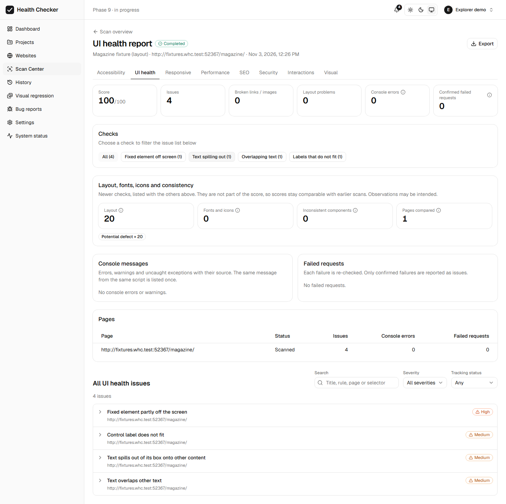
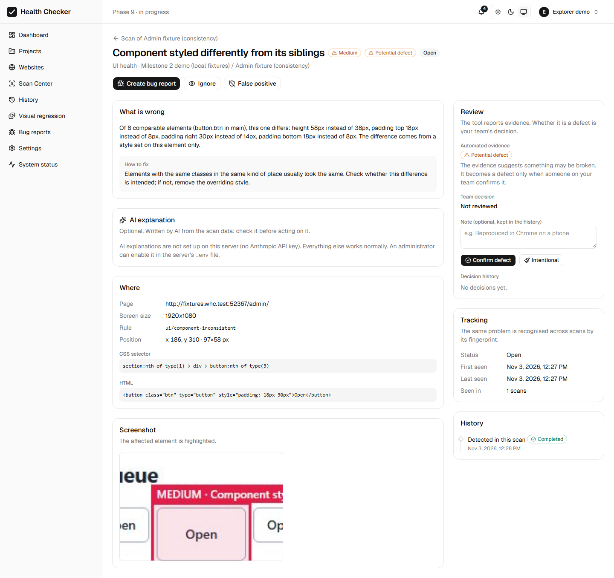
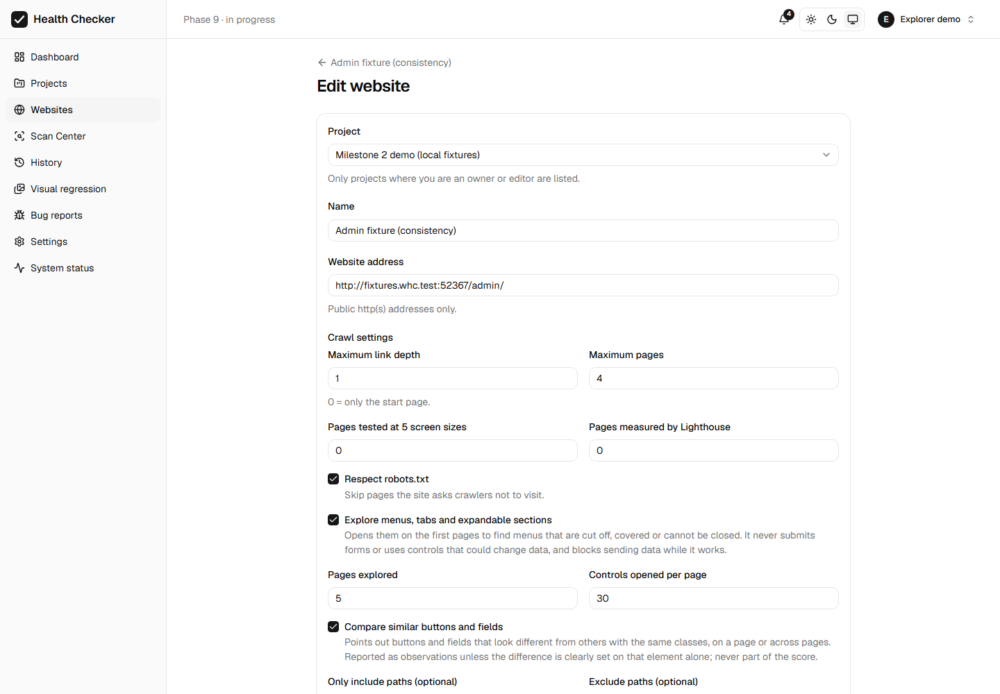

### 6.10 Limitations

- **Heuristic thresholds.** The cut-offs (40 px² and 30% overlap, 4 px spill, 2 px
  label, the consistency tolerances) favour silence over false positives, so subtler
  problems are missed.
- **Fonts.**
  - Stylesheets from another origin without CORS cannot be read. Their faces are still
    reported if they fail, but only as potential defects, and the generic failed
    request is kept.
  - A fallback font is only detected by family. A font whose glyphs are missing for
    some characters (a partial font) is not detected.
- **Icons.**
  - Icon-font glyphs are judged by whether their font loaded, not by drawing them.
  - CSS `mask`/background icons are only checked for "nothing visible" in labelled
    controls.
- **Consistency.**
  - Desktop only; class lists must match exactly.
  - A design system whose variants differ only by attributes (not classes) may give
    observations.
  - Comparisons across pages need the component on at least 3 crawled pages.
- **Cost.**
  - The W3C demo scan took 43 s, against 49 s for Milestone 1. That is within the
    run-to-run variance of a scan over the internet, so the added cost is small there.
  - Pages whose fonts are still loading wait up to 3 s for them.
  - Each explored page adds up to 10 layout runs on opened menus and panels.

## 7. Milestone 2, Checkpoint 2: keyboard and form probes (complete)

Two probes run on the pages the explorer opens, after the explorer, in the same browser
context with the safety layer armed. Each starts from a fresh copy of the page. Dialogs
are never opened; forms are never submitted. Their findings are in the `FUNCTIONAL`
category (Interactions), which no score uses.

### 7.1 Decisions applied

| Decision | How it is applied |
|---|---|
| Keyboard and form findings under `FUNCTIONAL` | 12 new `FunctionalCheckType` values. |
| Scores unchanged | `FUNCTIONAL` counts towards no score. A scan test compares the scores with the probes on and off. |
| Form probe `BLUR` by default | `Website.formProbeMode` = `OFF \| STATIC \| BLUR \| SYNTHETIC`, default `BLUR`. `SYNTHETIC` is only ever set explicitly per website: there is no environment variable or global default. |
| Dialogs stay closed | Dialog triggers stay skipped, and are listed as `opens-dialog`. |
| Enter and Space only where safe behaviour is established | See section 7.2. |
| A visible required mark without the attribute is not a defect | `OBSERVATION`, or `POTENTIAL_DEFECT` only when the form says what `*` means (section 7.3). |
| Missing feedback on blur is not a defect | `FORM_NO_BLUR_FEEDBACK` is always an `OBSERVATION`. Many sites validate on submit. |
| Focus, blur, `checkValidity()` and event handlers may have side effects | Every probe step runs inside the side-effect watch. See section 7.4. |

### 7.2 Keyboard probe (`Website.keyboardProbeEnabled`, default on)

1. **Tab walk** from the top of the page, at most 100 steps. Tab activates nothing.
   - **Focus visibility.** Before the walk, each focusable element's unfocused look (and
     its parent's) is recorded. Properties that cannot be seen are ignored, such as the
     offset of an absent outline.
   - **The walk stops** when focus comes back to the first element, when focus reaches
     the page itself with nothing focusable left, at a trap, or at the step limit.

   | Check | How it is decided | Classification |
   |---|---|---|
   | `FOCUS_NOT_VISIBLE` | The focused element and its parent look exactly as they do unfocused. A pixel comparison of the element's area, focused and unfocused, confirms it. | Potential defect |
   | `FOCUS_ON_HIDDEN` | The focused element cannot be seen: not rendered, outside the page area, cut off by a container that hides overflow, clipped to nothing, or transparent. Skip links pass, because they appear when focused. | Potential defect |
   | `FOCUS_LOST` | Focus falls back to the page itself while visible, focusable controls still follow. | Potential defect |
   | `KEYBOARD_TRAP` | The same 2 to 10 elements repeat three times with controls after them, not all inside an open modal dialog. A modal keeping focus inside is correct and is not reported. | Potential defect (HIGH) |

2. **Enter and Space.** Only on controls whose click the explorer proved safe in the
   same scan: the click opened something, and nothing was blocked, there was no
   navigation and no JavaScript error. The control is focused programmatically, then:
   - Enter is pressed (and Space, for buttons and disclosures);
   - the result is compared with what the click did;
   - the page is reloaded after each key that changed something (at most 10 reloads).

   Every other control is listed with a reason, so none is skipped silently:
   - `activation-not-established`: its click did not open anything;
   - `side-effect-observed`: something was blocked or failed during its click;
   - `opens-dialog`;
   - `limit`.

   Enter is never pressed in a text field.
   - **`KEY_ACTIVATION_FAILED`** (potential defect; HIGH when the control cannot receive
     focus): the key does nothing.

3. **`CLICK_NOT_FOCUSABLE`** (observation). An element has a pointer cursor and a click
   (or pointer-down) listener, but cannot receive keyboard focus. The listener is read
   through the Chrome DevTools Protocol (`DOMDebugger.getEventListeners`, read-only, at
   most 50 elements); nothing is clicked. Elements inside a link, button, label or other
   focusable element are excluded.

### 7.3 Form probe (`Website.formProbeMode`)

**Reading the fields** (`STATIC` and above; no focus, no events):

| Check | How it is decided | Classification |
|---|---|---|
| `FORM_REQUIRED_NOT_INDICATED` | A required field (`required` or `aria-required`) whose visible label and description show no mark. Not reported when the form says "all fields are required", or marks optional fields instead. | Potential defect |
| `FORM_INDICATOR_WITHOUT_REQUIRED` | The label shows `*` or "required", but the field has neither attribute. | Observation. Potential defect only if the form explains that `*` means required. Never `DETECTED`. |
| `FORM_DESCRIBEDBY_MISSING` | `aria-describedby` or `aria-errormessage` name an id that does not exist. Skipped when axe already reported the field. | Detected |
| `FORM_PLACEHOLDER_ONLY_LABEL` | No visible label; only the placeholder says what the field is. Search fields are excluded. | Potential defect |

**Focus and leave** (`BLUR`, the default). For each allowed, empty, required field (at
most 20 per page): focus it, move focus away without typing, then compare what the form
shows.

| Check | How it is decided | Classification |
|---|---|---|
| `FORM_ERROR_NOT_ASSOCIATED` | New text appeared in the form, but the field points to none of it (`aria-describedby` / `aria-errormessage`), it is not in a live region, and `aria-invalid` was not set. | Potential defect |
| `FORM_NO_BLUR_FEEDBACK` | Nothing appeared and nothing changed. One finding per form; a disturbed field gets its own finding. | Observation |

**Typing invalid values** (`SYNTHETIC`, opt-in per website only):
- **Which values.** One clearly invalid, non-personal value, only where it is certain to break the field's own rule:
  - `not-an-email` for email fields;
  - `not a web address` for URL fields;
  - `min − 1` or `max + 1` for numbers;
  - `x`, `0` or `-` for a pattern that rejects it.
- **Validity.** It is read from `validity` / `validationMessage`, which fire no events.
- **Checks.** The same two checks apply.

**Never touched, in any mode.** Each of these is listed as skipped, with its reason:
- secret or payment fields: password, one-time code, card or IBAN, by type, `autocomplete` or name and label;
- personal-data fields: name, e-mail, phone, address, birth date, by `autocomplete` or name and label;
- file, checkbox, radio, range and colour inputs;
- CAPTCHA fields;
- disabled, read-only and hidden fields.

There is no submit, no Enter in a field, and no checkbox or radio toggling. The explorer's
in-page guards also stop form submission.

### 7.4 Side effects (requirement 3)

Each probe step (one Tab press, one key on a control, one field focused and left, the
pixel comparison) runs inside the side-effect watch from Checkpoint 1:
- **What counts as part of the step:**
  - changes in the probed element, its wrapper, its labels and the elements it points to;
  - for form fields, changes anywhere in its form, such as an error summary;
  - announcements in live regions;
  - attribute changes on `<html>` and `<body>`;
  - elements that change by themselves (measured over a 300 ms baseline).
- **What makes a step disturbed:** a blocked request or navigation, a new JavaScript
  error, or a change anywhere else.

A finding from a disturbed step is **INCONCLUSIVE**. Its description says why, and the
evidence lists what happened.

Two lessons from building this:
- **Screenshot defaults touch the page.** Playwright's defaults for screenshots
  (`caret: 'hide'`, `animations: 'disabled'`) write inline styles into the page, and the
  watch caught them. The probe now takes screenshots without them.
- **Some disturbance is expected.** On the fixtures, a link that prefetches data when
  focused, and a field that autosaves when left, are deliberately not claimed.

### 7.5 Storage, API and UI (all additive)

- **Migration** `20261103093258_phase9_m2_cp2_keyboard_forms`:
  - 12 `FunctionalCheckType` values;
  - enum `FormProbeMode`;
  - `Website.keyboardProbeEnabled` (default `true`);
  - `Website.formProbeMode` (default `BLUR`).
- **Per page** (`ScanPage.exploration`):
  - `keyboard`: the steps, why the walk stopped, the focus order, activation results per key, and skipped controls with reasons;
  - `forms`: the mode, the number of fields, the probed fields with outcomes, and skipped fields with reasons and counts.
- **Tracking.** Keyboard findings are resolved only on pages the keyboard probe ran on
  again. Form findings that come from reading need the form probe to run again; findings
  from focus and leave need `BLUR` or `SYNTHETIC`; findings from invalid values need
  `SYNTHETIC`. Switching a probe off or down therefore never resolves its findings.
- **API.**
  - Websites accept `keyboardProbeEnabled` and `formProbeMode`; both are optional, and
    older clients keep the stored values.
  - `GET /api/reports/:scanId/functional` adds `keyboard` and `forms` per page (`null`
    for older scans) and three totals: `pagesKeyboardChecked`, `formFieldsProbed` and
    `probesSkipped`.
  - Selectors stay in the database.
- **UI.**
  - Interactions report: two more tiles, and a Keyboard and a Forms section per page,
    listing every field or control left alone with its reason.
  - Issue page: the recorded steps, under "What we did".
  - Website form: the keyboard setting, and the form mode with the `SYNTHETIC` opt-in.
  - Bug reports: an expected behaviour for each new check.

### 7.6 Fixtures and results

| Fixture | Seeded problems | Negative controls |
|---|---|---|
| `keyboard` (2 pages) | A link without a focus indicator; a div button that works with a click but not with Enter or Space; off-screen drawer links reachable with Tab; a rating widget that traps Tab; a link that removes itself when focused (focus lost); a span that reacts to clicks but cannot be focused; a link without an indicator whose focus triggers a (blocked) prefetch, which must be **INCONCLUSIVE** | A skip link, box-shadow focus rings, a native disclosure, a keyboard-ready div button, a `display: none` menu, a `tabindex="-1"` region, a span inside a link, a label, and (on `modal.html`) a modal dialog that keeps focus inside correctly |
| `forms` | A required field without a mark; `*` without `required` (with a legend); a description id that is missing; a placeholder-only field; an error message not linked; no feedback on blur (observation); a field that autosaves when left (blocked), which must be **INCONCLUSIVE**; with `SYNTHETIC`, an invalid tag whose message is not linked | A form that says "all fields are required", a search field with only a placeholder, a form that marks optional fields instead, linked messages. The never-touch fields (e-mail, full name, password, verification code, card number, consent checkbox, CAPTCHA) report any focus, input, change or Enter to the server; the forms post to `/trap/`. |

Each has corrected twins, so there are 6 new manifests: `keyboard`, `keyboard-fixed`,
`forms` (`BLUR`), `forms-fixed`, `forms-synthetic` and `forms-synthetic-fixed`. The
forms manifests switch the keyboard probe off, because the fixture would also report the
Tab walk's focus.

**Fixture acceptance.** 22 fixture pages; 88 tests. The new detectors are strict: every
unseeded finding counts as a false positive, observations included.

| Detector | Fixture pages | Expected | Found | Recall | False positives |
|---|---|---|---|---|---|
| keyboard (new) | 22 | 8 | 8 | 100% | 0 |
| forms (new) | 22 | 17 | 17 | 100% | 0 |
| explorer (M1) | 22 | 15 | 15 | 100% | 0 |
| layout (CP1) | 22 | 20 | 20 | 100% | 0 |
| fonts-icons (CP1) | 22 | 7 | 7 | 100% | 0 |
| consistency (CP1) | 22 | 3 | 3 | 100% | 0 |
| UI_HEALTH | 22 | 18 | 18 | 100% | 0 |
| ACCESSIBILITY | 9 | 3 | 3 | 100% | 0 |
| RESPONSIVE | 4 | 22 | 22 | 100% | 0 |

- The 16 fixture pages from earlier milestones produce **no** keyboard or form finding.
- The server-side safety counters stayed at 0 everywhere: no writes, no trap requests,
  no WebSockets. In the forms fixtures this includes "a never-touch field was focused,
  typed into or changed" and "Enter was pressed in a field".
- **These targets apply to these deterministic fixtures only, not to arbitrary
  websites.**

### 7.7 Verification on a real site (separate from the fixtures)

**Docker before and after** (W3C BAD "before" demo, 6 pages, the same settings as
before; compared with Checkpoint 1):
- **Unchanged:** the same pages and crawl order, the same scores (accessibility 62, UI
  health 91), the same links (88 checked, 4 broken), and the same 22 earlier rule groups
  with the same counts.
- **New:** 4 `functional/focus-lost` findings, one per explored page.
  - **Checked by hand:** they are **real**. The demo's main navigation links carry
    `onfocus="blur();"`, so Tab drops focus back to the page about 14 times in a row,
    after the "QUICKMENU" select.
  - This demo is deliberately inaccessible.
- **Scan time:** 43 s → 64 to 67 s (two runs). The probes add about 4 to 5 s per explored page.

**Demo** (this repository's scanner on the local fixtures, results in the development
database, shown by the Docker dashboard; no third-party site was used):
- `keyboard` and `forms` (`SYNTHETIC`) both completed, with 0 server writes, trap
  requests or WebSockets.
- **Browser check of the dashboard, 8 of 8 passed:**
  - the keyboard activation list per proven control;
  - the keyboard check filters;
  - the recorded steps on the issue page;
  - fields left alone with their reasons;
  - probed fields with their outcomes;
  - the opted-in mode on the website form;
  - no horizontal scroll at 390 px;
  - no page errors, console errors or failed API calls.

### 7.8 Screenshots

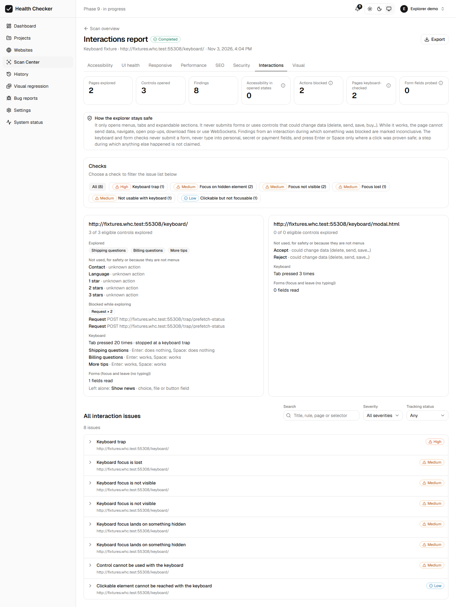
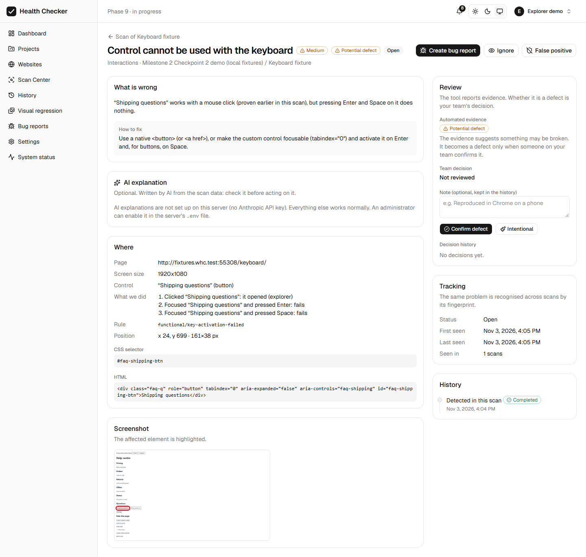
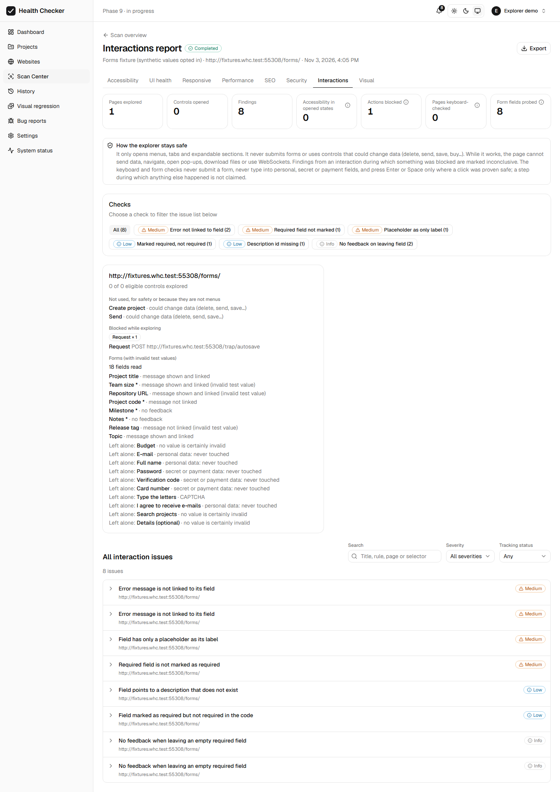
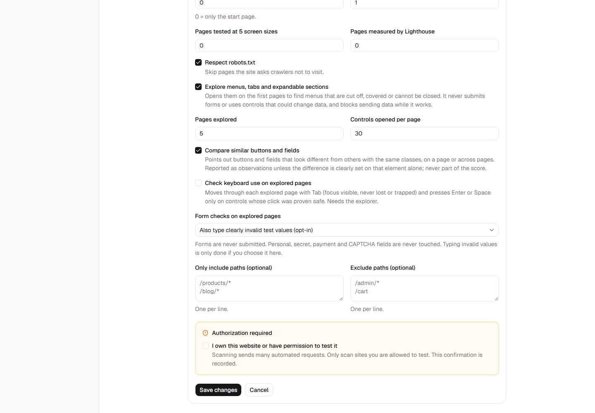

### 7.9 Limitations

- **The explorer is needed.** Probes run only on pages the explorer opens (its page
  limit); with the explorer off, they do not run.
- **Keyboard:**
  - The Tab walk stops at 100 steps; long pages may not be covered completely.
  - Shift+Tab is not tested.
  - Focus visibility is judged by style and pixels around the element; an indicator
    drawn far from it, or only by animation, may be missed.
  - Delegated click listeners (on a parent or the document) are not seen, so
    `CLICK_NOT_FOCUSABLE` misses them.
- **Forms:**
  - The personal-data and secret vocabulary is English.
  - Fields named in other languages are protected only by their `type` and
    `autocomplete`.
  - Many real forms consist mostly of personal-data fields, which are never probed.
  - Feedback is recognised as text appearing in the form, `aria-invalid`, or a change of
    the field's own border, outline or background. A message shown elsewhere (a toast)
    counts as a change elsewhere and makes the step inconclusive.
- **Desktop only (1920×1080).** No dialogs are opened.
- **Cost:** about 5 s per explored page on the W3C demo; more for pages with many
  proven controls (each key that works reloads the page).

## 8. Remaining milestones

| M | Scope |
|---|---|
| 3 | Mode 1: opt-in Firefox/WebKit compatibility |
| 4 | Mode 2: comparisons, routes, discovery and mapping, run job |
| 5 | Mode 2: element, visual, style and open-state differences |
| 6 | Scenarios (both modes), loading-state checks, QA case import and traceability |
| 7 | Comparison tracking, AI for both modes, QA-style reports and exports |
| 8 | Dashboards, hardening, Docker end to end, final documentation |

## 9. Known limitations (so far)

- Classification of older issues uses the data they stored. Older resource failures were
  not re-checked, so they are `POTENTIAL_DEFECT`, not `DETECTED`.
- The fixture harness matches DOM-check findings by exact selector. If a fixture's
  structure changes, its manifest must be updated.
- The issue page's History timeline reads the activity log. The Review card's decision
  history is the authoritative, append-only record.
